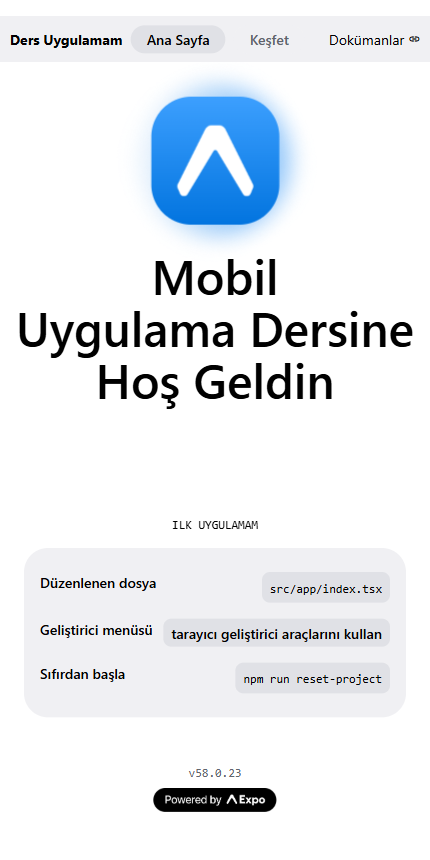
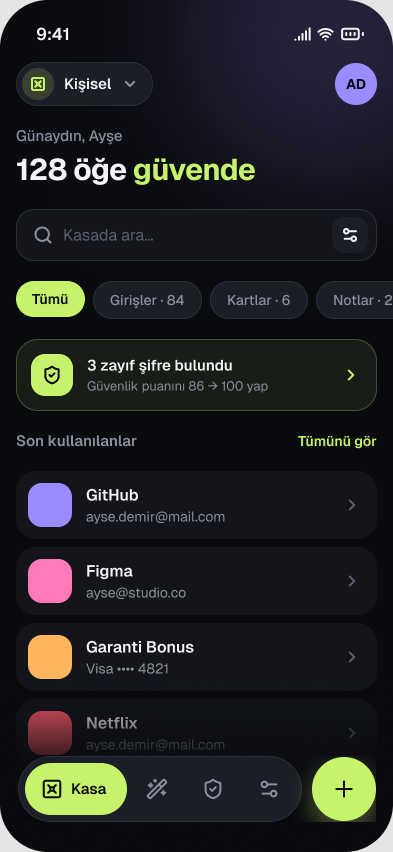
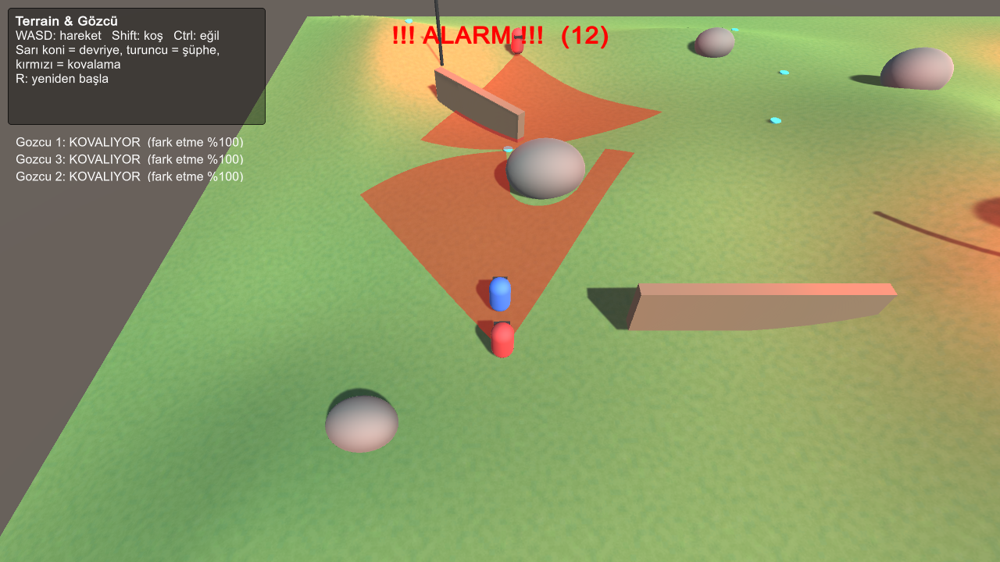
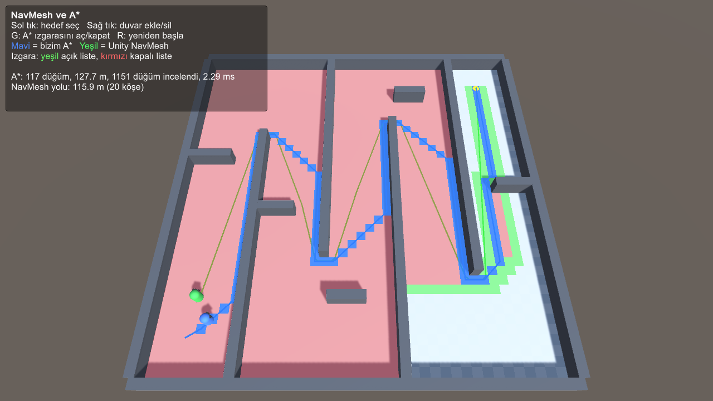

# Course Assignments

Weekly assignments for the **Mobile Application Development** and **Artificial Intelligence** courses.

| Course | Week | Topic | Folder |
|---|---|---|---|
| Mobile Application | 1 | Expo getting started: create the app, change the home screen texts | [`mobil/hafta1-expo-baslangic`](mobil/hafta1-expo-baslangic) |
| Mobile Application | 2 | Mobile app UI design in Figma | [`mobil/hafta2-figma-arayuz`](mobil/hafta2-figma-arayuz) |
| Artificial Intelligence | – | Terrain & guard: patrol, vision cone, alarm, NavMesh chase | [`yapay-zeka`](yapay-zeka) – scene `TerrainGozcu` |
| Artificial Intelligence | – | NavMesh and A* pathfinding | [`yapay-zeka`](yapay-zeka) – scene `NavMesh_AStar` |

## Screenshots

| Expo home screen | Figma design | Guard alarm & chase | NavMesh vs A* |
|---|---|---|---|
|  |  |  |  |
