# Course Assignments

Weekly practice work and homework for two courses (Fall 2026–2027). Every assignment lives in its own folder and is a standalone project (its own Unity, Expo or .NET project), so each one can be opened and graded on its own.

## Dijital Oyunlarda Yapay Zekâ (Game AI, Unity 6.6)

| Week | Assignment | Type | Folder |
|---|---|---|---|
| 1 | Field-of-view and side functions (`IsInFov`, `SideOf`) | .NET console | [`yapay-zeka/hafta01-gorus-fonksiyonlari`](yapay-zeka/hafta01-gorus-fonksiyonlari) |
| 2 | Smart turret: intercept aiming and ballistic angles (`NisanAl`, `AtisAcisi`) | .NET console | [`yapay-zeka/hafta02-akilli-kule`](yapay-zeka/hafta02-akilli-kule) |
| 3 | **Gözcü** – guard with a vision cone and line of sight on a terrain | Unity | [`yapay-zeka/hafta03-gozcu`](yapay-zeka/hafta03-gozcu) |
| 4 | In-class practice: NavMesh vs our own A* in a maze | Unity | [`yapay-zeka/hafta04-ders-ici-navmesh-astar`](yapay-zeka/hafta04-ders-ici-navmesh-astar) |
| 4 | **Dağ Yolu** – A* on a terrain where slope becomes cost | Unity | [`yapay-zeka/hafta04-dag-yolu`](yapay-zeka/hafta04-dag-yolu) |
| 5 | **Köşe Noktaları** – waypoint graph with corner (visibility) points, ping-pong patrol | Unity | [`yapay-zeka/hafta05-kose-noktalari`](yapay-zeka/hafta05-kose-noktalari) |
| 6 | **Kestirme mi, Güvenli Yol mu?** – NavMesh area costs, links and carving obstacles | Unity + PDF report | [`yapay-zeka/hafta06-kestirme-guvenli-yol`](yapay-zeka/hafta06-kestirme-guvenli-yol) |
| 7 | **Sesi Duyan Bekçi** – FSM guard (State pattern) with a fifth "Araştır" state triggered by noise | Unity + PDF report | [`yapay-zeka/hafta07-sesi-duyan-bekci`](yapay-zeka/hafta07-sesi-duyan-bekci) |
| Extra | Patrolling guards with alarm and chase (FSM) | Unity | [`yapay-zeka/ek-devriye-alarm`](yapay-zeka/ek-devriye-alarm) |

## DOT311 Mobil Uygulama Geliştirme I (React Native + Expo)

| Week | Topic | Folder |
|---|---|---|
| 1 | Setup: first Expo app, home screen texts changed | [`mobil/hafta01-kurulum`](mobil/hafta01-kurulum) |
| 2 | JavaScript (ES6+) basics, first list on screen | [`mobil/hafta02-javascript`](mobil/hafta02-javascript) |
| 3 | Components, JSX and props | [`mobil/hafta03-bilesen-props`](mobil/hafta03-bilesen-props) |
| 4 | Core components and Flexbox | [`mobil/hafta04-flexbox`](mobil/hafta04-flexbox) |
| 5 | Game dashboard activity + `useState` | [`mobil/hafta05-oyun-dashboard`](mobil/hafta05-oyun-dashboard) |
| 6 | User input: `TextInput`, `Pressable`, forms, number guessing game | [`mobil/hafta06-kullanici-girdisi`](mobil/hafta06-kullanici-girdisi) |
| Extra | Mobile app UI design in Figma (Kasa – Password Manager) | [`mobil/ek-figma-arayuz`](mobil/ek-figma-arayuz) |

## Screenshots

### Game AI

| Week 1 – IsInFov / SideOf | Week 2 – Smart turret |
|---|---|
| 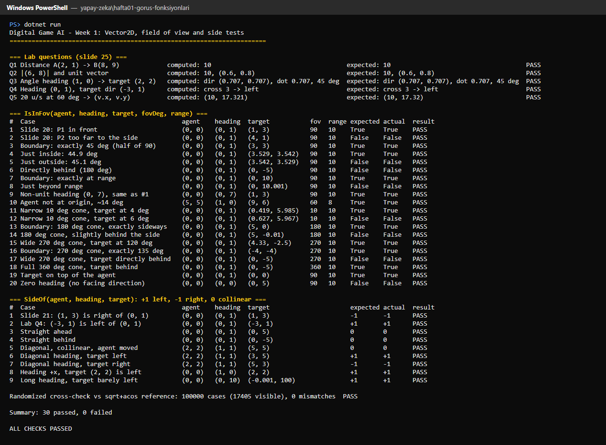 | 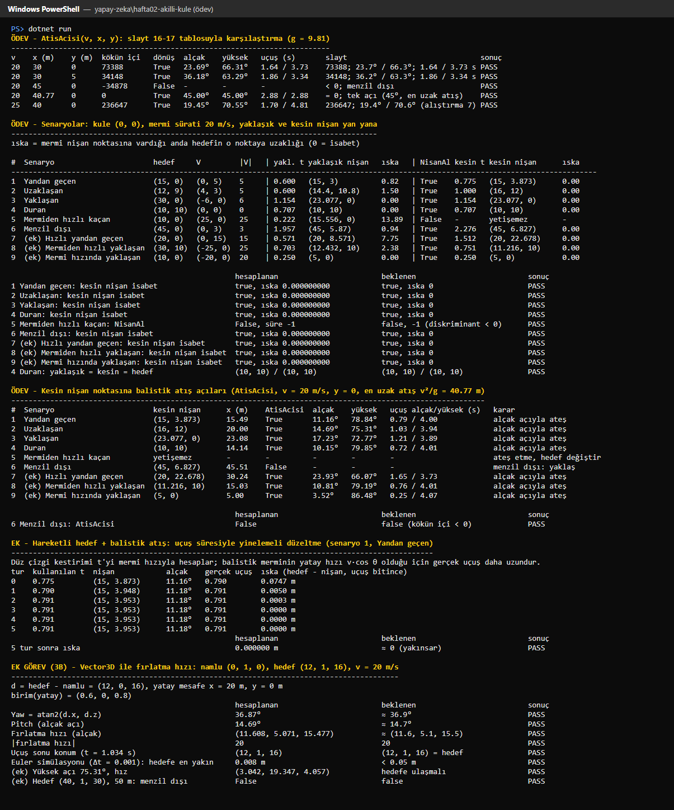 |

| Week 3 – Gözcü sees the player | Week 4 – In-class NavMesh vs A* |
|---|---|
| 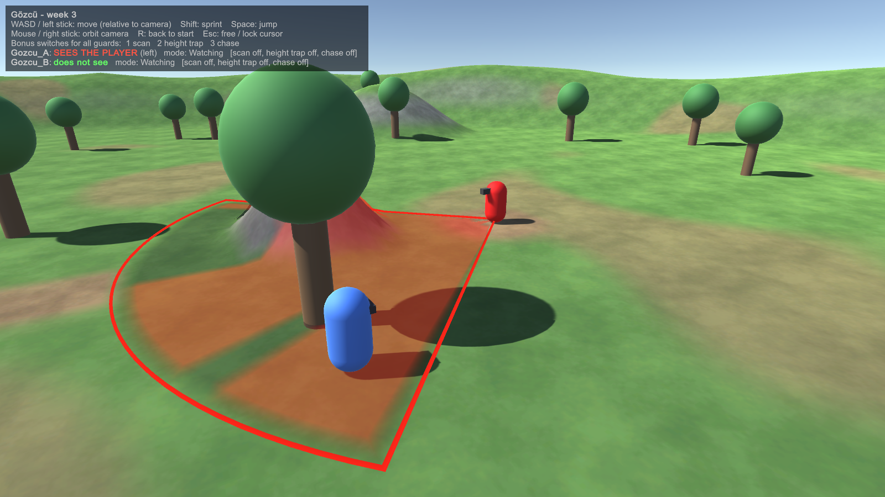 | 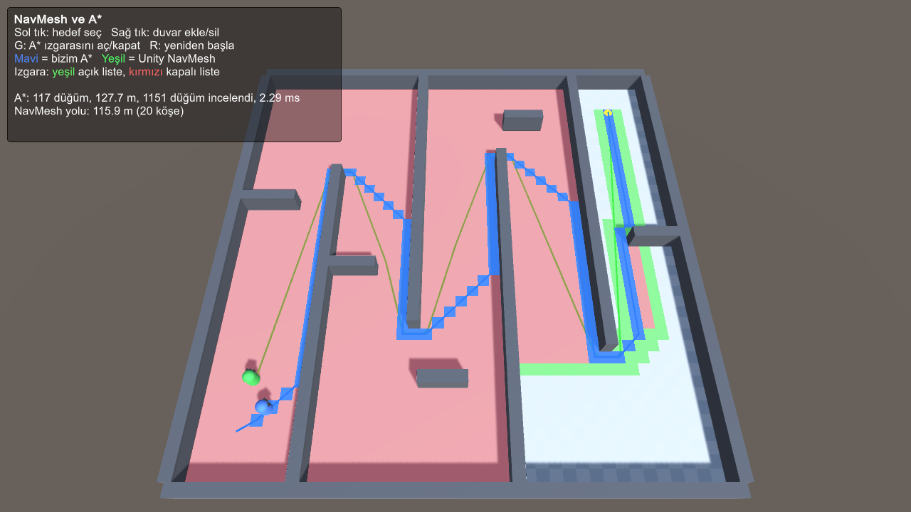 |

| Week 4 – Dağ Yolu, k = 0 / 2 / 8 | Week 5 – Corner points, smoothed path |
|---|---|
| 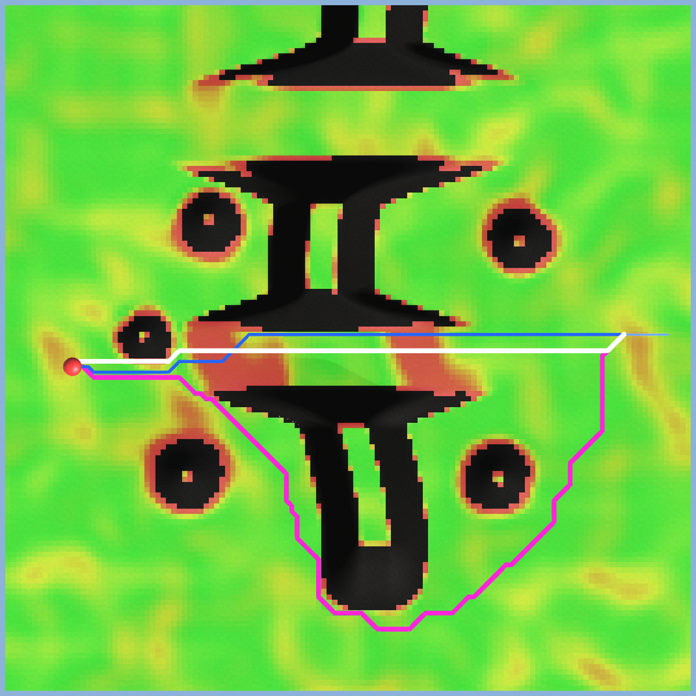 | 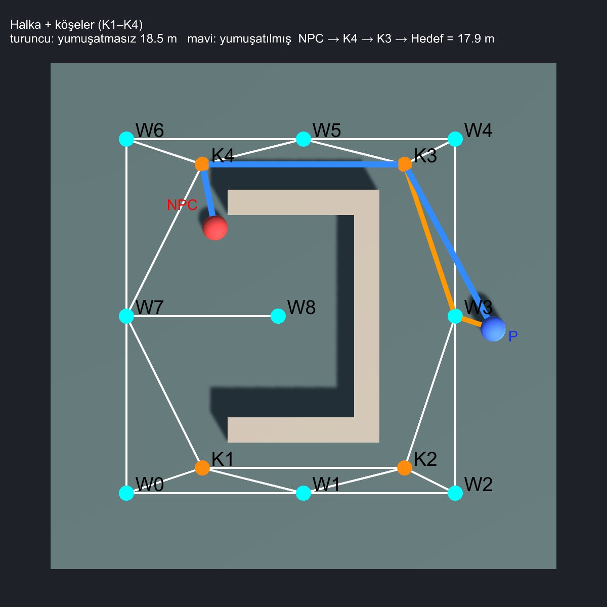 |

| Week 6 – Routes A–D | Week 7 – Guard hears a noise (Araştır) |
|---|---|
| 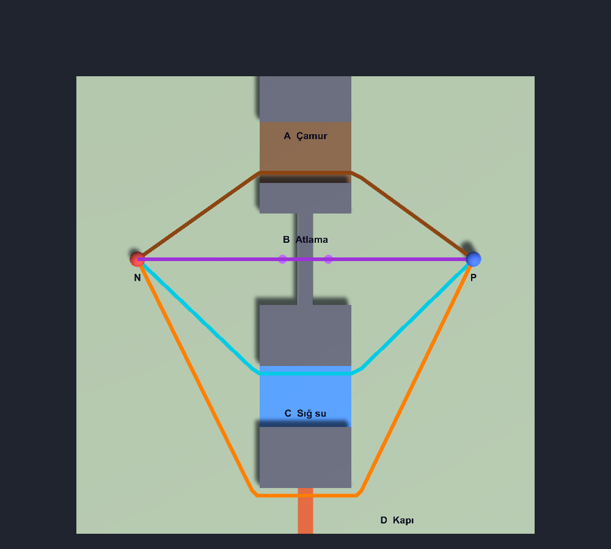 | 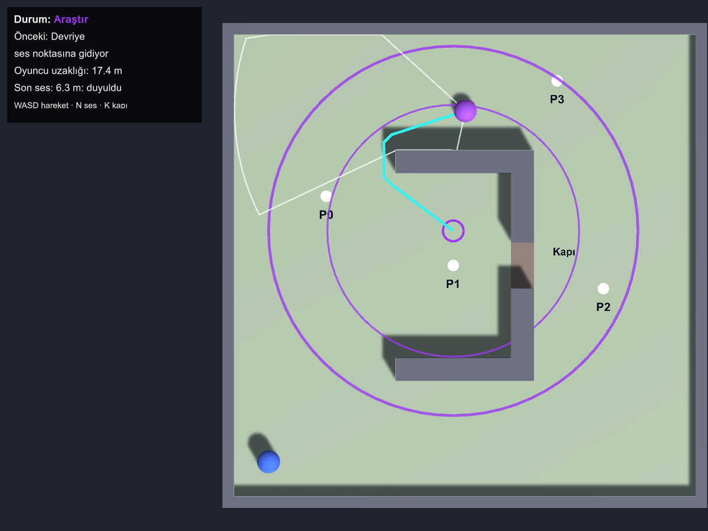 |

| Extra – Alarm and chase | |
|---|---|
| 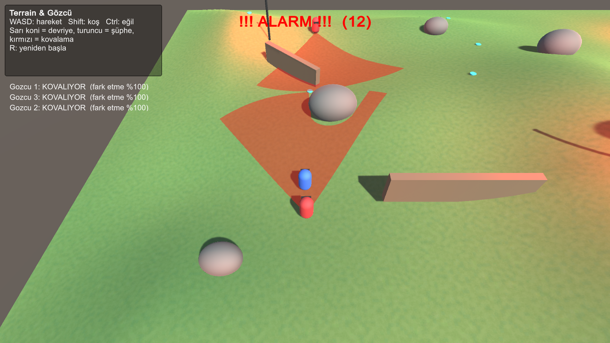 | |

### Mobile

| Week 1 | Week 2 | Week 3 | Week 4 |
|---|---|---|---|
| 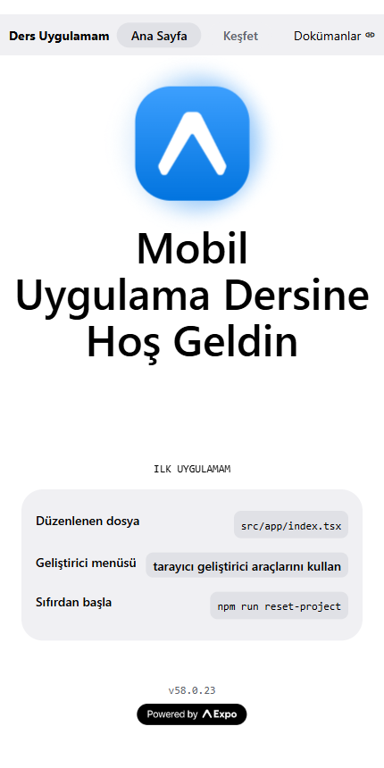 | 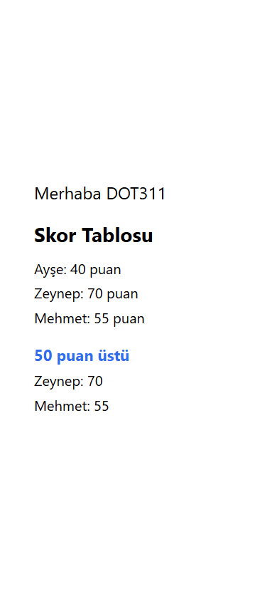 | 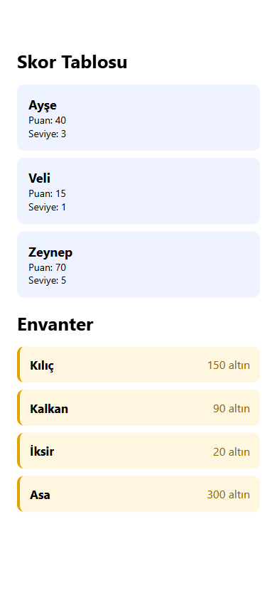 | 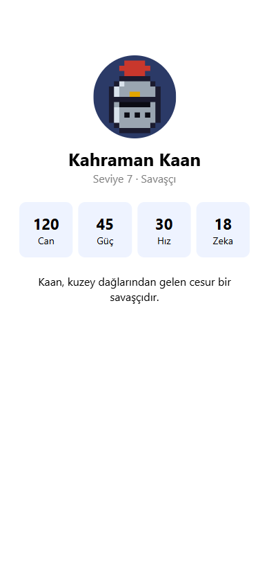 |

| Week 5 | Week 6 | Extra – Figma |
|---|---|---|
| 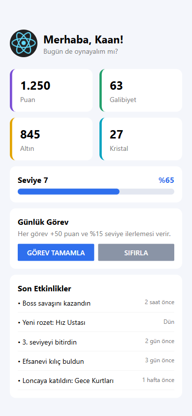 | 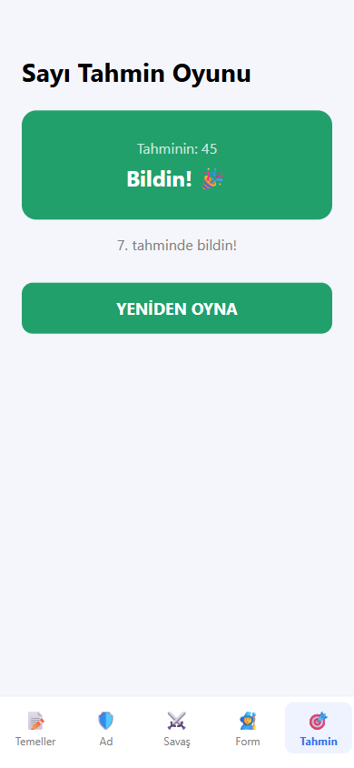 | 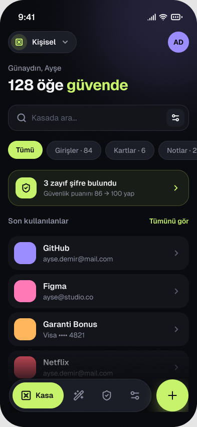 |

## Running

- **Unity projects:** open the folder in Unity Hub with Unity **6000.6.8f1** (week 7 was saved with 6000.6.7f1 and opens in either), then open the scene listed in the project's README.
- **Expo projects:** `npm install` then `npx expo start` (scan the QR code with Expo Go, or press `w` for web).
- **.NET projects:** `dotnet run` in the project folder (.NET 10 SDK).
