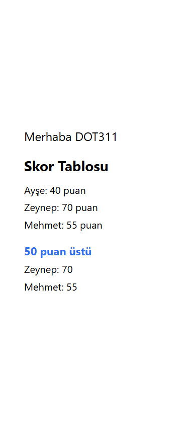

# Week 2 – JavaScript (ES6+) Basics for React Native

DOT311 week 2 lecture note: *"React Native için JavaScript (ES6+) Temelleri"*. The note has four in-class exercises (Uygulama 1–4) and a small exercise to finish before week 3:

- Uygulama 1 and 2 are plain JavaScript run with `node`.
- Uygulama 3 and 4 are done in an Expo project (blank template, `App.js`).

Expo SDK 58 (`expo ~58.0.25`, `react 19.3.0`, `react-native 0.88.1`), created with `npx create-expo-app@latest hafta02-javascript --template blank`.

## Running

```bash
npm install
npx expo start          # scan the QR code with Expo Go, or press w for web

# plain JavaScript exercises (no install needed)
node js-alistirmalar/uygulama1-skor-listesi.js
node js-alistirmalar/uygulama2-envanter.js
node js-alistirmalar/alistirma.js
```

## What was done, per note section

| Note section | Implemented in | Notes |
|---|---|---|
| Uygulama 1 – Oyuncu Skor Listesi (steps 1–4) | `js-alistirmalar/uygulama1-skor-listesi.js` | data array, `map` + template literal, `forEach`, leader search with `let` |
| Uygulama 1 – *Geliştirme* (optional) | same file, last block | `[...oyuncular].sort(...)` then `slice(0, 3)`. The spread copy keeps the original array unsorted. The note's variable name typo `siral15i` is written as `sirali`. |
| Uygulama 2 – Envanter (steps 1–4) | `js-alistirmalar/uygulama2-envanter.js` | `filter`, `filter().map()` chain, `reduce` with start value 0 |
| Uygulama 2 – *Geliştirme* (optional) | same file, last block | items with `deger > 100` printed as `ad (deger)` |
| Uygulama 3 – open Expo and change the text | `App.js` (first `<Text>`) | `<Text style={{ fontSize: 24 }}>Merhaba DOT311</Text>` |
| Uygulama 4 – score table with `map` | `App.js` | one `<Text key={o.isim}>` per player, template literal inside JSX |
| Uygulama 4 – *Geliştirme* (optional) | `App.js` ("50 puan üstü" block) | `filter((o) => o.puan > 50)` before `map` |
| End-of-week exercise | `js-alistirmalar/alistirma.js` | 1) names with `map`, 2) `puan > 30` with `filter`, 3) `forEach` + template literal |

## Real `node` output (Node v24.22.2)

```text
$ node js-alistirmalar/uygulama1-skor-listesi.js
--- Adım 2: map ---
[
  'Ayşe: 40 puan',
  'Veli: 15 puan',
  'Zeynep: 70 puan',
  'Mehmet: 55 puan'
]
--- Adım 3: forEach ---
Ayşe -> 40
Veli -> 15
Zeynep -> 70
Mehmet -> 55
--- Adım 4: en yüksek puan ---
Lider: Zeynep (70)
--- Geliştirme: ilk 3 ---
1. Zeynep
2. Mehmet
3. Ayşe
```

```text
$ node js-alistirmalar/uygulama2-envanter.js
--- Adım 2: silahlar ---
[ 'Kılıç', 'Asa' ]
--- Adım 3: nadir eşyalar ---
[ 'Kılıç', 'Asa' ]
--- Adım 4: toplam değer ---
Toplam değer: 560
--- Geliştirme: değeri 100'den büyük eşyalar ---
Kılıç (150)
Asa (300)
```

```text
$ node js-alistirmalar/alistirma.js
1) İsimler: [ 'Ayşe', 'Veli', 'Zeynep' ]
2) Puanı 30'dan büyük olanlar: [ { isim: 'Ayşe', puan: 40 }, { isim: 'Zeynep', puan: 70 } ]
3) Oyuncu satırları:
Ayşe: 40 puan
Veli: 15 puan
Zeynep: 70 puan
```

All results match the expected outputs written in the note (`Lider: Zeynep (70)`, `[ "Kılıç", "Asa" ]`, `Toplam değer: 560`, …).

## Screenshot

Web build (`npx expo export --platform web`), mobile viewport 390×844:



## Manual steps for the student

- Run the app once on your phone with Expo Go, change the `Merhaba DOT311` text and save it to see fast refresh (Uygulama 3, step 3).
