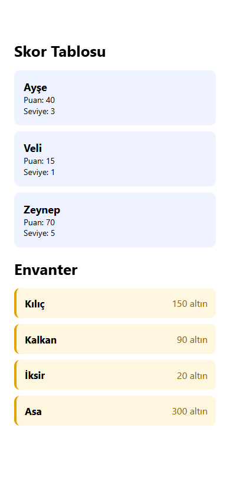

# Week 3 – Components, JSX and Props

DOT311 week 3 lecture note: *"Bileşen, JSX ve Props"*.

- **In class:** write an `OyuncuKarti` (player card) component that takes `isim` and `puan`, and use it three times.
- **Homework (Alıştırma):**
  1. Add a third prop, `seviye`, to the player card and show it.
  2. Write a new component for your own game, e.g. `EsyaKarti` (item name and value).
  3. Use it at least 3 times in `App` with different data.

Expo SDK 58 blank template (`expo ~58.0.25`, `react 19.3.0`, `react-native 0.88.1`).

## Running

```bash
npm install
npx expo start          # scan the QR code with Expo Go, or press w for web
```

## What was done

| Requirement | File | Details |
|---|---|---|
| `OyuncuKarti({ isim, puan })` from the note, with the note's card styles | `components/OyuncuKarti.js` | default export, props read with destructuring |
| Used three times with different props | `App.js` | Ayşe 40, Veli 15, Zeynep 70. Text props use quotes, number props use braces. |
| Homework 1: `seviye` prop shown on the card | `components/OyuncuKarti.js`, `App.js` | `seviye={3}`, `{1}`, `{5}` |
| Homework 2: new `EsyaKarti({ ad, deger })` component | `components/EsyaKarti.js` | item name on the left, value ("… altın") on the right, gold accent |
| Homework 3: `EsyaKarti` used at least 3 times | `App.js` | used 4 times: Kılıç 150, Kalkan 90, İksir 20, Asa 300 (the week 2 inventory) |
| Components in their own files | `components/` | imported with default imports (week 2's `import`/`export`) |

The outer container is a `ScrollView` instead of the note's `View`, because the extra cards make the content taller than a small phone screen.

## Screenshot

Web build (`npx expo export --platform web`), mobile viewport 390×844:


