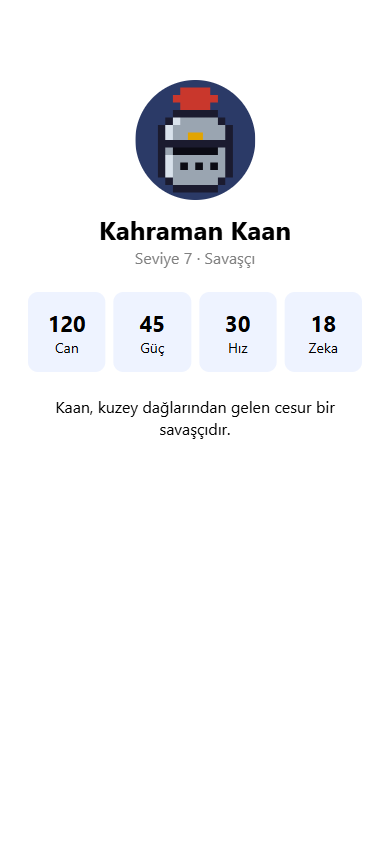

# Week 4 – Core Components and Flexbox

DOT311 week 4 lecture note: *"Temel Bileşenler ve Flexbox"*.

- **In class:** a character profile screen ("Karakter Profil Ekranı"):
  - avatar and name in the centre;
  - three stat boxes side by side;
  - a description at the bottom.

  It uses `View`, `Text`, `Image`, `ScrollView` and Flexbox.
- **Homework (Alıştırma):**
  1. Add a fourth stat box, e.g. "Zeka".
  2. Replace the character image with your own image from the `assets` folder, loaded with `require`.
  3. Turn the stat box into a component: `<StatKutusu deger={120} ad="Can" />`.

Expo SDK 58 blank template (`expo ~58.0.25`, `react 19.3.0`, `react-native 0.88.1`).

## Running

```bash
npm install
npx expo start          # scan the QR code with Expo Go, or press w for web
```

## What was done

| Requirement | File | Details |
|---|---|---|
| Profile screen layout from the note | `App.js` | `ScrollView` with `contentContainerStyle` (`alignItems: 'center'`), round avatar (`borderRadius` = half the width), name, class line, stat row, description |
| Stat boxes side by side, equal width | `App.js` (`satir`), `components/StatKutusu.js` (`kutu`) | `flexDirection: 'row'` on the row, `flex: 1` on each box |
| Homework 1: fourth stat "Zeka" | `App.js` | `<StatKutusu deger={18} ad="Zeka" />` |
| Homework 2: own image via `require` | `assets/karakter.png`, `App.js` | `source={require('./assets/karakter.png')}` |
| Homework 3: `StatKutusu` component | `components/StatKutusu.js` | used as `<StatKutusu deger={120} ad="Can" />` (plus Güç, Hız, Zeka) |

### About the character image

`assets/karakter.png` is original art: a 16×16 pixel-art knight helmet, scaled to 256×256. It is drawn in code by `scripts/make-avatar.js` (Node built-ins only, no copyrighted material). To regenerate it:

```bash
node scripts/make-avatar.js
```

## Screenshot

Web build (`npx expo export --platform web`), mobile viewport 390×844:



## Manual steps for the student

- If you want to use a different picture, put it in `assets/` and change the `require(...)` path in `App.js`.
