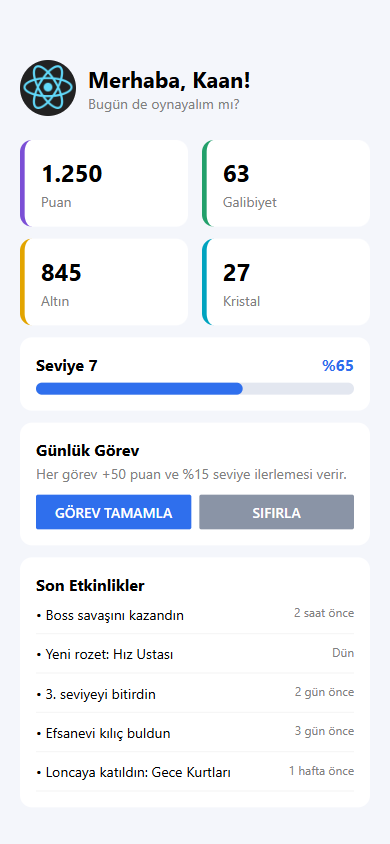
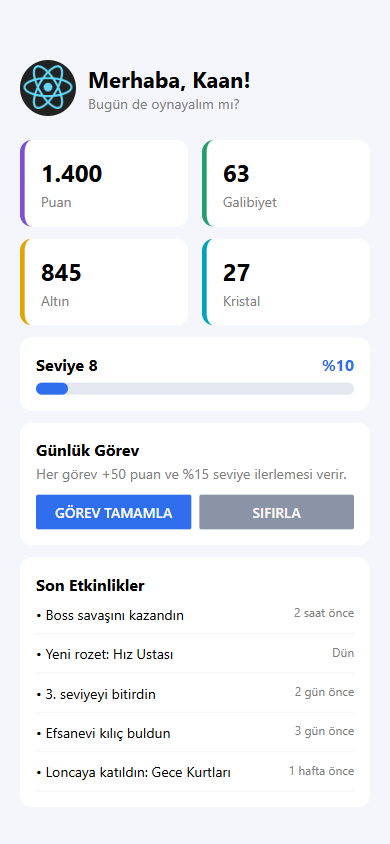

# Week 5 – Game Dashboard (+ useState)

This week is based on the DOT311 extra activity *"Ek Etkinlik: Oyun Dashboard Paneli Kılavuzu"*: a player statistics dashboard built in four steps.

1. Top bar.
2. 2×2 stat cards.
3. Level progress bar.
4. Recent activities list.

> **Note:** the week 5 lecture note itself (*Durum yönetimi ve useState*, "Sayaç ve etkileşim uygulaması" in the syllabus) was **not available**. Only the dashboard activity was provided. To cover the week's useState topic, the dashboard's "Haftaya bağlantı" idea was implemented: a button that changes the points and the progress bar through `useState`.

Expo SDK 58 blank template (`expo ~58.0.25`, `react 19.3.0`, `react-native 0.88.1`).

## Running

```bash
npm install
npx expo start          # scan the QR code with Expo Go, or press w for web
```

## Controls

- **GÖREV TAMAMLA:** each press gives +50 points and +15 % level progress. At 100 % the level goes up by one, and the extra progress carries over to the next level.
- **SIFIRLA:** resets points, level and progress to the starting values (1.250, Seviye 7, %65).

## What was done

| Guide step / item | File | Details |
|---|---|---|
| Step 1 – top bar (avatar + two text lines side by side) | `App.js` (`ustBar`) | `flexDirection: 'row'`, `alignItems: 'center'`; the avatar is the note's remote `tiny_logo.png` with width and height set |
| Step 2 – `StatKarti({ deger, baslik, renk })` | `components/StatKarti.js` | array style `[styles.kart, { borderLeftColor: renk }]` |
| Step 2 – 2×2 grid | `App.js` (`kartlar`) | `flexDirection: 'row'`, `flexWrap: 'wrap'`, `justifyContent: 'space-between'`, each card has `width: '48%'` |
| Step 3 – progress bar | `components/IlerlemeCubugu.js` | outer grey box plus inner box whose `width` is a percentage |
| Step 4 – activities with `map` and `key={e.id}` | `App.js` | `etkinlikler.map(...)` |
| Checklist: screen scrolls | `App.js` | outer `ScrollView`. Checked at a 390×600 viewport: the content is 858 px tall and scrolls. |
| Extra task 1 – own colours and values | `App.js` (`kartlar`) | Puan (purple), Galibiyet 63, Altın 845, "Kristal" 27 (teal) instead of Rozet 12 |
| Extra task 2 – two new activities | `App.js` (`etkinlikler`) | "Efsanevi kılıç buldun", "Loncaya katıldın: Gece Kurtları" |
| Extra task 3 – `<IlerlemeCubugu seviye={7} yuzde={65} />` | `components/IlerlemeCubugu.js` | ``width: `${yuzde}%` `` as in the hint |
| Extra task 4 – card data in an array, rendered with `map` | `App.js` | `kartlar.map((k) => <StatKarti key={k.baslik} … />)` |
| Haftaya bağlantı – `useState` button changes points and progress bar | `App.js` (`gorevTamamla`, `sifirla`) | three states: `puan`, `seviye`, `yuzde`. Uses the `Button` component; points are shown as "1.250" with a Turkish thousands separator. |

### Verified interaction (Playwright on the web build)

Pressing **Görev Tamamla** three times gave:

| Press | Points | Level | Progress |
|---|---|---|---|
| 1 | 1.300 | Seviye 7 | %80 |
| 2 | 1.350 | Seviye 7 | %95 |
| 3 | 1.400 | Seviye 8 | %10 |

**Sıfırla** then returned the screen to 1.250 / Seviye 7 / %65.

## Screenshots

Web build (`npx expo export --platform web`), mobile viewport 390×844:

| Start | After three quests (level up) |
|---|---|
|  |  |

## Manual steps for the student

- The avatar is loaded from the internet (`https://reactnative.dev/img/tiny_logo.png`, as in the guide), so the phone needs an internet connection to show it.
