# Week 6 – User Input (TextInput, Pressable, Events)

DOT311 week 6 lecture note: *"Kullanıcı Girdisi (TextInput, Pressable, Olaylar)"*. It covers:

- **Sections 1–4:** controlled `TextInput`, its useful props, events, and `Pressable` with a pressed style.
- **In-class exercises:**
  - Uygulama 1 – live character name preview
  - Uygulama 2 – `OyunButonu` component and a battle screen
  - Uygulama 3 – character creation form with validation
- **Homework:** "Sayı Tahmin Oyunu" (number guessing game), including the bonus.

The note writes each exercise as its own `App.js`. Here each one is a separate **screen component** in `screens/`. `App.js` switches between them with a simple state-based tab bar (`useState`, no navigation library; navigation is a week 9 topic).

Expo SDK 58 blank template (`expo ~58.0.25`, `react 19.3.0`, `react-native 0.88.1`).

## Running

```bash
npm install
npx expo start          # scan the QR code with Expo Go, or press w for web
```

## Controls

Use the bottom tab bar:

| Tab | Screen |
|---|---|
| 📝 Temeller | Sections 1–4 |
| 🛡️ Ad | Uygulama 1 |
| ⚔️ Savaş | Uygulama 2 |
| 🧙 Form | Uygulama 3 |
| 🎯 Tahmin | Homework |

On the Savaş screen, hold **Savun** for about half a second to trigger the long press. On the Tahmin screen, either press **Tahmin Et** or press Enter in the box.

## Structure

```
App.js                          tab switcher (state: aktif)
components/OyunButonu.js        reusable game button (Uygulama 2)
screens/TemellerEkrani.js       sections 1–4
screens/KarakterAdiEkrani.js    Uygulama 1
screens/SavasEkrani.js          Uygulama 2
screens/KarakterOlusturEkrani.js Uygulama 3
screens/SayiTahminEkrani.js     homework
```

## What was done

| Note item | File | Details |
|---|---|---|
| §1 controlled `TextInput` (`value` + `onChangeText`) | `screens/TemellerEkrani.js` | "Merhaba, {isim}!" updates on every key |
| §2 `placeholder`, `autoCapitalize="none"`, `maxLength={16}`, `secureTextEntry`, `keyboardType="numeric"` | `screens/TemellerEkrani.js` | also shows `yas + 1 → "251"` vs `Number(yas) + 1 → 26` |
| §3 `onSubmitEditing` (send with Enter, then clear the box) | `screens/TemellerEkrani.js` | logs `Gönderildi: …` and clears the box with `setMesaj('')` |
| §4 `Pressable` with `({ pressed }) => [...]` | `screens/TemellerEkrani.js` | opacity 0.6 + `scale: 0.95` while pressed |
| **Uygulama 1** steps 1–4: `maxLength={12}`, counter, orange from 10 characters, live card, "Adsız Kahraman" fallback | `screens/KarakterAdiEkrani.js` | |
| Uygulama 1 – *Kendin dene*: name in upper case | `screens/KarakterAdiEkrani.js` | `toLocaleUpperCase('tr-TR')`, so `i → İ` is correct for Turkish |
| Uygulama 1 – *Kendin dene*: "Temizle" Pressable | `screens/KarakterAdiEkrani.js` | `setIsim('')` |
| **Uygulama 2** steps 1–5: `OyunButonu({ baslik, renk, onPress, onLongPress, pasif })` | `components/OyunButonu.js` | `disabled={pasif}`, pressed style, `pasif` style (opacity 0.35) |
| Saldır / Savun / Büyü / Dinlen, mana state, Büyü disabled when `mana < 30`, Dinlen capped at 100, long press on Savun | `screens/SavasEkrani.js` | |
| Uygulama 2 – *Kendin dene*: enemy health `dusmanCan` (100), Saldır 10, Büyü 30 damage, shown on screen | `screens/SavasEkrani.js` | text plus a red health bar |
| Uygulama 2 – *Kendin dene*: "Zafer!" replaces the buttons at 0 health | `screens/SavasEkrani.js` | extra "Yeniden Savaş" button to restart |
| **Uygulama 3** steps 1–4: name / age inputs, class choice with `map` + `Pressable`, `olustur()` validation (`trim`, `isNaN(Number(yas))`, 10–99, class), summary card with a second `return`, "YENİ KARAKTER" reset | `screens/KarakterOlusturEkrani.js` | follows the note's full code |
| Uygulama 3 – *Kendin dene*: fourth class "Şifacı" | `screens/KarakterOlusturEkrani.js` | only the `siniflar` array changed |
| Uygulama 3 – *Kendin dene*: per-class icon on the card | `screens/KarakterOlusturEkrani.js` | `sinifSimgeleri`: ⚔️ / 🔮 / 🏹 / 🌿 |

### Homework – Sayı Tahmin Oyunu (`screens/SayiTahminEkrani.js`)

| Checkbox | Implementation |
|---|---|
| Secret number created with the given line and kept in state | `useState(Math.floor(Math.random() * 100) + 1)` |
| ☑ Numeric-keyboard `TextInput` and a "Tahmin Et" `Pressable` | `keyboardType="numeric"`; Enter (`onSubmitEditing`) also submits |
| ☑ "Daha büyük!" / "Daha küçük!" / "Bildin! 🎉" | `tahminEt()` compares the guess with `gizli` |
| ☑ Warning on invalid input (empty or outside 1–100) | Shows "Geçersiz giriş: 1 ile 100 arasında bir sayı yaz." Non-integers are rejected too. Invalid guesses are not counted. |
| ☑ State that counts the guesses, shown on screen | `tahminSayisi`; after a win the screen says "N. tahminde bildin!" |
| ☑ Box cleared after every guess | `setTahmin('')` at the start of `tahminEt()` |
| ☑ (Bonus) "Yeniden Oyna" after winning, with a new secret number | `yenidenOyna()` creates a new number and resets the counter and messages |

## Verification (Playwright on the web build, 390×844)

The web export built without errors, and the browser console showed no app errors or warnings. Every screen was driven in the browser:

- **Temeller:**
  - A 20-character username was cut to 16 (`16 / 16`).
  - The password field is `type="password"`.
  - The age field has `inputmode="numeric"` and showed `yas + 1 → "251" · Number(yas) + 1 → 26`.
  - Enter sent "Selam lonca!" and cleared the box.
  - Two presses gave "Basma sayısı: 2".
- **Ad:**
  - Typing "gizli kılıç usta" stopped at 12 characters.
  - The counter `12 / 12` turned orange and the card showed "GİZLİ KILIÇ".
  - **Temizle** brought back "Adsız Kahraman".
- **Savaş:**
  - Büyü: mana 50 → 20, enemy 100 → 70.
  - A second Büyü press was ignored because the button was disabled.
  - Long press on Savun showed "🛡️ Kalkanı kaldırdın! (uzun basma)"; a short press showed "Savunmaya geçtin."
  - Three Dinlen presses: mana 20 → 80.
  - Büyü: enemy 70 → 40. Four Saldır presses: enemy 0, then "🏆 Zafer!" appeared instead of the buttons.
- **Form:**
  - A name with only spaces showed "Lütfen bir ad yaz."
  - Ages 5 and "1a" showed the age error.
  - With no class selected: "Lütfen bir sınıf seç."
  - Elif / 21 / Şifacı showed the card "🌿 Elif · Şifacı · 21 yaşında".
  - YENİ KARAKTER cleared the form.
- **Tahmin:**
  - Empty input and 150 both showed the warning, and the counter stayed at 0.
  - A binary-search run (secret number 45): 50 → "Daha küçük!", 25 → "Daha büyük!", then 37, 43, 46, 44.
  - The 7th guess, 45, showed "Bildin! 🎉" and "7. tahminde bildin!".
  - The box was empty after every guess.
  - **Yeniden Oyna** reset the counter to 0 with a new number.

## Screenshots

| Temeller | Ad (empty) | Ad (typed, 12/12) |
|---|---|---|
| 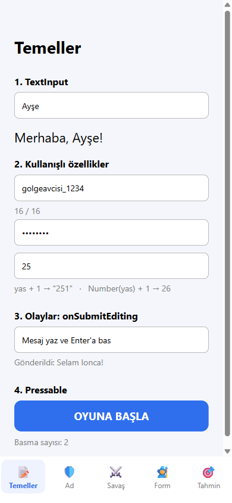 | 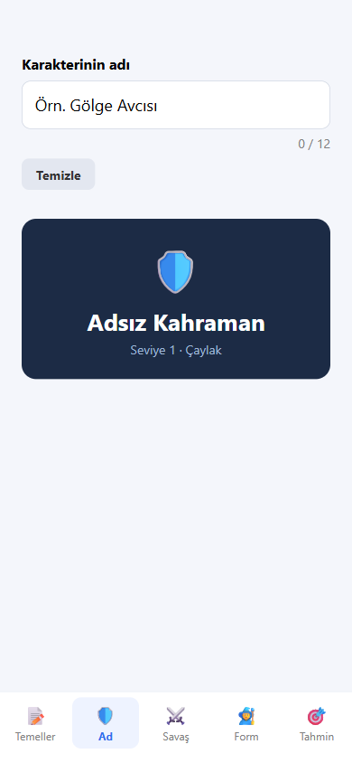 | 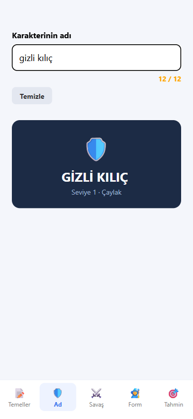 |

| Savaş (start) | Büyü disabled + long press | Zafer! |
|---|---|---|
| 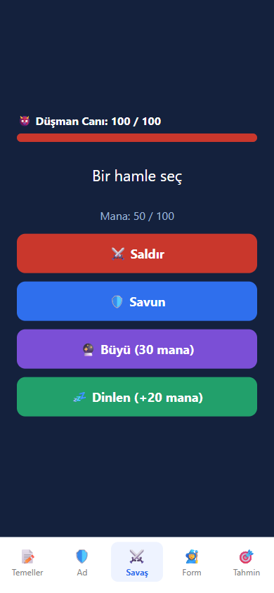 | 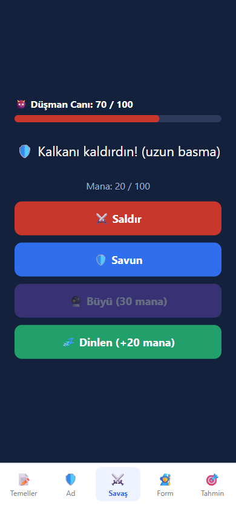 | 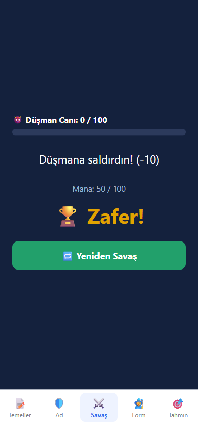 |

| Form: age error | Form: Şifacı selected | Form: summary card |
|---|---|---|
| 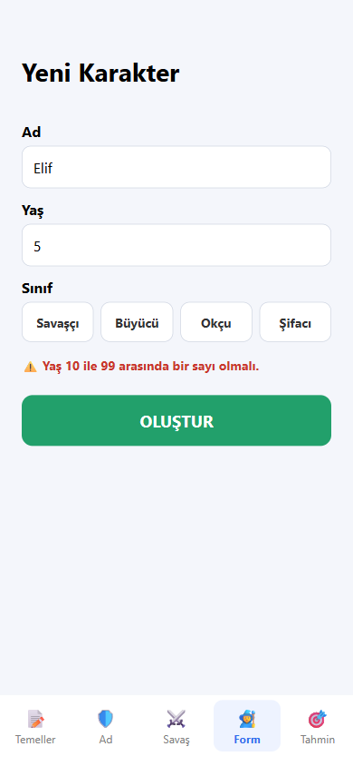 | 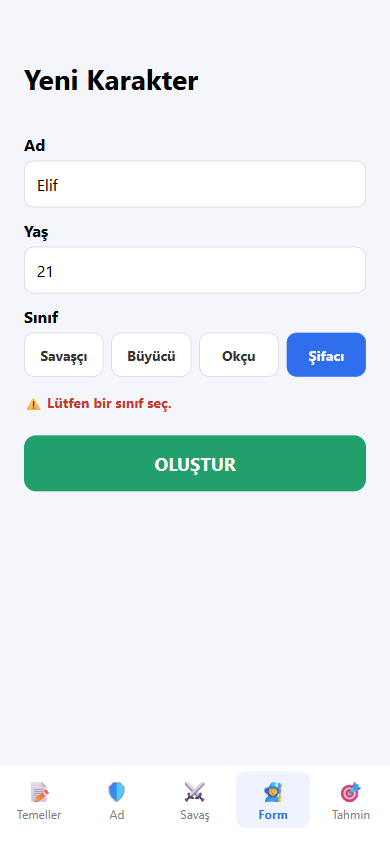 | 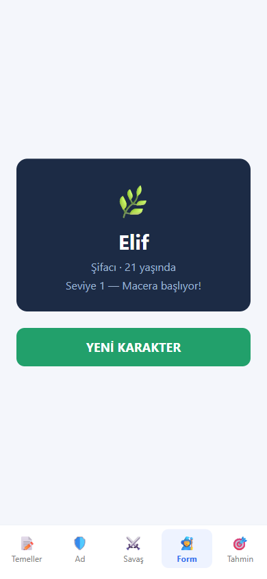 |

| Tahmin: start | Invalid input | Wrong guess |
|---|---|---|
| 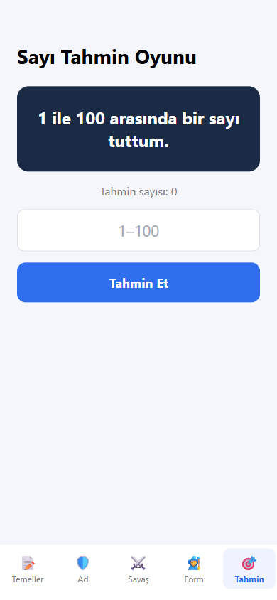 | 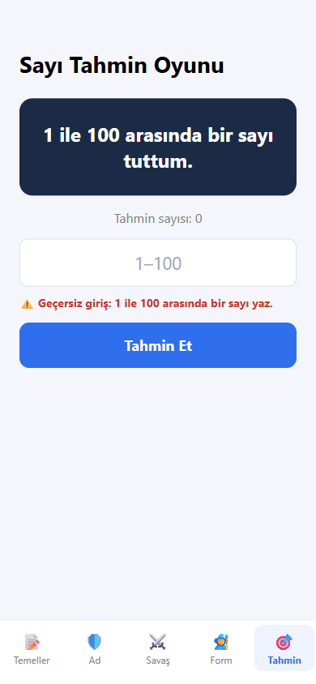 | 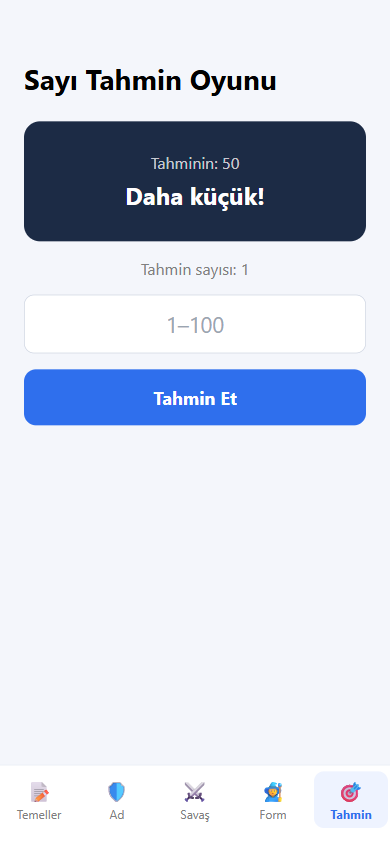 |

| Correct guess | Yeniden Oyna |
|---|---|
| 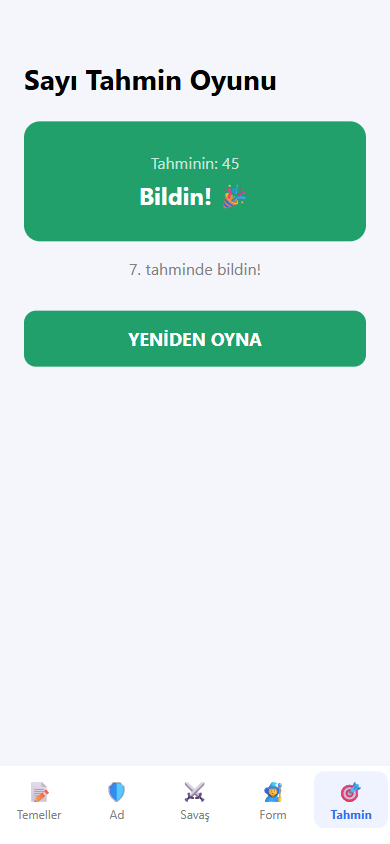 | 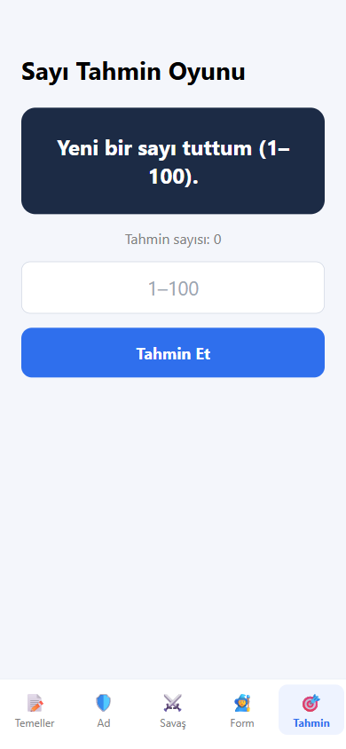 |

## Notes

- The emoji in the note's button labels and card icon (e.g. before "Saldır", "Savun", "Bildin!") were lost in the PDF text, so suitable emoji were chosen: ⚔️ 🛡️ 🔮 💤 🎉 ⚠️.
- On a phone, check that the numeric keyboard opens for the age and guess boxes. In the web build this shows only as `inputmode="numeric"`.
