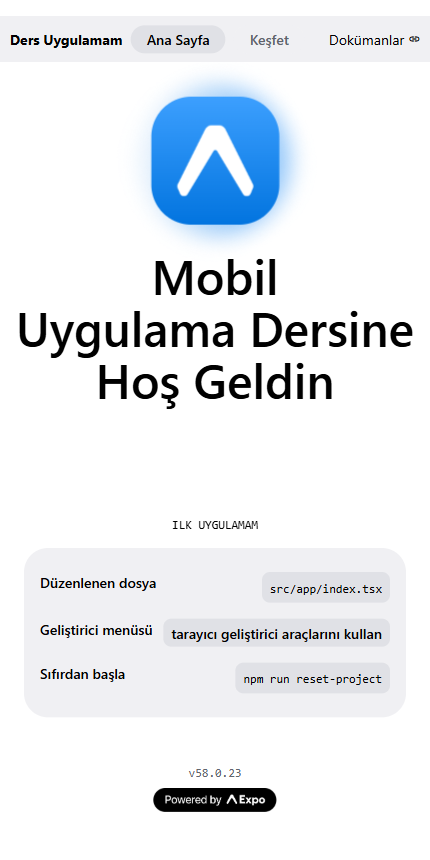
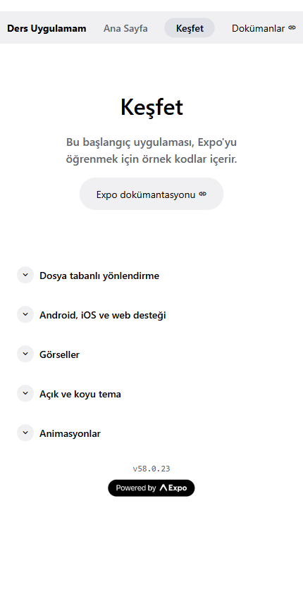

# Week 1 – Expo Getting Started

A new app created with `create-expo-app` (Expo SDK 58, Expo Router). The template's home screen and menu texts were changed and translated into Turkish.

## What was changed

| File | Change |
|---|---|
| `src/app/index.tsx` | Title "Welcome to Expo" → "Mobil Uygulama Dersine Hoş Geldin", "get started" → "ilk uygulamam", hint rows translated |
| `src/app/explore.tsx` | "Explore" screen title, description and all section headings translated |
| `src/components/app-tabs.tsx` | Tab bar labels: Home → Ana Sayfa, Explore → Keşfet |
| `src/components/app-tabs.web.tsx` | Web menu: "Expo Starter" → "Ders Uygulamam", tabs and "Docs" translated |
| `app.json` | App name → "Ders Uygulamam" |

| Home | Explore |
|---|---|
|  |  |

## Running

```bash
npm install
npx expo start      # scan the QR code with Expo Go, or press w for web
```
