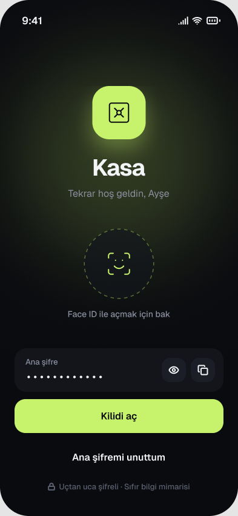
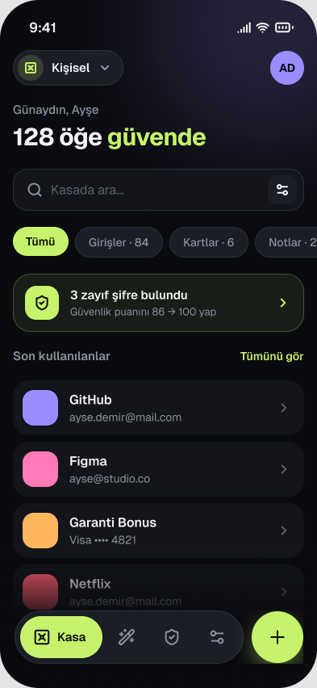
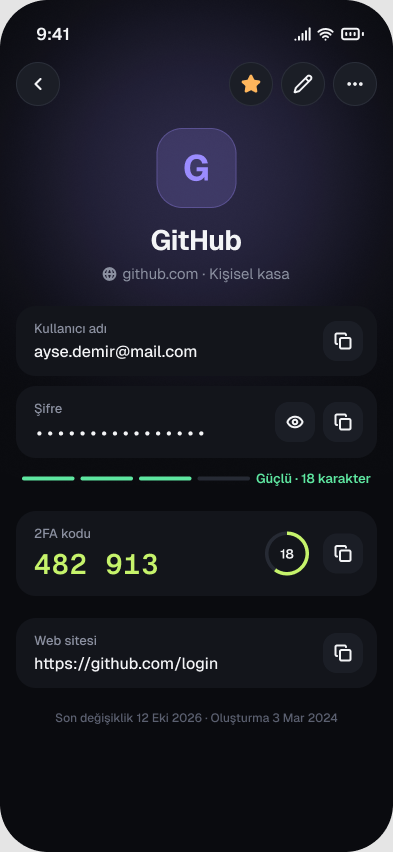
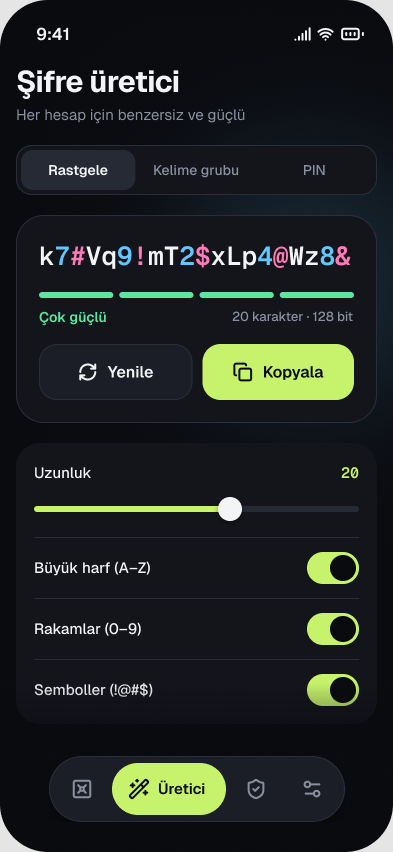
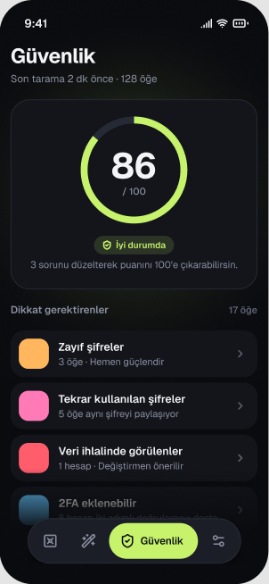
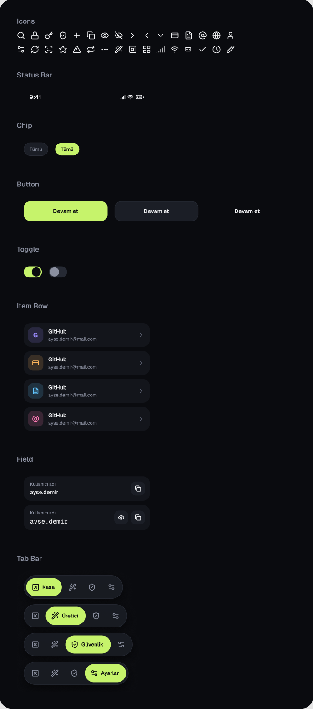
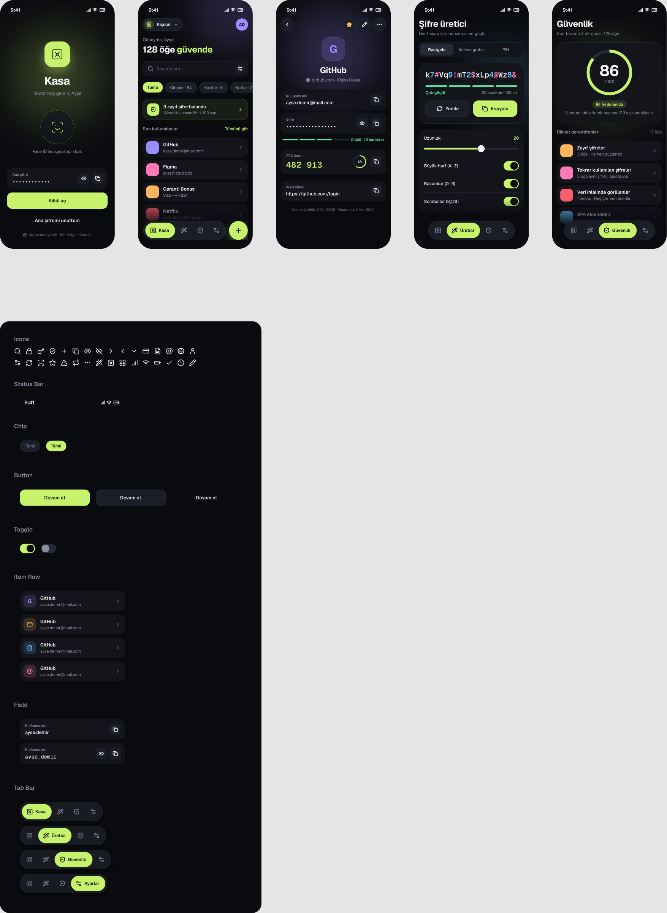

# Week 2 – Mobile App UI in Figma

**Kasa – Password Manager App**

Figma file: https://www.figma.com/design/Jb79yS2L065gP3EwwfW0pF/Kasa-%E2%80%94-Password-Manager-App?node-id=0-1

Five iPhone screens (393×852) plus a component board (icons, status bar, chips, buttons, toggles, item rows, fields, tab bar).

| Lock screen | Vault | Item detail | Password generator | Security |
|---|---|---|---|---|
|  |  |  |  |  |

### Components

### Overview

