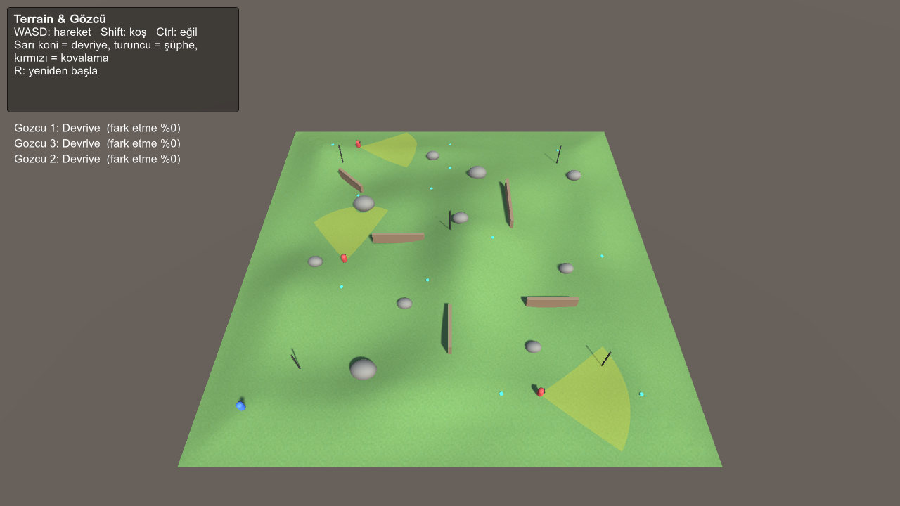
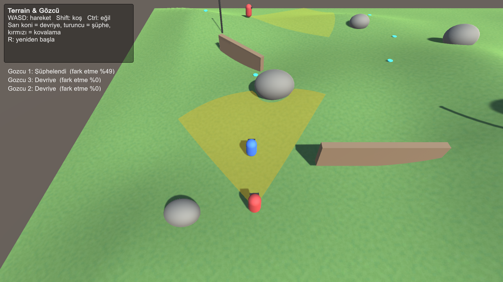
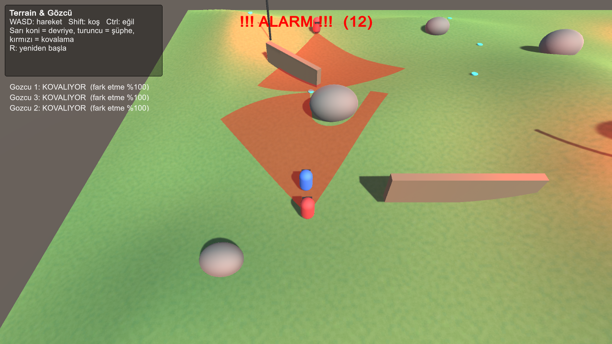
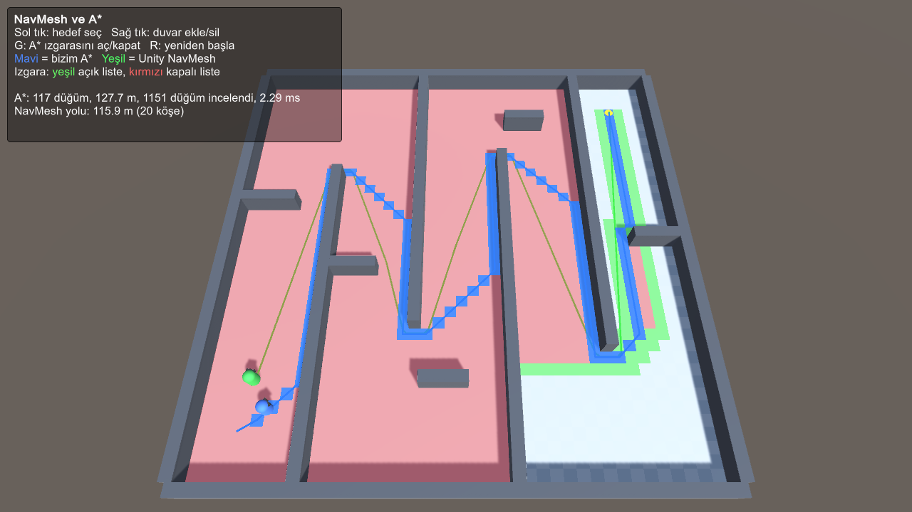

# Artificial Intelligence – Game AI in Unity

Unity **6.6 (6000.6.8f1)**, Built-in Render Pipeline, AI Navigation package 2.0.16.
Open the project in Unity Hub, then open a scene from `Assets/Scenes`.

## 1. Terrain & Guard (`Assets/Scenes/TerrainGozcu.unity`)

A stealth scenario on a hilly terrain. Three guards patrol between waypoints. If the player walks into a guard's **vision cone**, the **alarm** goes off and every guard **chases** the player over the terrain using the **NavMesh**.



**Guard state machine** (`GuardAI.cs`)

```
Patrol ──sees player──▶ Suspicious ──awareness full──▶ Chase (alarm!) ──lost sight──▶ Search ──timeout──▶ Patrol
   ▲                         │ player left the cone                                     │ sees player again
   └─────────────────────────┘                                                          └──────▶ Chase
```

**Vision check** (three steps):
1. **Distance**: is the player within `viewDistance`? (shorter when the player is crouching)
2. **Angle**: is the angle between the guard's forward vector and the player smaller than `viewAngle / 2`?
3. **Line of sight**: a raycast from the guard's eyes. Hills, rocks and walls block the view.

**Alarm** (`AlarmSystem.cs`): plays a siren (generated in code), makes the red alarm lights flash and broadcasts the player's last known position to *all* guards. The alarm stays on while any guard can still see the player.

**Vision cone** (`VisionConeMesh.cs`): a mesh rebuilt every frame from raycasts. It is cut off behind obstacles and follows the terrain height. Yellow = patrol, orange = suspicious, red = chase.

| Suspicious (cone is cut by the rock) | Alarm – all guards chase |
|---|---|
|  |  |

**Controls:** WASD move · Shift run · Ctrl crouch (harder to spot) · R restart

## 2. NavMesh & A* (`Assets/Scenes/NavMesh_AStar.unity`)

The same target is given to two agents in a maze:
- **Blue** walks along a path found by our own **A\*** implementation (`AStarGrid.cs`).
- **Green** is a Unity **NavMeshAgent** moving on a baked NavMesh.



**A\* details**
- The world is a 40×40 grid of 1 m nodes. A node is blocked if an `Obstacle`-layer collider overlaps it.
- `f = g + h`. `g` is the cost so far, `h` is the octile distance to the goal (straight step = 10, diagonal = 14).
- The open set is a **binary heap** (`Heap.cs`), so both picking the lowest-`f` node and inserting are O(log n).
- 8-directional movement without corner cutting.
- Visualization: green = open set, red = closed set, blue = final path. The overlay also shows the number of expanded nodes and the search time.

**Controls:** Left click: set target · Right click: add/remove a wall (the A* grid is rebuilt, the NavMesh is carved with `NavMeshObstacle`) · G: toggle grid overlay · R: restart

## Project structure

```
Assets/
  Scripts/
    Common/        InputHelper, PlayerController, FollowCamera
    TerrainGuard/  GuardAI, AlarmSystem, VisionConeMesh, GameUI
    AStar/         AStarGrid, Heap, AStarDemo
  Editor/          SceneBuilder (menu: Ders > Sahneleri Yeniden Oluştur)
  Scenes/          TerrainGozcu, NavMesh_AStar (+ baked NavMesh data)
```

Both scenes are generated by `SceneBuilder.cs`, which creates the terrain, obstacles, guards, waypoints and maze and bakes the NavMesh. Run it again from the **Ders** menu to regenerate them.
