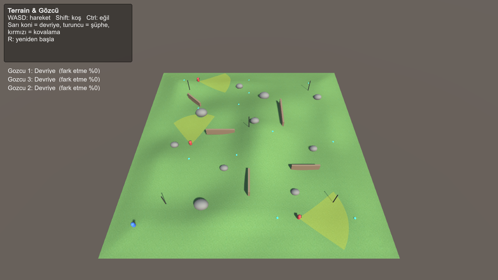
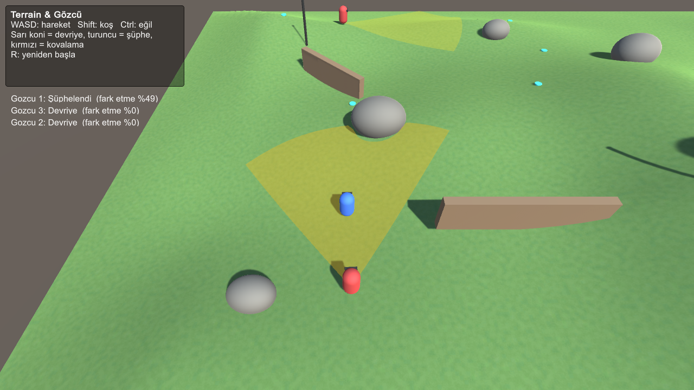
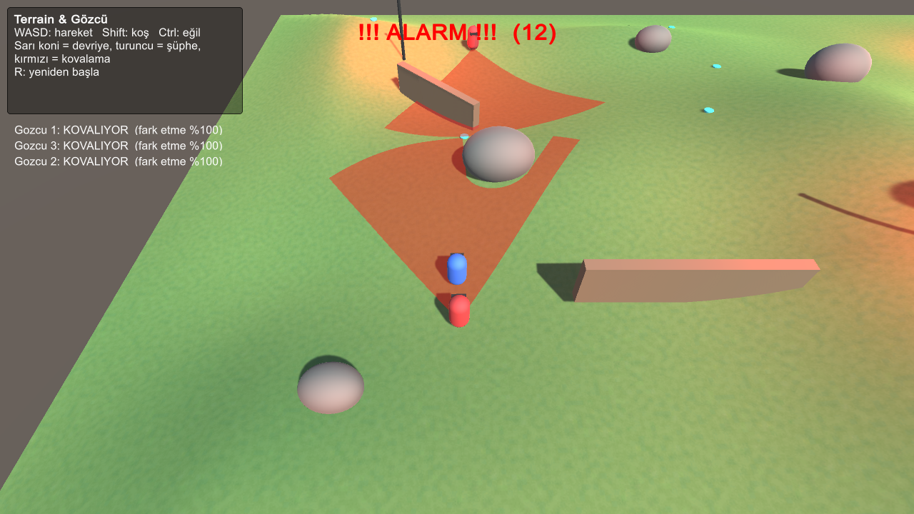

# Extra: Patrolling guards with an alarm (beyond the homework)

An **extra project**, not a graded assignment. It extends the week-3 "Gözcü" (guard) idea of the
"Digital Games AI" course: instead of one stationary guard that only changes colour, three guards **patrol**
on a hilly terrain with the **NavMesh**, use a **vision cone** that hills and rocks block, and run a
**finite state machine** (Patrol → Suspicious → Chase → Search) with a shared **alarm**.

The graded week-3 homework (stationary guard, vision cone, line of sight) is in
**[`../hafta03-gozcu`](../hafta03-gozcu)**.



## How to open and run

- Unity **6.6 (6000.6.8f1)**, Built-in Render Pipeline, AI Navigation package 2.0.16 (installed from `Packages/manifest.json`).
- Open this folder in Unity Hub, open `Assets/Scenes/TerrainGozcu.unity` and press **Play**.
- The scene, terrain, materials and baked NavMesh are generated by `Assets/Editor/SceneBuilder.cs`.
  To regenerate them: menu **Ders > Sahneyi Yeniden Oluştur**, or
  `Unity.exe -batchmode -quit -projectPath . -executeMethod SceneBuilder.BuildAll`.

## Controls

WASD move · Shift run · Ctrl crouch (shorter detection range) · R restart

## How it works

**Guard state machine** (`GuardAI.cs`)

```
Patrol ──sees player──▶ Suspicious ──awareness full──▶ Chase (alarm!) ──lost sight──▶ Search ──timeout──▶ Patrol
   ▲                         │ player left the cone                                     │ sees player again
   └─────────────────────────┘                                                          └──────▶ Chase
```

| Feature | Implementation |
|---|---|
| Patrol between waypoints on the NavMesh | `GuardAI.UpdatePatrol`, waypoints and `NavMeshAgent` set up in `SceneBuilder.BuildTerrainGuardScene` |
| Vision: distance → angle (cone) → line of sight | `GuardAI.IsPointInCone` (distance, half-angle) and `GuardAI.CheckVision` (raycast; terrain, rocks and walls block it) |
| Crouching makes the player harder to spot | `GuardAI.crouchDistanceFactor`, `PlayerController.IsCrouching` |
| Suspicious: awareness fills while the player stays in the cone | `GuardAI.UpdateSuspicious` (`timeToDetect` = 0.8 s) |
| Chase over the terrain, catch the player | `GuardAI.UpdateChase`, `GameUI.ShowCaught` |
| Search the last known position, then return to patrol | `GuardAI.UpdateSearch` (`searchDuration` = 5 s) |
| Alarm: siren (generated in code), flashing red lights, all guards chase | `AlarmSystem.Raise`, `AlarmSystem.AlarmRaised` event → `GuardAI.OnAlarm` |
| Guards share sightings while the alarm is on | `AlarmSystem.ReportSighting` → `GuardAI.HearReport` |
| Vision cone visible in the Game view, cut by obstacles, following the hills | `VisionConeMesh.cs` (yellow = patrol, orange = suspicious, red = chase) |
| Player movement relative to the camera, follow camera | `PlayerController.cs`, `FollowCamera.cs`, `InputHelper.cs` |

| Suspicious (cone is cut by the rock) | Alarm – all guards chase |
|---|---|
|  |  |

## Verification (batchmode play test)

A temporary play-mode harness (removed afterwards) ran the scene:
- In the first 5 s the three guards patrolled 8.56 m, 8.57 m and 8.65 m (state `Patrol`).
- With the player held 6 m in front of guard 1, the alarm went off after 0.80 s (= `timeToDetect`);
  one second later all 3 guards were in `Chase`.
- Editor log: 0 compile errors, 0 warnings, 0 missing scripts in the scene.

## Project structure

```
Assets/
  Scripts/Common/        InputHelper, PlayerController, FollowCamera
  Scripts/TerrainGuard/  GuardAI, AlarmSystem, VisionConeMesh, GameUI
  Editor/                SceneBuilder
  Scenes/                TerrainGozcu.unity, TerrainGozcu_NavMesh.asset (baked NavMesh)
  Terrain/               GozcuTerrain.asset, Grass texture and terrain layer
  Materials/
screenshots/             01-terrain-overview, 02-suspicious, 03-alarm-chase
```

## Manual steps

None required. For a short recording: sneak behind the ridge and rocks, crouch past a guard, then step into a
cone to show Suspicious → alarm → all guards chasing, and hide until they search and return to patrol.
