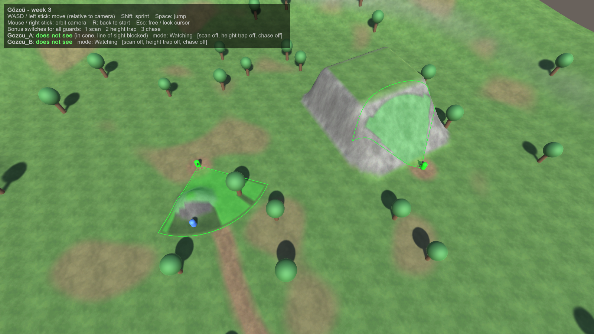
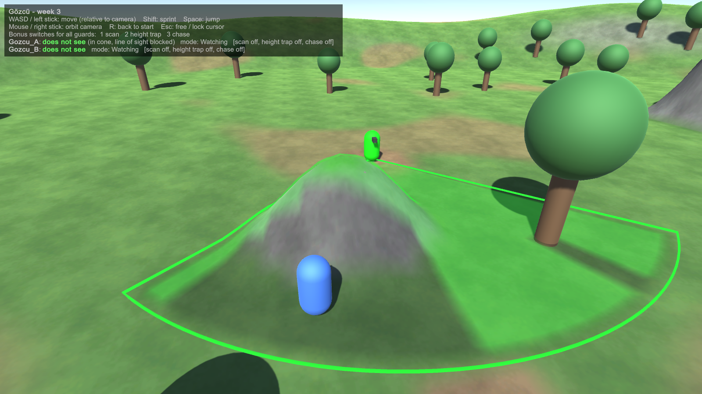
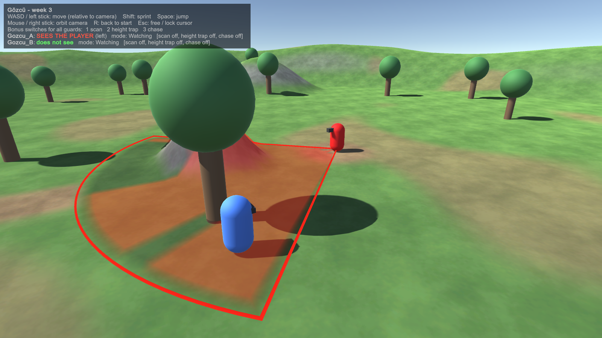
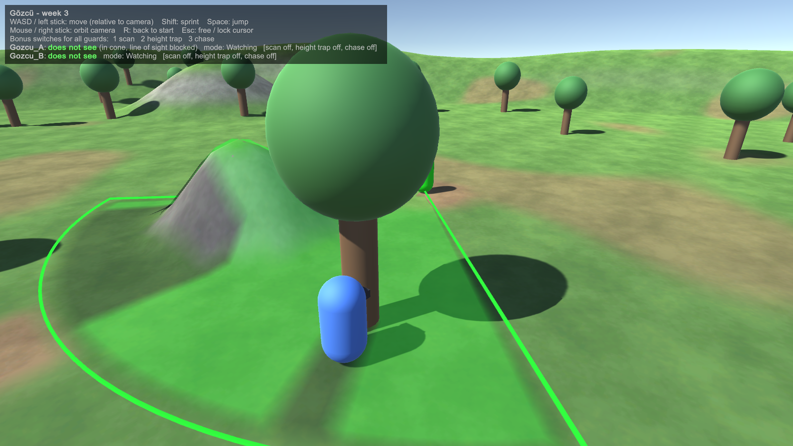
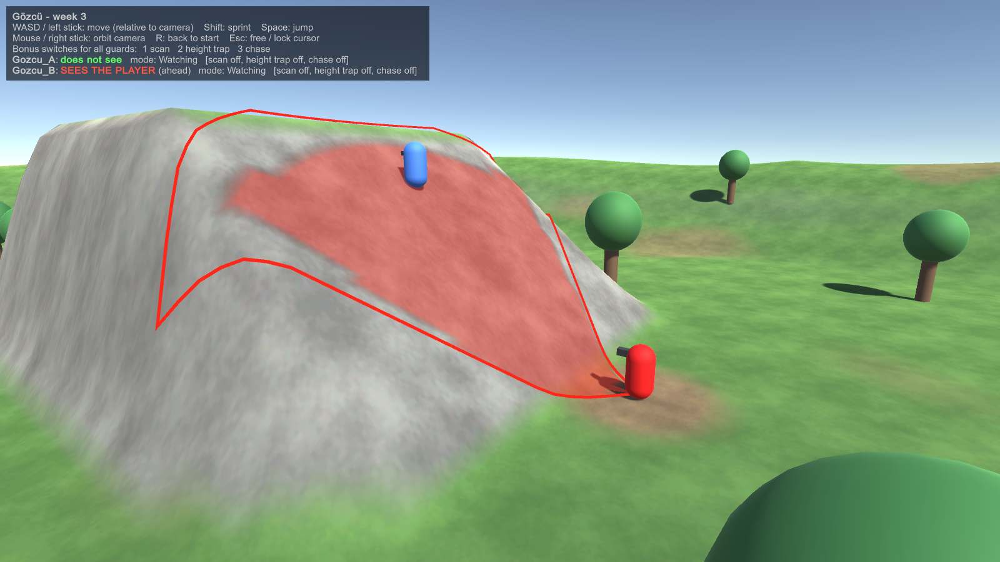
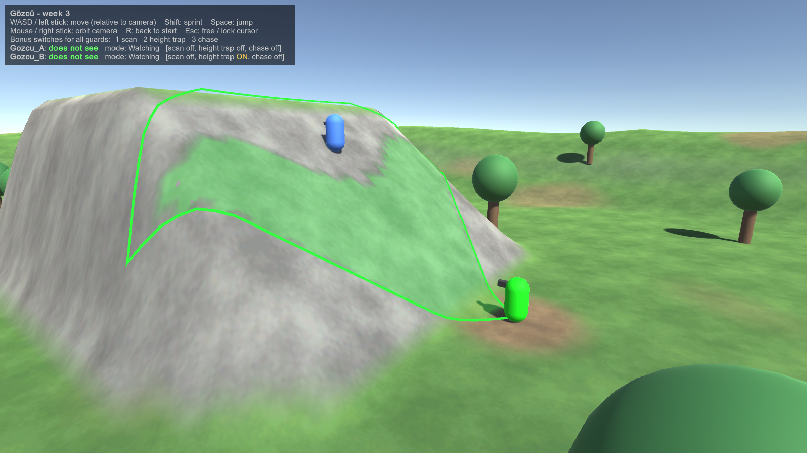

# Week 3 – Gözcü (guard with a vision cone on a terrain)

Homework for **Dijital Oyunlarda Yapay Zekâ**, week 3 ("Unity'de 3B Dünya: Arazi, Girdi ve Hareket").
The task is in section 7, "Ödev: Gözcü", of the week 3 lecture notes.

In short, the task asks for:

- a shaped and painted terrain with a hill to hide behind and some trees;
- a player that moves relative to the camera with the New Input System, using a CharacterController or a Rigidbody, followed by our own camera;
- a stationary guard that turns **red** when it sees the player and **green** when it does not.

"Seeing" has two parts:

- **cone test:** the player is within range and the angle to the guard's forward direction is less than half the view angle. We compute this ourselves with the dot product.
- **line of sight:** `Physics.Linecast` from the guard's eye to the player hits no terrain or tree.

When the guard sees the player, the Console says whether the player is on its right or its left (cross product). Gizmos draw the range sphere and the cone edges.

All three bonus tasks are also done: scan, height trap and chase.



## Open and run

1. Unity Hub → **Add project from disk** → select this folder. Editor: **Unity 6000.6.8f1 (Unity 6.6)**, Built-in Render Pipeline.
   - The notes suggest the URP template. The course repo uses the Built-in pipeline for every project, and nothing in this assignment depends on URP.
2. Open `Assets/Scenes/Gozcu.unity` and press **Play**. The scene is also the only entry in Build Settings.
3. Packages:
   - `com.unity.inputsystem` 1.20.1;
   - *Active Input Handling* = **Input System Package (New)**.
4. Optional: rebuild the scene from code with the menu **Gozcu → Build Scene**.
   - This regenerates the textures, terrain, trees and scene, and overwrites `Gozcu.unity`.
   - Batch mode: `-executeMethod GozcuSceneBuilder.Build`.

## Controls

| Input | Action |
|---|---|
| W A S D / arrows / left stick | Move, relative to the camera |
| Mouse / right stick | Orbit the camera |
| Left Shift / left-stick press | Sprint (7 m/s instead of 4 m/s) |
| Space / gamepad south | Jump (1.5 m) |
| **1** / **2** / **3** | Bonus switches for **all** guards: scan / height trap / chase |
| R | Back to the start point |
| Esc | Free / lock the mouse cursor |

The on-screen box shows these controls and, for every guard:

- whether it sees the player, and on which side;
- whether the player is "in the cone but the line of sight is blocked";
- the current mode (Watching / Scanning / Chasing);
- which bonuses are on.

## Scene and demo route

| Object | Where | Purpose |
|---|---|---|
| `Terrain` | 200 × 50 × 200 m at (−100, 0, −100), 257² heightmap | Shaped from code (see below) and painted with 3 layers: grass, rock on slopes > ~30°, dirt on the path, patches and guard pads |
| Hiding hill | Centre (−3, 14), 3.5 m high | Sits between the player's route and **Gozcu_A** |
| 40° ramp + 10 m plateau | x ≈ 32…48, z = 2…26 | Climbable ramp in front of **Gozcu_B**, used for the height trap. Its sides and back are steeper than 45°, so the CharacterController cannot climb them |
| Trees | 8 placed by hand + 45 random | Terrain trees with colliders. The prefab has a `CapsuleCollider` and *Enable Tree Colliders* is on. Tree **T1** at (5, 12) stands inside Gozcu_A's cone |
| `Player` | Start (0, −28), on the **Player** layer | Blue capsule with a dark visor (its front) |
| `Gozcu_A` | (0, 22), facing south (−Z) | Guards the hill and tree area |
| `Gozcu_B` | (40, 0), facing north (+Z), towards the ramp | Height trap demo |

Demo route:

1. Follow the dirt path north and stay behind the hill. Gozcu_A stays green.
2. Step out to the east: it turns red and the Console logs "LEFT".
3. Hide behind tree T1: green.
4. Walk east to Gozcu_B and climb the ramp.

The terrain shape is built in `GozcuSceneBuilder.HeightAt`:

- low Perlin noise;
- cosine-bump hills (`Bump`);
- the clamped linear ramp;
- flat pads under the guards.

The textures are procedural, tileable value noise (`MakeTexture`). They are saved as PNGs and used by three `TerrainLayer` assets.

## CharacterController or Rigidbody? → **CharacterController**

The player uses a **CharacterController** (`PlayerMovement.cs`). The reasons:

1. **Exact control for a stealth game.**
   - The player must be able to stop *exactly* behind the hill or a tree trunk and step out a little.
   - The CharacterController reacts instantly, with no acceleration or sliding.
   - A Rigidbody reaches its speed through forces and keeps some momentum, so it is harder to stop precisely in cover.
2. **Terrain without extra work.**
   - Slope Limit (45°) and Step Offset come built in.
   - That is exactly what the scene needs: the 40° ramp is climbable, while the > 45° sides of the plateau and the steep hill are not.
   - With a Rigidbody we would have to handle slopes ourselves, and the notes warn about sliding and bouncing.
3. **One update loop and no jitter with our camera.**
   - Movement runs in `Update` and the camera follows in `LateUpdate`, in the same frame.
   - A Rigidbody moves in `FixedUpdate` and needs Interpolate to avoid camera jitter.
4. **Nothing in the scene needs physics forces.**
   - Nothing pushes the player and the player pushes nothing.
   - The guard only needs the player's position.
   - Later weeks (NavMeshAgent) also move kinematically, and the notes point out that the switch is easier from a CharacterController.

Gravity and jumping are written by hand as in week 2, with an Euler step:

- `verticalSpeed += g·Δt`, then `Move(v·Δt)`;
- jump speed `v0 = √(2·g·h)`.

## How the guard sees (`Gozcu.cs`)

The skeleton's names are kept: `oyuncu`, `menzil = 15`, `gorusAcisi = 90`, `gozYuksekligi = 0.6`, `engeller = Default`, `GorusKonisinde`, `GorusHattiAcik`.

- **`GorusKonisinde(goz, hedef)`**
  - Range: `fark.sqrMagnitude > menzil²` → outside. Squared values are compared, so no square root is needed.
  - Angle: `Vector3.Dot(transform.forward, fark.normalized) >= cos(gorusAcisi / 2)`.
  - `Vector3.Angle` appears **only** in `VerifyWithVectorAngle`. That check is on by default and logs a warning if our result ever disagrees. No warning appeared in any test run.
- **`GorusHattiAcik(goz, hedef)`**
  - `!Physics.Linecast(goz, hedef, engeller, QueryTriggerInteraction.Ignore)`.
  - `engeller` contains only **Default**: the terrain, including its tree colliders.
  - The player is on the **Player** layer and the guards are on the **Guard** layer. Both are excluded, so the ray never hits the player itself or the guard's own capsule.
- **Colour:** `govde.material.color = goruyor ? Color.red : Color.green`, as in the skeleton.
- **Right / left:** `SideOf` uses `Vector3.Cross(forward, toPlayer).y`. Positive means right (Unity is left-handed); within ±2° it counts as straight ahead.
  - To avoid spam, the Console prints a line only when something changes. Output looks like this:

    ```text
    [Gozcu_A] Player SEEN - on the LEFT of the guard (solunda)
    [Gozcu_A] Player now on the RIGHT of the guard (sağında)
    [Gozcu_A] Player lost
    ```

  - Side changes are throttled to at most one per 0.5 s (`sideLogInterval`).
- **Gizmos (`OnDrawGizmos`):**
  - a wire sphere for the range at the eye;
  - the two cone edges, `Quaternion.AngleAxis(±gorusAcisi / 2, Vector3.up) * transform.forward`;
  - the vertical limits when the height trap is on;
  - a red line to the player while he is seen.
- **Runtime cone (`VisionConeView.cs`):** Gizmos are not drawn in the Game view or in builds, so a mesh fan is draped over the terrain inside the horizontal cone.
  - For each sample point the guard's own `GorusKonisinde` and `GorusHattiAcik` are called for a standing player (centre 1 m above the ground).
  - Visible ground is tinted with the guard's colour (green or red). Hidden ground is dark, so you can see the "shadow" behind the hill and behind each trunk.
  - A LineRenderer draws the outline.
  - This is what the screenshots and the video show.

## Bonus tasks (+10)

Each bonus has a checkbox on every guard (Inspector, `Gozcu` component). Keys 1, 2 and 3 switch it on all guards. All are **off** by default, so the basic behaviour can be shown first.

| Bonus | Field(s) | Implementation |
|---|---|---|
| **Tarama / scan (+4)** | `scanEnabled`, `scanHalfAngle = 60`, `scanSpeed = 30` | `Turn()`: `Quaternion.RotateTowards` towards `startRotation * AngleAxis(±60°, up)` at 30°/s, reversing at each end |
| **Yükseklik tuzağı / height trap (+3)** | `heightLimitEnabled`, `verticalHalfAngle = 30` | `GorusKonisinde`: horizontal test on the flattened vectors (90°) **and** vertical test \|dir·up\| ≤ sin 30°. A player high up the ramp, or above the guard, is inside the horizontal cone but is not seen |
| **Takip / chase (+3)** | `chaseEnabled`, `chaseTurnSpeed = 90`, `loseSightTime = 2` | When the guard sees the player it turns towards him (RotateTowards). After 2 s without seeing him it goes back to scanning, or, with scan off, to its start direction. Mode is shown in the HUD (`Watching` / `Scanning` / `Chasing`) |

## Rubric mapping

| Rubric item (points) | Where |
|---|---|
| Arazi sahnesi – terrain: shape, paint, hiding places (15) | `GozcuSceneBuilder.HeightAt`, `CreateTerrainData` (heights, 3 painted layers, trees with colliders); hill and tree T1 in front of Gozcu_A; assets in `Assets/Terrain/` |
| Oyuncu hareketi – New Input System, camera-relative, Δt (20) | `Assets/Input/GozcuControls.inputactions` (Player map: Move with WASD/arrows 2D-vector composites + stick, Look, LookStick, Jump, Sprint); `PlayerMovement.Update` (reads actions, `* Time.deltaTime`); `MoveDirection.RelativeToCamera` (flattened camera axes, `ClampMagnitude(…, 1)` for diagonals) |
| Takip kamerası – LateUpdate, frame-rate-independent smoothing (10) | `FollowCamera.LateUpdate`: `t = 1 − e^(−k·Δt)`, mouse delta not multiplied by Δt, stick multiplied by Δt; SphereCast anti-clipping (exercise 7c) in `DesiredPosition` |
| Görüş konisi – range + angle, own dot product (25) | `Gozcu.GorusKonisinde` (dot product vs. cos(angle/2), squared range); `VerifyWithVectorAngle` only checks it |
| Görüş hattı – hidden behind hill and tree (15) | `Gozcu.GorusHattiAcik` (`Physics.Linecast`, `engeller` = Default; Player/Guard layers excluded) |
| Geri bildirim, sağ/sol, Gizmos (10) | Red/green in `Gozcu.Update`; `SideOf` + `LogSide` (cross product, log on change); `OnDrawGizmos` (wire sphere + `AngleAxis(±aci/2)` edges); runtime cone `VisionConeView`; HUD `HelpOverlay` |
| Kod düzeni ve README (5) | Folders `Scripts/Player`, `Scripts/Guard`, `Scripts/UI`, `Editor`; this README |
| Ek görevler (+10) | `Gozcu.Turn` (scan, chase), `GorusKonisinde` height-trap branch |

## Verification

A temporary test harness was used to check the behaviour. It was a MonoBehaviour that ran in a Windows player build only when the build was started with `-gozcuTest`.

- It placed the player at fixed spots, waited for the guards' real `Update`, and logged PASS or FAIL.
- It drove the player through a virtual keyboard of the Input System.
- It took the screenshots.

The harness and the build were deleted afterwards. The full output is in [`verification/harness-output.txt`](verification/harness-output.txt). Result: **32 PASS, 0 FAIL**.

| Case | Result |
|---|---|
| Inside the cone, clear line (7.5, 12) | **seen**, body red, angle 36.9°, side **LEFT**, Console logged it once |
| Other side (−4, 17) | seen, side **RIGHT**, Console logged the change; no new messages in 30 still frames |
| Behind the hill (−4.56, 9.82) | **not seen**, although inside the cone (Linecast hit the terrain) |
| Behind tree T1 (5.58, 10.84) | **not seen**, inside the cone; Linecast hit 0.44 m from the trunk centre |
| Out of range (16.5 m, clear line) | not seen |
| Outside the angle (60°, 10 m, clear line) | not seen |
| Floating above Gozcu_A, elevation 38° | seen with the 90° 3D cone; **not seen** with the height trap on |
| Up the ramp in front of Gozcu_B, elevation 31.9° | seen with trap off; **not seen** with trap on |
| Low on the ramp, elevation 21° | still seen with the trap on |
| Scan | sweeps −59.9° … +59.9°, median speed **30.0°/s** at ~240 FPS |
| Chase | faces the player (error 0.00°); still Chasing 1.5 s after losing him; back to Scanning after **2.00 s** |
| Walk W at 30 / 60 / 144 FPS | 3.87 / 3.93 / 3.97 m/s. 4 m/s is expected; the gap is about one frame of key latency |
| W + D diagonal | 3.93 m/s (not 5.66) |
| Camera yaw 90°, W | moves along world +X |
| Shift + W | 6.89 m/s (7 expected) |
| Math checks | Exercise 2 from the notes: (−2, 0, 5) is LEFT. One 30 FPS smoothing step equals two 60 FPS steps (0.2835) |

The project compiles with zero errors and zero warnings in Unity 6000.6.8f1.

## Screenshots

| | |
|---|---|
|  **Hidden behind the hill:** the guard is green. The dark area on the ground is the hill's "shadow" |  **Stepped out:** the guard and the cone are red. The trunk of T1 leaves a narrow shadow |
|  **Behind tree T1:** green |  **Gozcu_B, height trap off:** the player high on the ramp is seen |
|  **Gozcu_B, height trap on (±30°):** the same spot is no longer seen; only the lower ramp is tinted |  **Overview:** both guards and their cones |

The screenshots show the runtime cone (`VisionConeView`), not Gizmos. To see the Gizmos in the Editor, use the Scene view, or turn on the **Gizmos** button in the Game view.

## Checklist for the 1–2 minute video (student)

Record the Game view with the **Console** visible next to it, and a Scene view with Gizmos if there is room.

1. **(0:00) Start:** press Play.
   - Move the mouse: the camera orbits.
   - Press W after turning the camera: the player walks where the camera looks.
   - Show Shift (sprint) and Space (jump).
   - Walk close to the hill with the camera behind it: the camera moves in front of the hill instead of clipping into it.
2. **Hiding:** follow the dirt path to the hill and stay behind it.
   - Gozcu_A stays green.
   - The HUD says "in cone, line of sight blocked".
   - The dark shadow behind the hill is visible on the ground.
3. **Seen:** step out to the east.
   - The guard turns red.
   - Console: `Player SEEN - on the LEFT of the guard`.
   - Walk across in front of it: `Player now on the RIGHT…`.
4. **Tree:** hide behind the big tree T1, east of the hill. The guard turns green.
5. **Range and angle:** walk out of the 15 m range, then sideways out of the 90° cone. Both are green.
6. **Inspector and Gizmos:**
   - Select `Gozcu_A` and show `menzil`, `gorusAcisi`, `gozYuksekligi` and `engeller` (Default).
   - Show the wire sphere and the cone edges in the Scene view.
   - Optionally change `menzil` live and watch the cone change.
7. **Bonuses:**
   - Press **1**: the guard sweeps ±60°.
   - Press **3**, step into view: it turns towards you. Hide: about 2 s later it goes back to scanning.
   - Walk to **Gozcu_B** and climb the ramp: it is red high up.
   - Press **2**: it turns green high up and is red again lower down.
8. **Code (10–15 s):** scroll through `Gozcu.cs`:
   - `GorusKonisinde`: dot product;
   - `GorusHattiAcik`: Linecast;
   - `SideOf`: cross product;
   - `OnDrawGizmos`.

## Manual steps for the student

- Record and upload the 1–2 minute video (checklist above) and hand in the Git link.
- If the Console logs nothing: check that *Collapse* is off and that Info messages are shown.
- Optionally rebuild the scene with **Gozcu → Build Scene** after changing the layout constants at the top of `GozcuSceneBuilder.cs`.

## Files

```text
Assets/
  Scenes/Gozcu.unity                 the scene (generated, ready to play)
  Scripts/Guard/Gozcu.cs             the guard (skeleton names, cone, line of sight, side, gizmos, bonuses)
  Scripts/Guard/VisionConeView.cs    runtime cone mesh + outline
  Scripts/Player/PlayerMovement.cs   CharacterController movement (New Input System, Δt)
  Scripts/Player/MoveDirection.cs    camera-relative direction, diagonal clamp
  Scripts/Player/FollowCamera.cs     LateUpdate follow camera, 1 − e^(−kΔt), SphereCast
  Scripts/UI/HelpOverlay.cs          on-screen help, guard states, bonus keys 1/2/3
  Editor/GozcuSceneBuilder.cs        builds textures, terrain, trees, materials, input actions, scene
  Input/GozcuControls.inputactions   Player + Demo action maps
  Terrain/                           TerrainData, 3 TerrainLayers, generated textures
screenshots/                         images above
verification/harness-output.txt      console output of the test run
```
