# Hafta 4 Ödevi — Dağ Yolu: Rapor

**Ders:** Dijital Oyunlarda Yapay Zekâ · Hafta 4 (NavMesh ve A*)

Bu rapordaki bütün sayılar sahnede gerçekten çalıştırılan deneylerden alındı. Deneyleri `Dag Yolu → Run Experiments` menüsü (ya da `DagYoluExperiments.RunAll`) çalıştırır. Ham çıktı `deney-ciktisi.txt` dosyasında; oyun içi (player build) testin çıktısı `oyun-ici-test-ciktisi.txt` dosyasında.

## 1. Kurulum

**Arazi**

- 128 × 128 m, en yüksek nokta 40 m. Yükseklik haritası 257 × 257, yani 0,5 m'de bir örnek.
- Perlin gürültüsüyle hafif tepeler, eğimlerin çoğu 0–20°.
- Ortadan kuzey–güney yönünde bir dağ sırtı geçiyor. Yamaçları 60–80° olduğu için geçilemez.
- Sırtta iki geçit var:
  - ortada kısa ama dik bir boyun (30°'ye kadar);
  - kuzeyde yumuşak bir geçit.
- Güneyde sırt bitiyor; düz zeminden dolanmak mümkün.
- Ovada yamaçları dik beş kayalık tepe var.

**Izgara**

- 128 × 128 hücre, hücre boyu 1 m. Notlardaki ipucu 150 × 150'yi geçmemesiydi.
- 16 384 hücrenin 2 458'i 35°'den dik, yani geçilemez.

**Ajanlar**

- NPC (kırmızı küre) (12, 60) hücresinde, bayrak (115, 66) hücresinde.
- Aralarındaki kuşuçuşu mesafe 103,2 m.

**Maliyet**

Eğim `TerrainData.GetSteepness` ile hücre merkezinden okunur ve derece cinsindendir. Hücre maliyeti:

```
c(s) = 1 + k · (s / s_max)²   (s ≤ s_max)
c(s) = ∞                      (s > s_max)
```

- s_max = 35°.
- Bir adımın maliyeti, adım uzunluğu (düz 1, çapraz √2) çarpı girilen hücrenin maliyeti.
- Kontrol: s = 20°, k = 4 için c = **2,306**, çapraz adımda **3,261** (slayttaki örnekle aynı).
- s = 30°, k = 8 için c = 6,878; s = 36° için ∞.

**Arama**

- 8 komşuluk; sıra K, D, G, B, ardından KD, GD, GB, KB.
- Köşe kesme yasak: çapraz adım ancak iki yandaki hücre de yürünebilirse geçerli.
- Sezgisel oktil: `max(Δx, Δy) + (√2 − 1) · min(Δx, Δy)`.
- Eşitlik bozma derstekiyle aynı: önce küçük f, sonra küçük h, sonra önce eklenen.
- Açık liste olarak varsayılan ikili yığın kullanılıyor; sonuçlar düz listeyle birebir aynı (bkz. 5.1).

## 2. Deney 1 — k = 0, 2, 8

Sezgisel oktil; başlangıç ve hedef aynı. k = 4 satırı karşılaştırma için eklendi.

| k | Yol uzunluğu (m, yüzey boyunca) | Yatay uzunluk (m) | Yoldaki en büyük eğim (°) | Ortalama eğim (°) | Yol maliyeti | Genişletilen düğüm | Adım |
|---|---|---|---|---|---|---|---|
| **0** | **109,4** | 105,5 | **33,4** | 15,5 | **105,49** | **225** | **103** |
| **2** | **109,8** | 106,3 | **30,0** | 12,8 | **146,71** | **3 225** | **103** |
| 4 | 109,8 | 106,3 | 30,0 | 12,8 | 187,11 | 6 304 | 103 |
| **8** | **169,9** | 168,9 | **19,0** | 6,6 | **231,35** | **9 237** | **142** |

Her yolun öteki k değerlerindeki maliyeti (yollar sabit, yalnızca k değişiyor):

| Yol | k = 0'da | k = 2'de | k = 4'te | k = 8'de | Toplam tırmanış |
|---|---|---|---|---|---|
| k = 0 yolu | **105,5** | 159,0 | 212,6 | 319,6 | 12,0 m |
| k = 2 yolu | 106,3 | **146,7** | **187,1** | 267,9 | 11,1 m |
| k = 8 yolu | 168,9 | 184,5 | 200,1 | **231,3** | 7,4 m |

Kalın değerler her satırın kendi k'sındaki maliyeti. Her sütunun en küçük değeri o k için bulunan yol (A* doğru çalışıyor).

NPC'nin yürüme süreleri (TODO 4, `NpcGridChase.Tick` ile dt = 0,02 s simülasyon, taban hız 4 m/s):

| k | Varış süresi | Ortalama hız | En düşük hız | En dik hücredeki hız |
|---|---|---|---|---|
| 0 | 26,4 s | 4,00 m/s | 4,00 m/s | 4,00 m/s (33,4°'de; k = 0'da yavaşlama yok) |
| 4 | 46,9 s | 2,26 m/s | 1,01 m/s | 1,01 m/s (30,0°'de) |
| 8 | 58,0 s | 2,91 m/s | 1,19 m/s | 1,44 m/s (19,0°'de) |

Hız `speed / c(hücre)` olduğu için bir yolun süresi = maliyet / taban hız. Simülasyon bunu doğruladı; örneğin k = 4'te 46,9 s × 4 m/s = 187,8 ≈ yolun maliyeti 187,7. Demek ki A* bu ödevde aslında **en kısa süreli** yolu buluyor.

Gerçek oyunda (Windows player build) da ölçüldü:

- NPC bayrağa 46,9 oyun saniyesinde vardı.
- Hızı 3,97 m/s'den 30°'lik hücrede 1,00 m/s'ye düştü.
- Oyun sırasında k = 4'ten 8'e geçince yolu 103 adımdan 142 adıma yeniden planladı.

Ekran görüntüleri:

- `screenshots/02-yollar-k0-k8.png`: k = 0 beyaz, k = 8 pembe.
- `screenshots/02b-yollar-k0-k2-k8.png`: k = 2 mavi olarak eklendi.
- `screenshots/02c-yollar-perspektif.png`: aynı yollar perspektiften.

## 3. Yorum: k'nın etkisi

**k = 0.** Maliyet her hücrede 1, eğim yalnızca s_max sınırıyla önemli. NPC kuşuçuşuna en yakın yolu seçiyor (105,5 m yatay; mümkün olan en kısa oktil mesafe de 105,5 m). Sırtın ortasındaki dik boyundan geçiyor. Yolda 33,4°'lik hücreler var; geçilemez sınırına (35°) çok yakın.

**k = 2.** Yine aynı boyundan geçiyor, ama en dik hücrelerden birkaç metre kaçınıyor. Yol yalnızca 0,8 m uzuyor; en büyük eğim 33,4°'den 30,0°'ye, ortalama eğim 15,5°'den 12,8°'ye iniyor. Küçük bir k rotayı değiştirmiyor, rotanın içindeki "çizgiyi" değiştiriyor.

**k = 8.** Boyun artık çok pahalı. Bu yolda 30°'lik bir hücre 6,9 kat maliyetli, yani NPC orada 7 kat yavaş. NPC sırtı tamamen bırakıp güney ucundan dolanıyor:

- yol %55 uzuyor (109 m → 170 m);
- en büyük eğim 19°'ye, ortalama eğim 6,6°'ye iniyor;
- toplam tırmanış 12 m'den 7,4 m'ye düşüyor.

Uzun yol k = 8 dünyasında gerçekten daha ucuz. k = 0 yolu orada 319,6 tutardı, dolanma 231,3 tutuyor (%28 daha ucuz). Süre olarak da yaklaşık 80 s yerine (319,6 / 4) 58 s.

**Oyun tasarımındaki anlamı.** Aynı A* kodu, tek bir sayıyla farklı "karakterler" üretiyor:

- **Dağ keçisi (k ≈ 0):** Eğim umurunda değil. s_max'a kadar her yere dosdoğru tırmanır, en kısa yolu seçer. Hızlı akıncı, izci ya da hafif birlik için uygun.
- **Sağlıklı piyade / yaya (k ≈ 2):** Kısa yolu korur, ama en dik taşlardan sakınır. Oyuncunun "makul" bulduğu, doğal görünen hareket.
- **Yük taşıyan katır, yaralı asker, top arabası (k ≈ 8):** Dik yokuş ona çok pahalı, çok yavaşlatır. Uzun ama düz vadi yolunu tercih eder.

Strateji oyunlarında birimlerin araziye göre farklı hareket maliyeti (ör. Civilization'da tepe ve dağ, Total War'da arazi cezaları) tam olarak budur.

s_max ise ikinci bir kişilik ekseni. Keçi için s_max = 50°, katır için 25° verilirse, katır için bazı yollar tümden kapanır.

**Tasarımcı için bir yan etki.** k büyüdükçe genişletilen düğüm sayısı 225'ten 9 237'ye çıkıyor. Sebep sezgisel: oktil, en ucuz hücre maliyetini (1) varsayıyor. Gerçek maliyet büyüdükçe tahmin gerçeğin çok altında kalıyor; ortalama h/h* oranı k = 0'da 0,97, k = 8'de 0,57. A* böylece Dijkstra'ya yaklaşıyor. Bu, "zayıf ama kabul edilebilir" sezgiselin bedeli. Çok sayıda ajanlı bir oyunda yüksek k aramayı pahalılaştırır.

## 4. Deney 2 — k = 4: oktil mi, Manhattan mı?

En ucuz maliyeti ölçmek için aynı başlangıç ve hedefte Dijkstra (h = 0) da çalıştırıldı.

| Sezgisel | Bulunan yol maliyeti | Genişletilen düğüm | Adım | Uzunluk (m) | En ucuz yol mu? | Fark |
|---|---|---|---|---|---|---|
| **Oktil** | **187,108** | 6 304 | 103 | 109,8 | **Evet** | 0 |
| **Manhattan** | **187,205** | **4 053** | 103 | 109,7 | **Hayır** | +0,097 (+%0,05) |
| Öklid | 187,108 | 6 986 | 103 | 109,8 | Evet | 0 |
| Sıfır (Dijkstra) | 187,108 | 12 632 | 103 | 109,8 | Evet (referans) | 0 |

Aynı karşılaştırma öteki k değerlerinde:

| k | En ucuz maliyet (Dijkstra) | Oktil: maliyet / düğüm | Manhattan: maliyet / düğüm | Manhattan en ucuzu buldu mu? |
|---|---|---|---|---|
| 0 | 105,485 | 105,485 / 225 | 105,485 / 156 | Evet (bu sefer) |
| 2 | 146,711 | 146,711 / 3 225 | 146,829 / 2 297 | **Hayır** (+%0,08) |
| 4 | 187,108 | 187,108 / 6 304 | 187,205 / 4 053 | **Hayır** (+%0,05) |
| 8 | 231,348 | 231,348 / 9 237 | 234,153 / 7 264 | **Hayır** (+%1,21) |

**Sonuç.** k = 4'te en ucuz yolu **oktil buldu**. Manhattan %36 daha az düğüm genişletti ama biraz daha pahalı bir yol döndürdü. Fark k = 4'te küçük, k = 8'de %1,2'ye çıkıyor.

### Kabul edilebilirlik yorumu

Bir sezgisel her n düğümü için **h(n) ≤ h\*(n)** ise kabul edilebilirdir (h\*, n'den hedefe gerçek en ucuz maliyet). Kabul edilebilir sezgiselle A*'ın bulduğu yol en ucuzdur. Ayrıca **tutarlıysa**, yani her kenar için h(n) ≤ c(n, m) + h(m), kapalı listeye giren düğümün g'si kesinleşmiştir. Bizim AStar.cs de derstekiyle aynı şekilde kapalı düğümü bir daha açmıyor.

**Oktil burada neden kabul edilebilir?**

- 8 komşulukta engelsiz, her hücresi 1 maliyetli bir ızgarada (Δx, Δy) farkını kapatmanın en ucuz yolu min(Δx, Δy) çapraz adım (her biri √2) ile kalan |Δx − Δy| düz adımdır. Toplamı tam olarak oktil formülü: `max + (√2 − 1) · min`.
- Bizim haritada her hücrenin maliyeti **en az 1**: c(s) = 1 + k(s/s_max)² ≥ 1. Geçilemez hücreler ise yolu ancak uzatabilir.
- Eğim ve engeller gerçek maliyeti sadece artırır, hiçbir zaman azaltmaz. Bu yüzden h_oktil ≤ h\* her yerde geçerli. Kodda sezgiseli `cellSize × MinCellCost (= 1)` ile ölçekledik ki bu garanti bozulmasın.
- Tutarlı da: bir adım oktili en fazla adım uzunluğu (1 ya da √2) kadar azaltır, adımın maliyeti ise en az bu uzunluk.

**Manhattan neden kabul edilemez?**

- Manhattan Δx + Δy sayar; bu, 4 komşulukta doğrudur. 8 komşulukta tek bir çapraz adım iki eksende birer birim ilerler ve √2 ≈ 1,414 tutar, Manhattan ise onu 2 sayar.
- Slayttaki örnek: (0, 0) → (3, 1). Manhattan 4 der, gerçek yol 2 düz + 1 çapraz = 3,414. Manhattan gerçeği aşıyor; en fazla 2/√2 = 1,414 kat abartır.
- Abartan sezgisel, aslında daha ucuz olan bir yolu "pahalı görünüyor" diye açık listede bekletir. A* hedefe daha pahalı bir yoldan önce varır ve durur.

Bunu ölçtük. Bayraktan geriye doğru çalışan bir Dijkstra (ters Dijkstra) ile ulaşılabilir 13 649 hücrenin hepsinin gerçek h\* değerini hesaplayıp sezgisellerle karşılaştırdık:

| k | Sezgisel | h > h\* olan hücre | En büyük h / h\* | Tutarsız kenar (h(n) > c + h(m)) |
|---|---|---|---|---|
| 0 | Oktil | **0** | 1,000 (düz zeminde tam) | **0** / 107 048 |
| 0 | Manhattan | **12 746 (%93,4)** | **1,414** | 13 200 (%12,3) |
| 4 | Oktil | **0** | 0,879 | **0** |
| 4 | Manhattan | **1 874 (%13,7)** | 1,132 | 7 961 (%7,4) |
| 8 | Oktil | **0** | 0,784 | **0** |
| 8 | Manhattan | 5 (%0,04) | 1,003 | 4 952 (%4,6) |
| 4 | Öklid | 0 | 0,818 | 0 |

Gözlemler:

1. **Oktil hiçbir hücrede gerçeği aşmadı.** k = 0'da en büyük oran tam 1,000: düz zeminde oktil gerçek maliyete eşit, yani en güçlü kabul edilebilir tahmin. k büyüdükçe oran düşüyor; tahmin güvenli ama zayıflıyor.
2. **Manhattan k = 0'da hücrelerin %93'ünde abartıyor** ve en büyük oran tam teorideki 1,414. Hocanın notundaki gibi, maliyet büyüdükçe gerçek h\* de büyüyor ve abartmanın payı küçülüyor: k = 4'te %13,7, k = 8'de yalnızca 5 hücre.
3. Buna rağmen Manhattan **k = 8'de en kötü sonucu (+%1,2) verdi**. Çünkü kabul edilebilirliğin yanında **tutarlılık** da bozuk. Düz hücrelerde bir çapraz adım Manhattan'ı 2 azaltırken maliyeti √2·c; c < √2 olan her yerde h(n) > c(n, m) + h(m) oluyor (k = 8'de 4 952 kenar). Tutarsız sezgiselde bir düğüm kapalı listeye pahalı bir g ile girebilir. Kodumuz kapalı düğümü yeniden açmadığı için bu hata yola taşınır.
4. **k = 0'da Manhattan şans eseri en ucuzu buldu.** Kabul edilemez bir sezgisel her zaman yanlış yol vermez; yalnızca **doğruluk garantisi yoktur**. k = 2, 4 ve 8'de garanti olmamasının bedelini gerçekten ödedi.
5. Manhattan'ın **daha az düğüm** genişletmesi (4 053'e karşı 6 304) abartmanın yan etkisi: f = g + h'de h büyüdükçe arama, ağırlıklı A* (w > 1) gibi hedefe daha açgözlü koşar. Hızlıdır ama en ucuz yolu garanti etmez; ders slaytındaki "f = g + w·h, w > 1: daha hızlı, en ucuz değil" satırı.
6. Öklid de kabul edilebilir ama oktilden zayıf: 6 986 düğüm. h = 0 (Dijkstra) en ucuzu bulur ama 12 632 düğüm genişletir.

**Kısaca:** 8 komşulukta oktil hem kabul edilebilir hem tutarlı, ve kabul edilebilirlerin en güçlüsü olduğu için doğru seçim. Manhattan 4 komşuluğun sezgiseli; 8 komşulukta çaprazı abartır, en ucuz yolu garanti etmez.

## 5. Ek görevler

### 5.1 İkili yığın (binary heap) açık liste

Açık liste, `DecreaseKey` destekli, indeksli bir ikili min-yığın (`BinaryHeap.cs`). Sıralama anahtarı (f, h, ekleme sırası). Bu, dersteki düz listenin "küçük f, eşitlikte küçük h, o da eşitse önce eklenen" kuralıyla aynı. Bu yüzden iki sürüm **aynı yolu ve aynı düğüm sayısını** veriyor.

Ölçüm: 20 çalıştırmanın ortalaması, öncesinde 3 ısınma turu.

| k | Arama | Liste | Genişletilen | Aynı yol mu? | Ortalama süre |
|---|---|---|---|---|---|
| 4 | A* oktil | Düz liste (tarama) | 6 304 | — | 20,79 ms |
| 4 | A* oktil | **İkili yığın** | 6 304 | Evet | **6,03 ms** |
| 4 | Dijkstra | Düz liste | 12 632 | — | 37,48 ms |
| 4 | Dijkstra | **İkili yığın** | 12 632 | Evet | **11,59 ms** |
| 8 | A* oktil | Düz liste | 9 237 | — | 33,32 ms |
| 8 | A* oktil | **İkili yığın** | 9 237 | Evet | **8,59 ms** |

**Etki:** Aynı sonuç, 3,2–3,9 kat daha hızlı. Düz listede en küçük f'yi bulmak O(n), yığında O(log n). 128 × 128 ızgarada açık liste yüzlerce düğüme çıktığı için fark belirgin. Ölçüm editörde yapıldı; milisaniyeler makineye göre değişir, oran anlamlı. NPC yarım saniyede bir yeniden aradığı için bu kazanç oyunda doğrudan kare süresine yansır. Klavyede **B** ile açılıp kapatılabilir; HUD'da süre görünür.

### 5.2 Yol düzeltme (path smoothing)

Izgara yolu hücre merkezlerinden geçer ve zikzaklıdır. `PathSmoother` her noktadan görebildiği en uzak noktaya düz bir parça çeker; buna ip germe (string pulling) denir.

"Görmek" ızgara üzerinde bir ışın atma: Gözcü ödevindeki görüş hattının ızgara karşılığı. Düz parçanın geçtiği her hücre Amanatides–Woo yöntemiyle tek tek gezilir. Hepsi yürünebilir olmalı ve köşe kesme kuralı burada da geçerli.

Ek bir koşul daha var: düz parçanın maliyeti (her hücrede kat edilen uzunluk × hücre maliyeti), yerine geçtiği ızgara yolunun maliyetinden **büyük olamaz**. Böylece düzeltme, maliyet fonksiyonunun kaçındığı bir dik yamacı kestirmeden geçmez.

| k | Ara nokta (ham → düzeltilmiş) | Yatay uzunluk (m) | Sürekli maliyet | Değişim |
|---|---|---|---|---|
| 0 | 104 → 2 | 105,5 → 103,2 | 105,49 → 103,17 | uzunluk −%2,2, maliyet −%2,2 |
| 2 | 104 → 4 | 106,3 → 103,3 | 147,01 → 146,61 | uzunluk −%2,8, maliyet −%0,3 |
| 4 | 104 → 4 | 106,3 → 103,5 | 187,71 → 187,38 | uzunluk −%2,7, maliyet −%0,2 |
| 8 | 143 → 11 | 168,9 → 159,6 | 231,89 → 229,30 | uzunluk −%5,5, maliyet −%1,1 |

**Etki:**

- k = 0'da yol tek bir düz çizgiye iniyor: 2 nokta, kuşuçuşu 103,2 m.
- k = 8'de 143 noktalık zikzak 11 noktaya iniyor, yol 9 m kısalıyor.
- Maliyet hiçbir durumda artmadı; kabul koşulu bunu garanti ediyor.
- NPC'nin varış süresi de kısaldı: k = 8'de 58,0 s → 57,3 s, k = 0'da 26,4 s → 25,8 s.
- Görsel olarak NPC artık hücre merkezlerinde 45°/90° dönmüyor, NavMesh ajanı gibi köşeden köşeye düz gidiyor (`screenshots/04-yol-duzeltme-k8.png`).
- Klavye: **P**.

### 5.3 Yokuş yukarı pahalı (yöne bağlı kenar maliyeti)

`GridMap.uphillExpensive` açıkken tırmanan bir adımın maliyeti `(1 + ceza · yükselme / yatay mesafe)` ile çarpılır; ceza = 3. İnişin maliyeti değişmez. Böylece c(a → b) ≠ c(b → a) olur ve kenar maliyeti **yöne bağlı** hale gelir. Çarpan hep ≥ 1 olduğu için oktil sezgisel kabul edilebilir kalıyor. NPC de tırmanırken aynı çarpanla yavaşlıyor.

Ölçüm k = 4'te, oktil ile yapıldı.

| Yokuş cezası | Yön | Yol maliyeti | Uzunluk (m) | Toplam tırmanış (m) | En büyük eğim (°) | Adım |
|---|---|---|---|---|---|---|
| Kapalı | NPC → bayrak | 187,11 | 109,8 | 11,1 | 30,0 | 103 |
| Kapalı | bayrak → NPC | 186,79 | 109,8 | 11,2 | 29,0 | 103 |
| **Açık** | NPC → bayrak | **225,75** | 168,7 | **6,8** | 19,0 | 140 |
| **Açık** | bayrak → NPC | **229,32** | 164,6 | 6,6 | 19,0 | 136 |

**Etki:**

- Ceza açılınca NPC dik boyunu bırakıp güneyden dolanıyor. Eski yolla yalnızca 4/104 hücre ortak; toplam tırmanış 11,1 m'den 6,8 m'ye iniyor.
- Gidiş ve dönüş artık farklı yollar (141 hücrenin 76'sı ortak) ve farklı maliyetler (225,75 ve 229,32). Tepeye çıkmak ile inmek aynı şey değil.
- Bu, "geri dönerken başka yol kullanan" daha inandırıcı NPC'ler demek: devriye ya da kervan yolları, yokuşu inerek kaçan düşman.
- Ekran görüntüsü: `screenshots/05-yokus-yukari-k4.png`. Klavye: **U**.

## 6. Ekran görüntüleri

**Sahne: dağ sırtı, orta boyun, kuzey geçidi ve güney dolanma yolu**

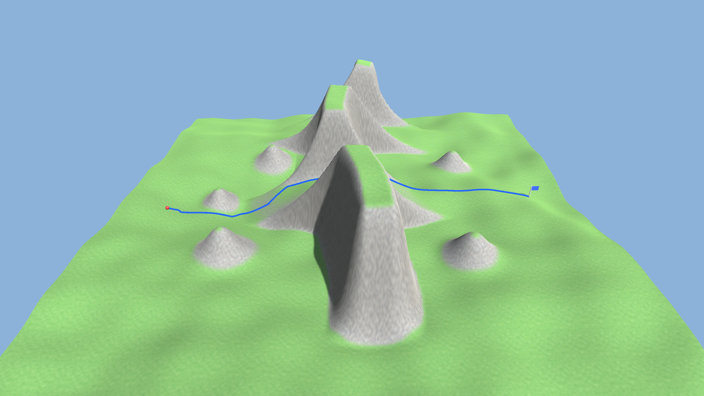

**Maliyet haritası, k = 4 (yeşil → kırmızı, siyah = geçilemez) ve k = 4 yolu**

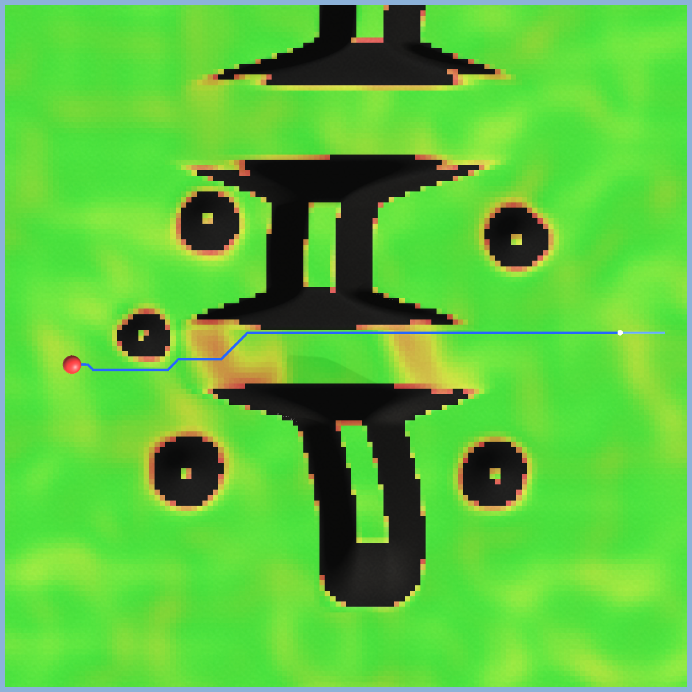

**Aynı harita k = 8'de (renk ölçeği sabit; dik hücreler kızarıyor)**

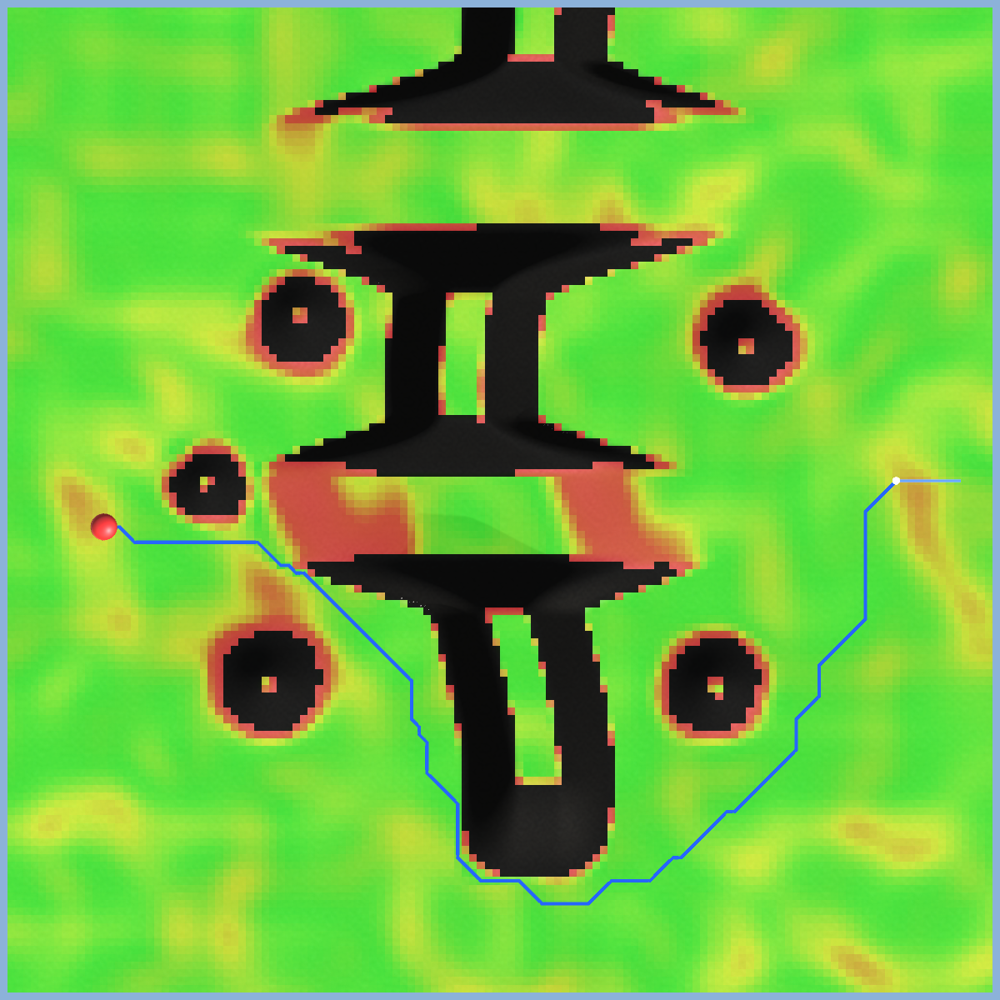

**Deney 1: aynı başlangıç ve hedef, k = 0 (beyaz) ve k = 8 (pembe)**

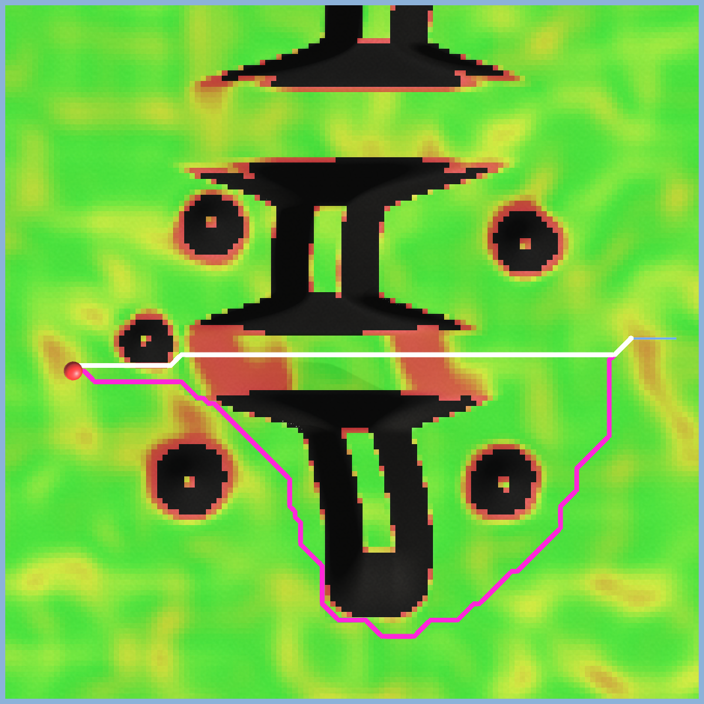

**Deney 1: k = 0 beyaz, k = 2 mavi, k = 8 pembe**


**Aynı yollar perspektiften**

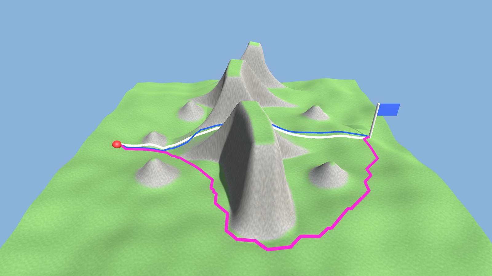

**NPC k = 4 yolunda, boyuna tırmanırken**

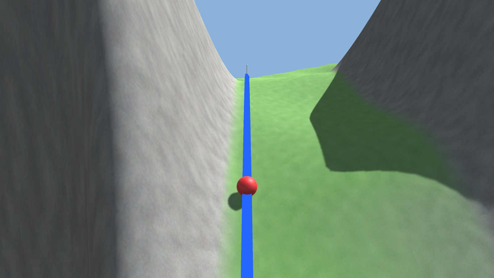

**NPC yolda, maliyet haritası açık**

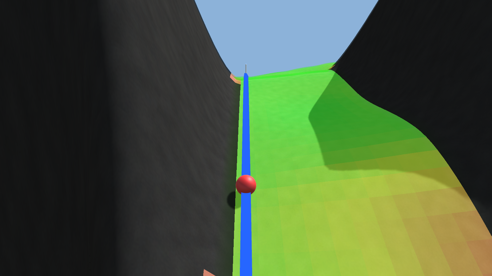

**Ek görev: yol düzeltme (k = 8)**

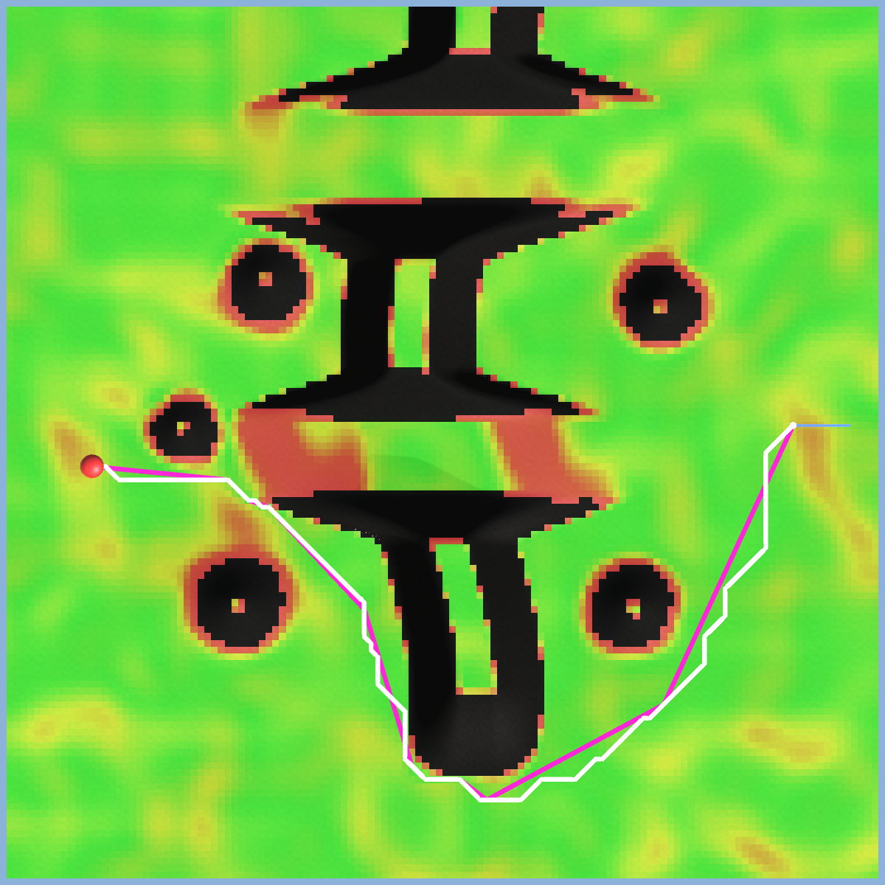

**Ek görev: yokuş yukarı pahalı (k = 4)**

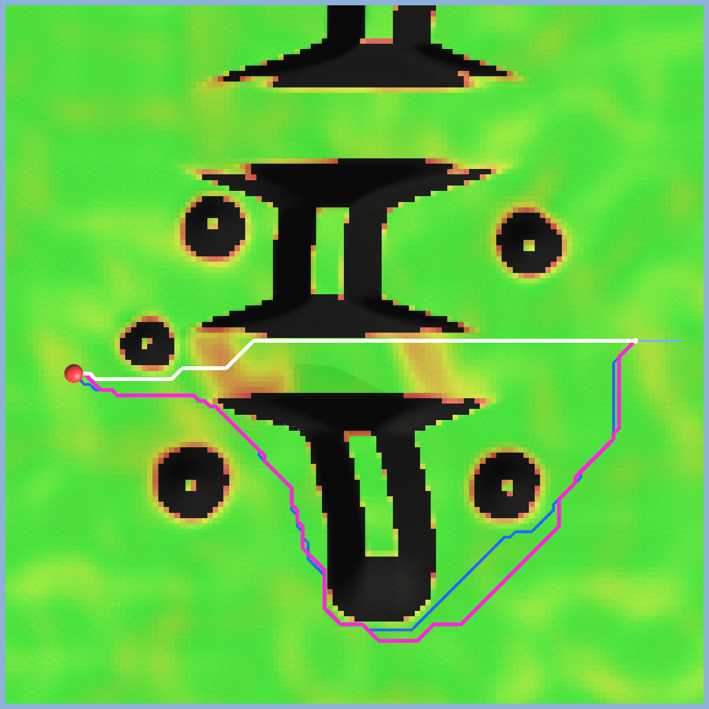

**Çalışan oyundan (player build): HUD eğimi, maliyet çarpanını ve hızı gösteriyor; örneğin 27,9° → ×3,53 → 1,13 m/s**

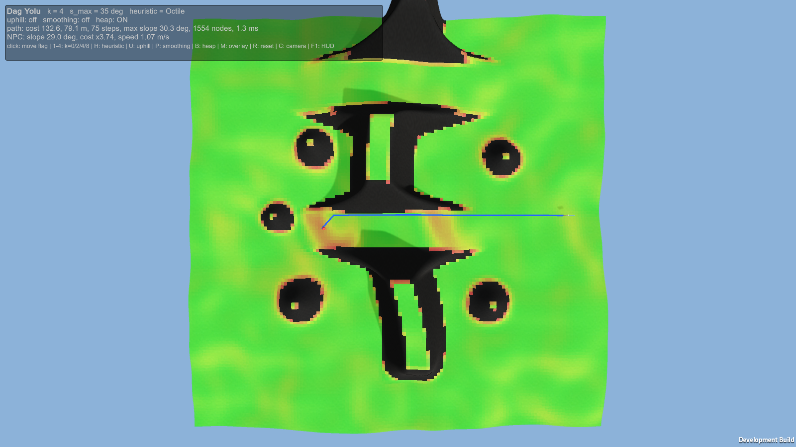

**Çalışan oyundan: takip kamerası**

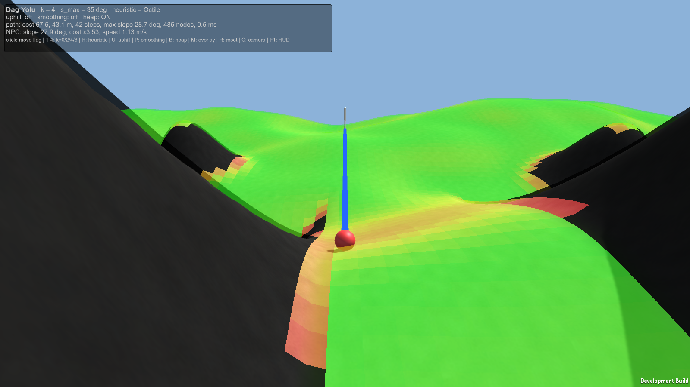

Gizmos görüntüsü toplu (batch) modda yakalanamadığı için resimlerde aynı renk fonksiyonunu (`GridMap.CostColor`) kullanan çalışma zamanı katmanı (`CostMapOverlay`) görünüyor. Editörde `Grid → Draw Cost Map` işaretlenince Gizmos sürümü de Sahne görünümünde çizilir.
