# Week 4 homework: Dağ Yolu (mountain path)

Course: *Dijital Oyunlarda Yapay Zekâ*, week 4 "NavMesh ve A\*", Dr. Öğr. Üyesi Can Meşe.
Due at the start of week 5. You hand in the Git repo, a 1–2 minute video and `RAPOR.md`.

## The assignment in short

A red NPC walks to a flag across the week-3 style hilly terrain. It uses our own grid A\* from the
lecture: `GridMap.cs`, `AStar.cs` and `NpcGridChase.cs`. The cost of each cell comes from the terrain slope:

```
c(s) = 1 + k · (s / s_max)²   if s ≤ s_max
c(s) = ∞                      if s > s_max   (impassable)
```

For example, s = 20°, s_max = 35° and k = 4 give c ≈ 2.306. A diagonal step costs √2 × that, ≈ 3.261.

- TODO 1: `SlopeCost`, with impassable cells above s_max.
- TODO 2: a Gizmos cost map (green → red, black = impassable) and the path drawing.
- TODO 3: 8 neighbours, the no-corner-cutting rule and the octile heuristic.
- TODO 4: the NPC's speed is `speed / cell cost`.
- Deney 1: k = 0, 2 and 8. Compare path length and the steepest slope on the path.
- Deney 2: k = 4, octile vs Manhattan. Which one finds the cheapest path?
- Bonus tasks (+5 each): uphill is expensive, path smoothing, a binary-heap open list. All three are implemented.

The full lecture note (chapter 9, with the official skeleton and report tables) was not available.
This project rebuilds the homework from the week-4 slides and the in-class practice document. It keeps
the teacher's file and class names (`GridMap`, `AStar`, `NpcGridChase`, plus `PathLine`) and the
in-class code structure: the `mode` and `weight` fields, the N-E-S-W neighbour order, and the
"smaller f, then smaller h" tie-break.

## How to open and run

1. Open the folder `yapay-zeka/hafta04-dag-yolu` in **Unity 6.6 (6000.6.8f1)**. It uses the Built-in Render Pipeline and the Input System package.
2. Open `Assets/Scenes/DagYolu.unity` and press **Play**.
3. To regenerate the scene, use the menu **Dag Yolu → Build Scene**. It rebuilds the terrain, the grid, the NPC, the flag, the overlay and the camera.
4. To re-run every experiment, use **Dag Yolu → Run Experiments**. It writes `deney-ciktisi.txt` and logs everything to the Console.
5. To re-render the PNGs in `screenshots/`, use **Dag Yolu → Capture Screenshots**.

Batch mode, without opening the editor:

```
Unity.exe -batchmode -projectPath <path> -executeMethod DagYoluExperiments.BuildRunCapture -quit -logFile build.log
```

## Controls (Play mode)

| Input | Action |
|---|---|
| Left click on terrain | Move the flag there. The NPC re-plans. Impassable cells are refused. |
| 1 / 2 / 3 / 4 | k = 0 / 2 / 4 / 8. The cost overlay repaints and the NPC re-plans. |
| H | Cycle the heuristic: Octile → Manhattan → Euclid → Zero |
| U | Bonus: uphill-expensive on/off |
| P | Bonus: path smoothing on/off |
| B | Bonus: binary heap on/off |
| M | Runtime cost overlay on/off |
| R | NPC back to its start cell |
| C | Top view ↔ chase camera |
| F1 | HUD on/off |

You can also edit everything in the Inspector during Play mode:

- On `Grid` (GridMap): **k**, **s_max**, uphill on/off and its penalty.
- On `NPC` (NpcGridChase): **heuristic**, mode, weight, heap, smoothing and speed.

The HUD shows the live path cost, length, max slope, expanded nodes and search time. It also shows
the NPC's current slope, its cost factor and its speed.

## Scene

- **Terrain**: 128 × 128 m, height 40 m, heightmap 257² (0.5 m samples).
  - Rolling Perlin hills, mostly 0–20°.
  - A north–south ridge with flanks of 60–80°, which are impassable.
  - Two passes through the ridge. The central saddle is short but steep (up to 30°). The northern pass is gentle.
  - In the south the ridge ends, so the NPC can go round it on flat ground.
  - Five rocky knolls with steep sides (black cells).
  - Out of 16,384 cells, 2,458 are steeper than 35°, so the detours really matter.
- **Grid**: 128 × 128 cells of 1 m (the hint says ≤ 150 × 150). The origin is the terrain corner.
- **NPC**: red sphere at cell (12, 60). **Flag**: cell (115, 66).

## Requirement → implementation

| Rubric item (points) | Where |
|---|---|
| TODO 1 – `SlopeCost`, impassable cells (15) | `GridMap.SlopeCost(float slopeDegrees)`. The slope comes from `TerrainData.GetSteepness` in degrees, via `GridMap.SampleSteepness`, called in `Scan()`. Costs are cached in `RecomputeCosts()`, and impassable cells get `+∞`. `IsWalkable`, `Cost` and `StepCost` (length × c(entered cell)) build on it. |
| TODO 2 – Gizmos cost map and path drawing (10) | `GridMap.OnDrawGizmos` draws one cube per cell: green → yellow → red, black = impassable. The colour comes from `GridMap.CostColor` on a fixed scale (`colorMaxCost`), so a bigger k visibly reddens the map. `NpcGridChase.OnDrawGizmos` draws the closed list (grey) and the path (yellow). **Runtime equivalents**, because Gizmos are not visible in the Game view or in screenshots: `CostMapOverlay` is a transparent mesh hugging the terrain, one texel per cell, in the same colours. `PathLine` is a LineRenderer that follows the terrain. |
| TODO 3 – 8 neighbours, no corner cutting, octile (15) | `AStar.Search`: the neighbour loop over `Dirs` (N, E, S, W, then NE, SE, SW, NW). A diagonal step is skipped unless both side cells are walkable. `AStar.H` uses Octile = max + (√2−1)·min, scaled by `cellSize × MinCellCost`. Manhattan, Euclid and Zero are also selectable through the `Heuristic` enum. |
| TODO 4 – speed / cell cost (15) | `NpcGridChase.Tick` sets `CurrentSpeed = speed / grid.MoveCostFactor(...)`. The factor is the cost of the cell the NPC stands on, times the uphill factor when that bonus is on. |
| Deney 1 and Deney 2 tables (20) | `Assets/Editor/DagYoluExperiments.cs` runs them on the real scene. The raw output is in `deney-ciktisi.txt` and the tables are in `RAPOR.md`. |
| Commentary on k and admissibility (15) | `RAPOR.md`, sections 3 and 4. They are backed by an exact h\* check: a reverse Dijkstra from the flag counts the cells where each heuristic overestimates. |
| Code structure, Git history, video (10) | **The video and the Git history are graded.** See "What the student must do" below. |
| Bonus: uphill expensive (+5) | `GridMap.uphillExpensive` and `uphillPenalty`. In `GridMap.StepCost` a climbing step costs × (1 + penalty · rise/run) and downhill steps are unchanged, so the edge cost depends on direction. The NPC also slows down while climbing (`MoveCostFactor`). |
| Bonus: path smoothing (+5) | `PathSmoother.Smooth`, toggled with `NpcGridChase.smoothPath`. It does string pulling with a grid line-of-sight test (Amanatides–Woo traversal, same no-corner-cutting rule). A shortcut is accepted only if it is **not more expensive** than the grid path it replaces, so it never cuts across a slope the cost function avoided. |
| Bonus: binary heap (+5) | `BinaryHeap<T>`: an indexed min-heap with `DecreaseKey`. It is used when `AStar.useBinaryHeap` is on. Ties break on (f, h, insertion order), the same order as the in-class List scan, so both versions return identical paths and node counts. |

Other files:

- `PathStats.cs`: the measured numbers (length, max/mean slope, ascent, cost, nodes).
- `CameraModes.cs`: top view and chase camera.
- `DemoControls.cs`: keys, mouse and HUD.
- `Assets/Editor/DagYoluBuilder.cs`: builds the scene.
- `Assets/Editor/DagYoluScreenshots.cs`: renders the screenshots.

## Results (summary; details in `RAPOR.md`)

| k | path length (m) | max slope (°) | path cost | expanded | steps |
|---|---|---|---|---|---|
| 0 | 109.4 | 33.4 | 105.49 | 225 | 103 |
| 2 | 109.8 | 30.0 | 146.71 | 3225 | 103 |
| 8 | 169.9 | 19.0 | 231.35 | 9237 | 142 |

With k = 4, octile finds the optimal cost 187.108 (6,304 nodes). Manhattan finds 187.205 (4,053 nodes),
so it is **not** the cheapest path. With k = 8 Manhattan is 1.2 % more expensive than optimal.

## Screenshots

| | |
|---|---|
| 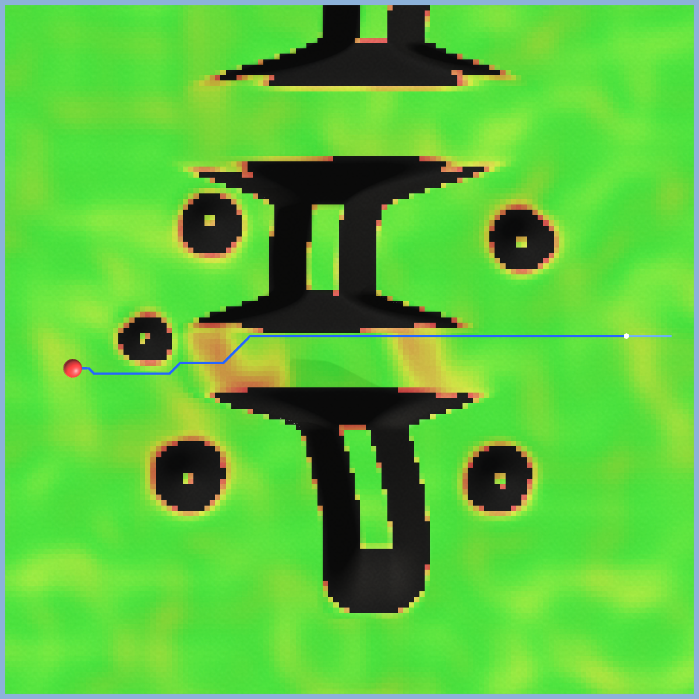 Cost map, k = 4 (green → red, black = s > 35°), with the k = 4 path | 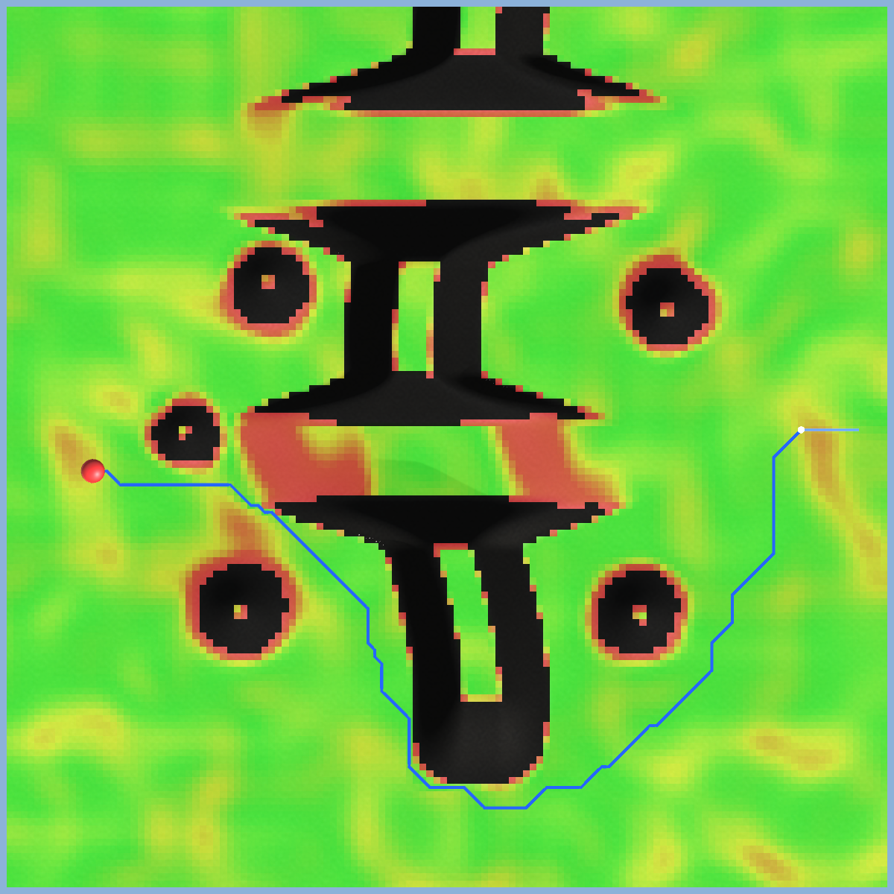 Same map, k = 8 (same colour scale: steep cells cost more) |
| 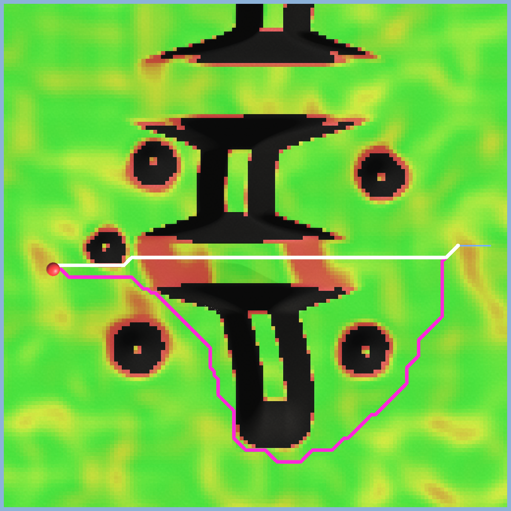 Same start and goal: **k = 0 white** (over the saddle), **k = 8 magenta** (round the south end of the ridge) |  k = 0 white, **k = 2 blue** (shifts away from the steepest cells), k = 8 magenta |
| 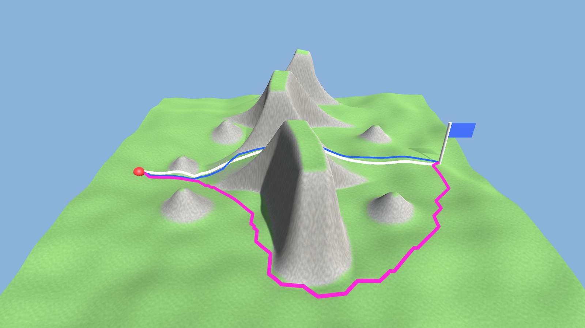 The same paths in perspective | 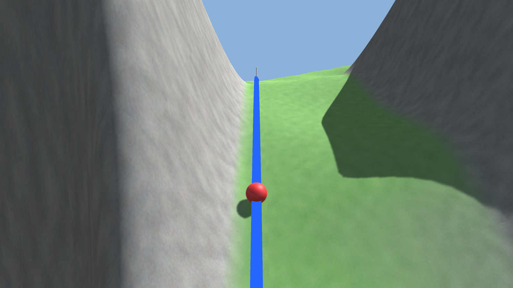 The NPC on its k = 4 path, climbing the saddle |
| 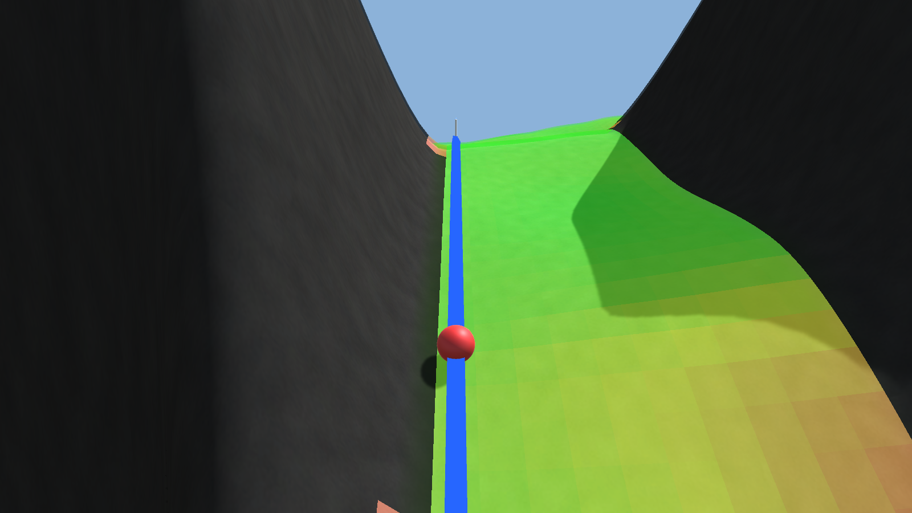 The same, with the runtime cost overlay | 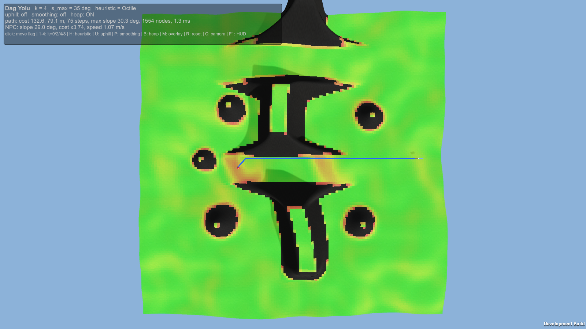 In the running game (player build): overlay, path, HUD |
| 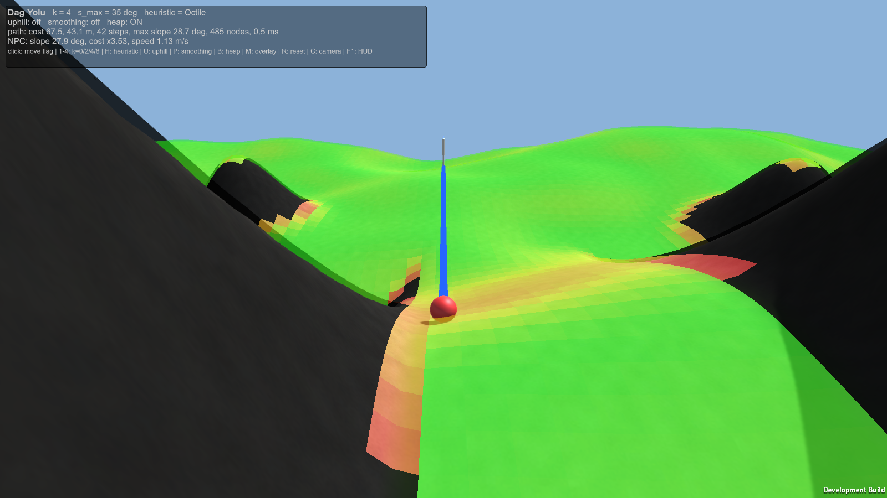 Chase camera in the running game: slope 28°, cost × 3.5, speed 1.1 m/s | 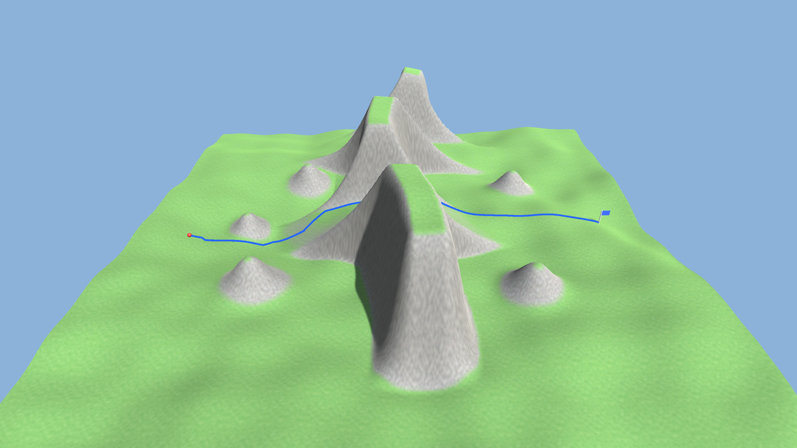 The scene |
| 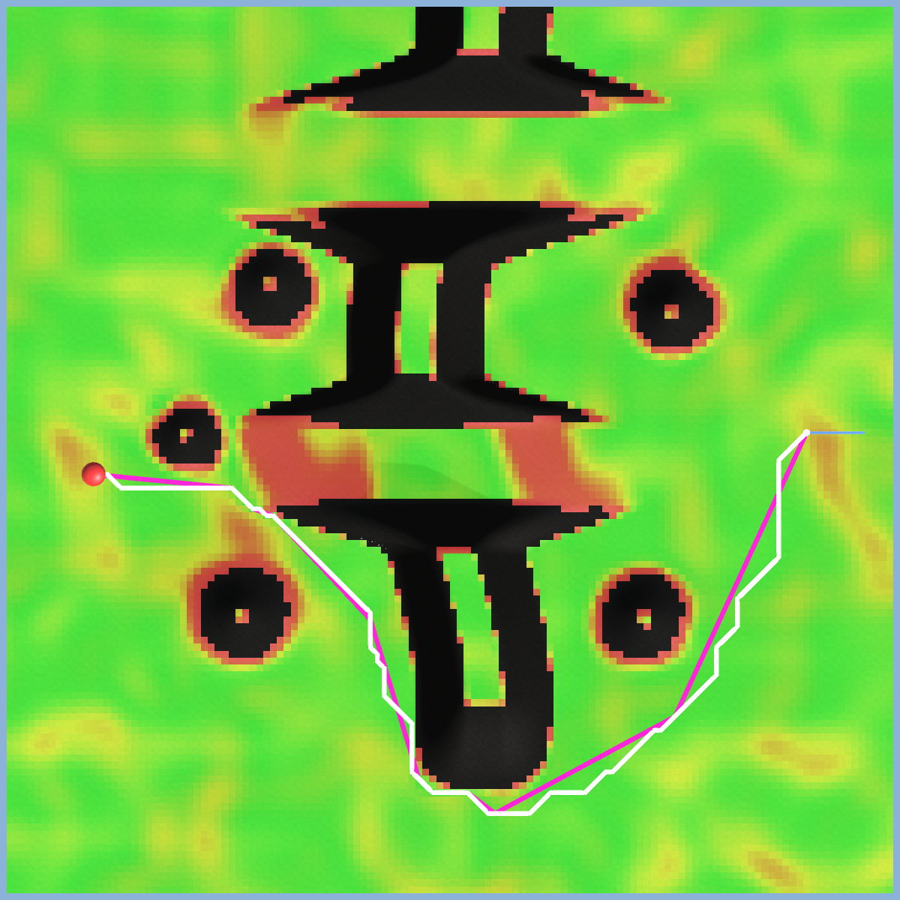 Bonus, smoothing (k = 8): raw grid path white, smoothed magenta | 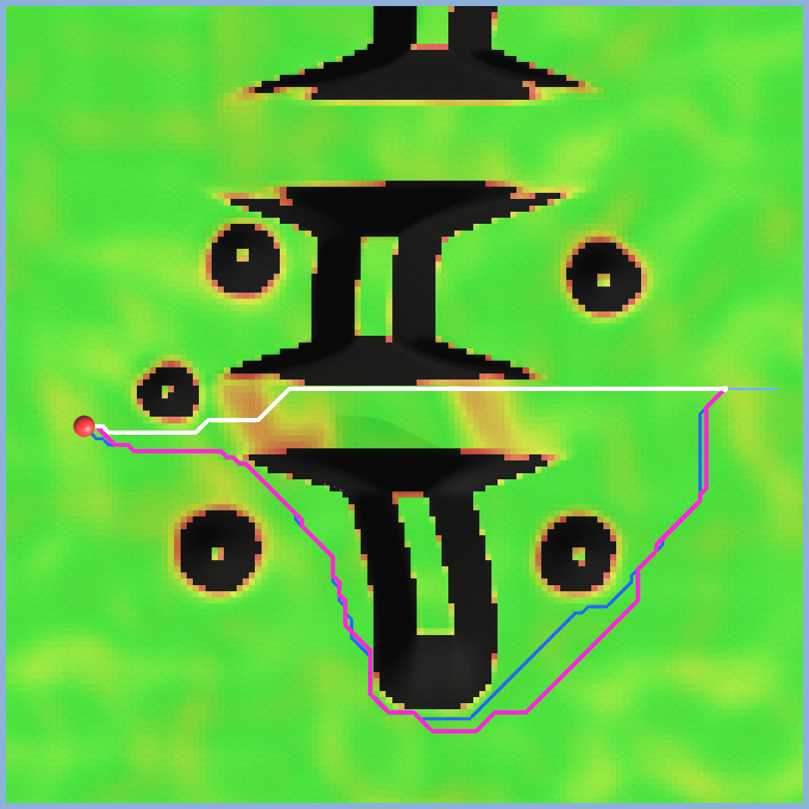 Bonus, uphill (k = 4): uphill off white, on: NPC → flag magenta, flag → NPC blue |

Screenshots 00–05 are rendered by `DagYoluScreenshots`. Screenshots 06–07 come from a temporary
Windows player build with a test harness, which has been deleted. Gizmos cannot be captured in
batch mode, so the images show the runtime overlay. It uses the same `CostColor` function as the
Gizmos, so the colours match.

## How it was verified

- All scripts compile with 0 errors and 0 warnings in Unity 6000.6.8f1.
- `DagYoluExperiments.RunAll` produced every number in `RAPOR.md`. The raw output is in `deney-ciktisi.txt`.
- The TODO 4 walk was simulated with `NpcGridChase.Tick` at dt = 0.02 s. The travel time × base speed equals the path's continuous cost: for example 46.9 s × 4 m/s ≈ 187.7.
- A temporary Windows player build ran the real scene with Update, Input System, HUD and overlay. It logged three PASS results:
  - the NPC reached the flag after 46.9 game-seconds;
  - the speed dropped from 3.97 to 1.00 m/s on a 30° cell;
  - changing k from 4 to 8 at runtime made the NPC re-plan from 103 to 142 steps.

## What the student must do

1. **Video (1–2 min, graded).** Suggested checklist:
   - [ ] Press Play. The top view shows the cost overlay (green/yellow/red/black) and the blue path.
   - [ ] Switch to the Scene view to show the **Gizmos** version (TODO 2; `Grid → Draw Cost Map` is on by default), plus the grey closed list and yellow path gizmos of the NPC.
   - [ ] Show `GridMap.SlopeCost` and say the formula. Mention the 2.306 example and that cells above s_max are black (TODO 1).
   - [ ] Press **C** for the chase camera. Watch the NPC slow down on the saddle: the HUD shows the slope, the cost × and the speed in m/s (TODO 4).
   - [ ] Press **1** (k = 0) and then **4** (k = 8). The path jumps from the saddle to the detour round the ridge (Deney 1).
   - [ ] Press **3** (k = 4) and **H** to switch Octile ↔ Manhattan. The HUD shows a different cost and node count (Deney 2).
   - [ ] Show the 8-neighbour loop and the corner-cutting `if` in `AStar.cs` (TODO 3).
   - [ ] Bonus: **P** (smoothing), **U** (uphill), **B** (heap: the same path, a shorter ms in the HUD).
   - [ ] Click somewhere on the terrain to move the flag. Click a black cell to show that it is refused.
2. **Git history (graded).** Commit in meaningful steps, for example:
   - scene + grid;
   - TODO 1;
   - TODO 2;
   - TODO 3;
   - TODO 4;
   - experiments;
   - bonus tasks;
   - report.

   Do not commit everything in one go.
3. Read `RAPOR.md`, check that the commentary matches your own understanding, and edit it in your own words if needed.
