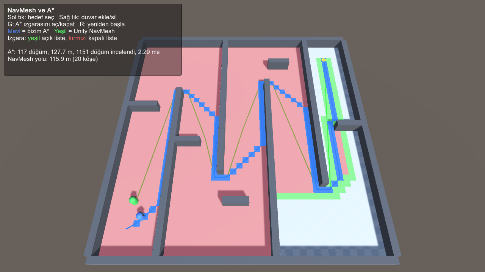

# Week 4 – In-class practice: NavMesh vs A* in a maze

This is the **week-4 in-class practice** of the "Digital Games AI" course
("Hafta 4 — Ders İçi Uygulama: Arazide Labirent ve A*"). In class we find paths in the same maze twice:
first with Unity's built-in **NavMesh**, then with our own **A\***, and compare the two side by side.
Left click gives both agents the same target, right click adds or removes a wall and both agents replan.

The graded week-4 homework ("Dağ Yolu", A* with slope-based cost on the terrain) is a separate project:
**[`../hafta04-dag-yolu`](../hafta04-dag-yolu)**.



## How to open and run

- Unity **6.6 (6000.6.8f1)**, Built-in Render Pipeline, AI Navigation package 2.0.16 (installed from `Packages/manifest.json`).
- Open this folder in Unity Hub, open `Assets/Scenes/NavMesh_AStar.unity` and press **Play**.
- The scene, materials and the baked NavMesh (`Assets/Scenes/AStar_NavMesh.asset`) are generated by
  `Assets/Editor/SceneBuilder.cs`. To regenerate them: menu **Ders > Sahneyi Yeniden Oluştur**, or
  `Unity.exe -batchmode -quit -projectPath . -executeMethod SceneBuilder.BuildAll`.

## Controls

| Input | Action |
|---|---|
| Left click (ground) | Set the target. Blue walks there with our A*, green with the NavMeshAgent. |
| Right click (ground) | Add a 2×2 m wall (`UserWall`). The A* grid is rebuilt, the NavMesh is carved by a `NavMeshObstacle`, both agents replan. |
| Right click (added wall) | Remove that wall. The maze walls themselves cannot be removed. |
| G | Show / hide the A* grid overlay. |
| R | Restart the scene. |

## What the in-class practice asks for and where it is

| In-class goal | Implementation |
|---|---|
| A maze with walls on a separate layer, ground on its own layer (Step 1–2) | `SceneBuilder.BuildAStarScene`, layers `Ground` (6) and `Obstacle` (7) set in `SceneBuilder.SetupTagsAndLayers` |
| Bake a NavMesh for the maze and send an agent to the clicked point (Step 3) | `SceneBuilder.BakeNavMesh` (`NavMeshSurface`), `AStarDemo.SetTarget` → `NavMeshAgent.SetDestination` |
| Show the NavMesh agent's path (Step 4) | `AStarDemo.DrawNavMeshPath` (green line from `NavMeshAgent.path.corners`) |
| Own grid A* with a heap-based open list (Step 5) | `AStarGrid.FindPath`, `Heap.cs` (binary heap), octile heuristic, 8 directions without corner cutting |
| Draw the found path (Step 6) | `AStarDemo.SetTarget` (blue `LineRenderer`) and the grid overlay (`AStarDemo.RefreshOverlay`: open = green, closed = red, path = blue) |
| Walk the character along the path (Step 7) | `AStarDemo.FollowPath` |
| Right click: add / remove a wall, replan (Step 9) | `AStarDemo.ToggleWall`, `AStarDemo.RebuildGrid` → `AStarGrid.CreateGrid` + `SetTarget` again; NavMesh carving with `NavMeshObstacle` |
| Side-by-side comparison (Step 10) | On-screen panel (`AStarDemo.OnGUI`): A* node count, length, expanded nodes, search time vs. NavMesh path length and corner count |

**A\* details:** 40×40 grid of 1 m nodes; a node is blocked if an `Obstacle` collider overlaps it.
`f = g + h`, `h` = octile distance (straight step 10, diagonal 14). The open set is a binary heap, so taking the
lowest-`f` node and inserting are O(log n).

**Differences from the step-by-step class handout:** this is an independent implementation of the same ideas.
The maze is a fixed serpentine on a flat plane (not generated on the week-3 terrain), and the class files
(`MazeGenerator`, `GridPathfinder`, `PathLine`, `PathFollower`, `CameraModes`, DFS/BFS/Dijkstra switching with keys 1–4,
camera toggle with C) are not part of this project. The homework project `../hafta04-dag-yolu` follows the handout's structure.

## Verification (batchmode play test)

A temporary play-mode harness (removed afterwards) clicked the far corner (16.5, 0, 16.5) from the start:
- A*: path found, 117 nodes, 127.7 m, 1151 nodes expanded, 3.54 ms.
- NavMeshAgent: `PathComplete`, 20 corners, 118.0 m (shorter, because the NavMesh cuts corners).
- A wall added on the A* path: the cell became blocked, A* replanned (1169 nodes expanded, 125.2 m) around it,
  the NavMesh path stayed `PathComplete`. Both agents moved (25.5 m and 22.9 m in ~6 s).
- Editor log: 0 compile errors, 0 warnings, 0 missing scripts in the scene.

## Project structure

```
Assets/
  Scripts/Common/  InputHelper (works with both the new and the legacy input handling)
  Scripts/AStar/   AStarGrid, Heap, AStarDemo
  Editor/          SceneBuilder
  Scenes/          NavMesh_AStar.unity, AStar_NavMesh.asset (baked NavMesh)
  Materials/
screenshots/       04-navmesh-vs-astar.png
```

## Manual steps

None required. For a short recording: click a far target, toggle the grid with G to show the open/closed
sets, then right-click to block the corridor in front of the agents and show both of them replanning.
