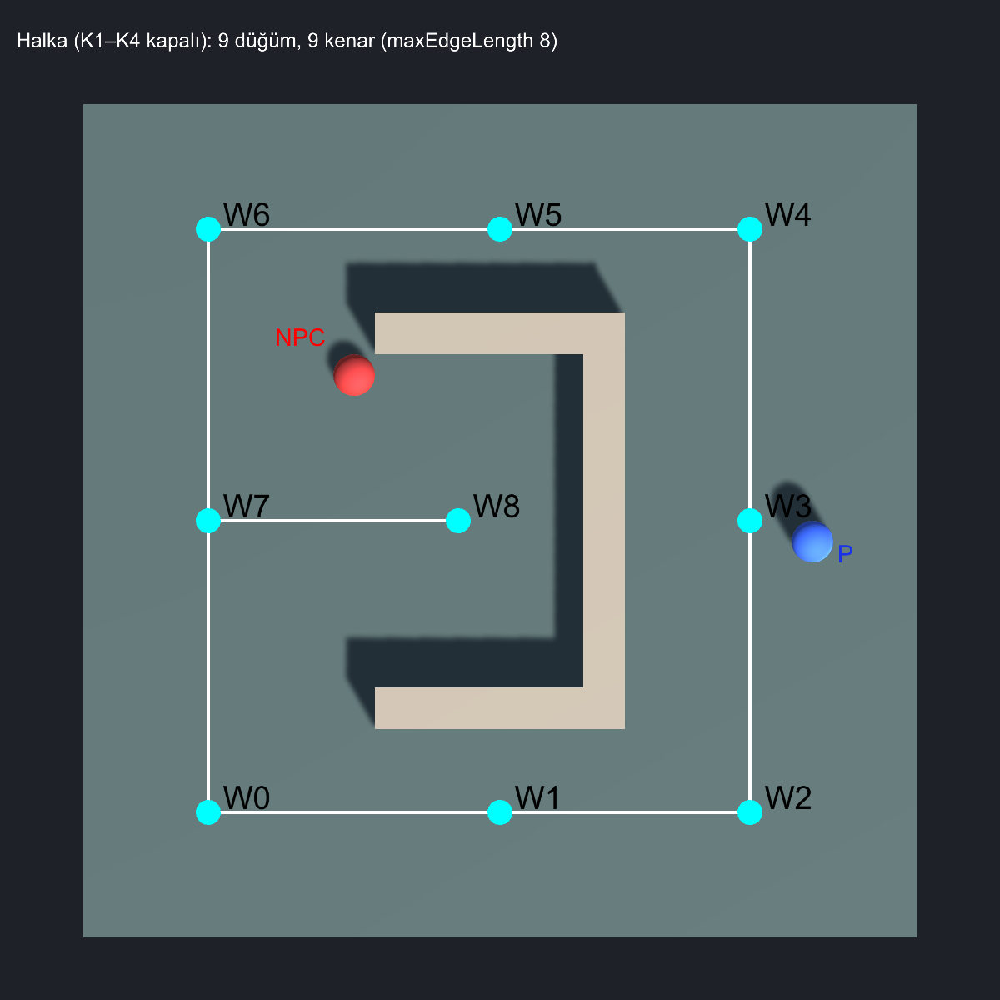
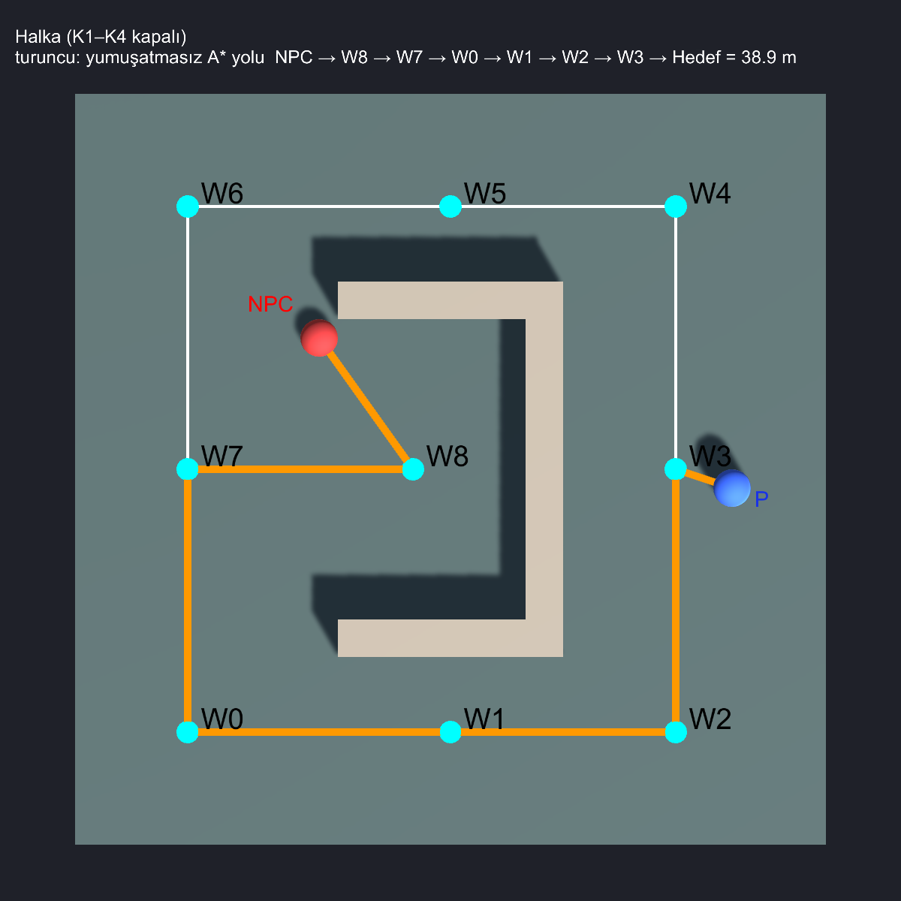
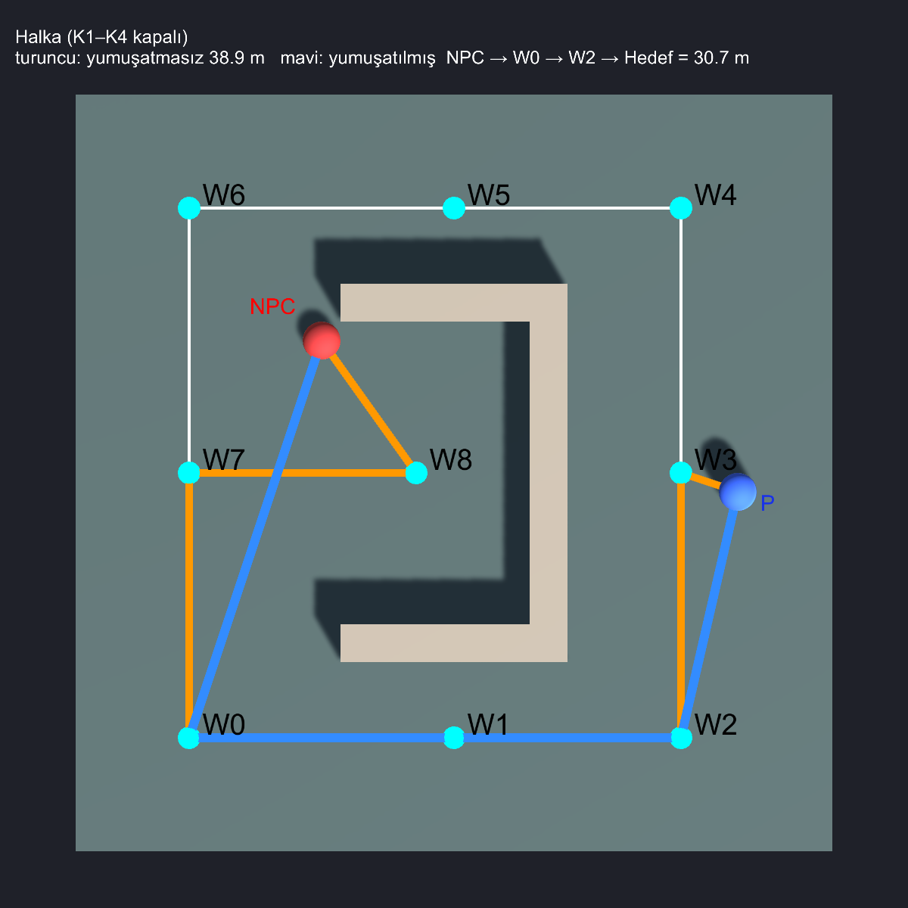
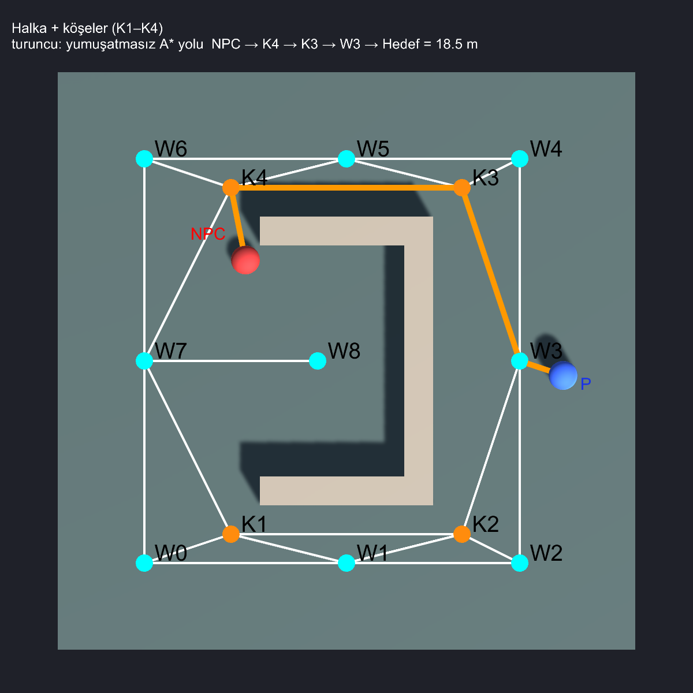
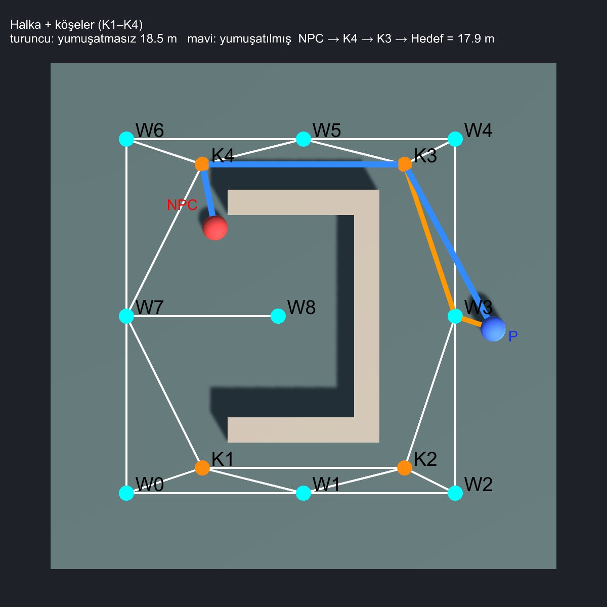

# Hafta 5 Ödevi — Köşe Noktaları (Rapor)

Dijital Oyunlarda Yapay Zekâ · Unity 6.6 · Sahne: `Assets/Scenes/Hafta5.unity`

Bu rapordaki bütün sayılar gerçek çalıştırmalardan alındı. Ham Console çıktıları:

- `results/astar-experiments.txt`: Editörde, batch modunda `Hafta5Builder.RunExperiments` çalıştı. K1–K4 kapatılıp açıldı, ardından derste yazılan `A* Testi` (`WaypointGraph.TestPath`) ve `NpcWaypointGuard.PlanTo` çağrıldı.
- `results/play-mode-runs.txt`: Sahnenin Windows player derlemesinde (Play modu) yapılan çalıştırmalar: A* Testi, devriye sıraları, kovalama.

## 0. Önce derste kurulan sahnenin doğrulanması

Önce ders notundaki sahne kuruldu: U engeli (SirtDuvari, AltKol, UstKol), W0–W8, `Waypoint`, `WaypointGraph`, `GraphAStar` ve `NpcWaypointGuard`. Ardından K1–K4 kapalıyken 9.1'deki A* Testi çalıştırıldı. Sonuç ders notunun verdiği satırla birebir aynı:

```
Kenarları Kur: 9 düğüm, 9 kenar
W8 → W7 → W0 → W1 → W2 → W3 | genişletilen: 8 | uzunluk: 38.9 m
```

Test Heuristic kapatılınca (Dijkstra) yol aynı kalıyor, genişletilen düğüm sayısı 9 oluyor:

```
W8 → W7 → W0 → W1 → W2 → W3 | genişletilen: 9 | uzunluk: 38.9 m
```

Kurulan 9 kenar da 6.2'deki tabloyla aynı: W0–W1, W0–W7, W1–W2, W2–W3, W3–W4, W4–W5, W5–W6, W6–W7, W7–W8. W7'nin komşu listesi `[W0, W6, W8]` sırasında olduğu için 6.3'teki elle izleme adım adım tekrarlanıyor.

## Görev 1 — U'nun köşelerine nokta eklendi

`Waypoints` nesnesinin altına, W8'in arkasına dört boş nesne eklendi ve her birine `Waypoint` bileşeni verildi:

| Nesne | Konum (x, y, z) |
|---|---|
| K1 | (6; 0,5; 4) |
| K2 | (14; 0,5; 4) |
| K3 | (14; 0,5; 16) |
| K4 | (6; 0,5; 16) |

maxEdgeLength 8 olarak bırakıldı. Kenar sayısını Console'a yazmak için `BuildEdges`'in sonuna tek satır eklendi:

```csharp
Debug.Log($"Kenarları Kur: {nodes.Length} düğüm, {nodes.Sum(n => n.neighbors.Count) / 2} kenar");
```

Kenarları Kur çalıştırılınca şu çıktı alındı:

```
Kenarları Kur: 13 düğüm, 23 kenar
```

**Sonuç: 23 kenar oluştu.** Halkanın 9 kenarına 14 yeni kenar eklendi:

W0–K1 3,16 · W1–K1 4,12 · W1–K2 4,12 · W2–K2 2,24 · W3–K2 6,32 · W3–K3 6,32 · W4–K3 2,24 · W5–K3 4,12 · W5–K4 4,12 · W6–K4 3,16 · W7–K1 6,71 · W7–K4 6,71 · K1–K2 8,00 · K3–K4 8,00

- K1–K2 ve K3–K4 tam 8 m uzunlukta. Koşul `dist <= maxEdgeLength` olduğu için bu iki kenar kuruldu.
- W8–K1 ve W8–K4 yalnızca 6,71 m, ama kurulmadı. W8 (9, 10) ile K1 (6, 4) arasındaki doğru, U'nun iç köşesinden, yani (7, 6) noktasından tam geçiyor. K4 tarafında da (7, 14) iç köşesinden geçiyor. `Physics.Linecast` bu teğet geçişi çarpma sayıyor. Bu yüzden W8 hâlâ yalnızca W7'ye bağlı.

Ekran görüntüleri (Gizmos açık görünümünün karşılığı):

| K1–K4 kapalı (9 düğüm, 9 kenar) | K1–K4 açık (13 düğüm, 23 kenar) |
|---|---|
|  |  |

Not: Unity'de Gizmos yalnızca editörün Scene görünümünde çizilir; kamera görüntüsüne ve oyun derlemesine girmez. Bu görüntüler, Gizmos'un çizdiği şeylerin aynısını gerçek geometriyle çizen `GraphVisualizer` bileşeniyle alındı: camgöbeği küre düğüm, beyaz çizgi kenar. Tek fark, K1–K4'ün ayırt edilsin diye turuncu çizilmesi. Kenarların listesi, `Waypoint.OnDrawGizmos`'un çizdiği `neighbors` listesinin aynısı.

## Görev 2 — Ölçüm tablosu

Ölçümde TestBaşlangıç (6,5; 0,5; 13,5) ve TestHedef (17,5; 0,5; 9,5) yerinden oynatılmadı. K1–K4 nesneleri `SetActive(false/true)` ile kapatılıp açıldı; bu, Hierarchy'deki onay kutusunu kaldırmakla aynı işi görüyor. Her durumda A* Testi iki kez çalıştı: önce Test Heuristic açık, sonra kapalı.

| Graf | Düğüm | Kenar | Yol (düğümler) | A* genişletilen | Dijkstra genişletilen | Uzunluk (m) |
|---|---|---|---|---|---|---|
| Halka (K1–K4 kapalı) | 9 | 9 | W8 → W7 → W0 → W1 → W2 → W3 | 8 | 9 | 38,9 |
| Halka + köşeler | 13 | 23 | K4 → K3 → W3 | 4 | 10 | 18,5 |

Console çıktısı (`results/astar-experiments.txt`):

```
=== Halka + köşeler (K1–K4 açık) ===
-- A* Testi (Test Heuristic açık) --
Kenarları Kur: 13 düğüm, 23 kenar
K4 → K3 → W3 | genişletilen: 4 | uzunluk: 18.5 m
-- A* Testi (Test Heuristic kapalı = Dijkstra) --
Kenarları Kur: 13 düğüm, 23 kenar
K4 → K3 → W3 | genişletilen: 10 | uzunluk: 18.5 m
```

Aynı dört ölçüm Play modunda (player derlemesinde, `Awake` kenarları kurduktan sonra) tekrarlandı ve aynı sonuçları verdi (`results/play-mode-runs.txt`, "scenario: astar").

Uzunluğun sağlaması: TestBaşlangıç → K4 = 2,55, K4 → K3 = 8,00, K3 → W3 = 6,32, W3 → TestHedef = 1,58. Toplam 18,45 ≈ 18,5 m.

Başlangıç düğümü de değişti. Köşeler açıkken TestBaşlangıç'a görünen en yakın düğüm artık W8 (4,30 m) değil, K4 (2,55 m). Hedef tarafında en yakın düğüm yine W3 (1,58 m).

9. bölümdeki tablonun tamamlanmış hâli:

| Graf | Düğüm | A* genişletilen | Dijkstra genişletilen | NPC'nin yürüdüğü yol |
|---|---|---|---|---|
| Izgara (4. hafta, ders notundan) | 400 hücre | 71 | 326 | 19 m |
| Waypoint halkası | 9 | 8 | 9 | 38,9 m |
| Waypoint halkası + yumuşatma (7.2) | 9 | 8 | 9 | 30,7 m |
| **Halka + U'nun 4 köşesi (ödev)** | **13** | **4** | **10** | **18,5 m** |
| Halka + köşeler + yumuşatma (ek görev) | 13 | 4 | 10 | 17,9 m |

Izgara satırındaki sayılar ders notundan alındı; bu projede ızgara yeniden ölçülmedi.

## Görev 3 — Gidip gelme (pingPong) modu

Değişiklik `Assets/Scripts/NpcWaypointGuard.cs` dosyasında. TODO'daki tarife göre yazıldı:

```csharp
public bool pingPong = false;   // true: 0 1 2 ... 7 6 5 ... 0 1 ...
int patrolDir = 1;              // +1 forward, -1 backward
...
if (MoveTo(heading.transform.position, patrolSpeed))
{
    if (pingPong && patrolRoute.Length > 1)
    {
        int next = patrolIndex + patrolDir;
        if (next < 0 || next >= patrolRoute.Length) patrolDir = -patrolDir;   // dizinin dışına çıkıyorsa yönü çevir
        patrolIndex += patrolDir;                                            // sonra patrolDir'i ekle
    }
    else
    {
        patrolIndex = (patrolIndex + 1) % patrolRoute.Length;   // döngü modu (değişmedi)
    }
}
```

`patrolRoute.Length > 1` koşulu tek elemanlı bir rotada dizinin dışına çıkmayı önlüyor; bu durumda döngü dalı indeksi 0'da tutuyor.

Test, sahnenin player derlemesinde gerçek `Update` döngüsüyle yapıldı. Hızlandırmak için `Time.timeScale = 8` kullanıldı. Karakter görüş alanının dışına alındı. NPC'nin her varışında `patrolIndex` değeri kaydedildi (`results/play-mode-runs.txt`):

```
[H5] pingpong3 pingPong=True route=[W0, W1, W2]
[H5] visited index order: 0 1 2 1 0 1 2 1 0 1 2 1 0
[H5] expected index order: 0 1 2 1 0 1 2 1 0 1 2 1 0
[H5] PASS pingpong3
```

Döngü modunun bozulmadığını görmek için diğer üç durum da denendi:

```
[H5] loop3 pingPong=False route=[W0, W1, W2]
[H5] visited index order: 0 1 2 0 1 2 0 1 2 0 1 2 0                       → PASS
[H5] loop8 pingPong=False route=[W0, W1, W2, W3, W4, W5, W6, W7]
[H5] visited index order: 0 1 2 3 4 5 6 7 0 1 2 3 4 5 6 7 0 1 2 3 4 5 6 7 → PASS
[H5] pingpong8 pingPong=True route=[W0, W1, W2, W3, W4, W5, W6, W7]
[H5] visited index order: 0 1 2 3 4 5 6 7 6 5 4 3 2 1 0 1 2 3 4 5 6 7 6 5 → PASS
```

Kovalama ve dönüş de Play modunda denendi ("scenario: chase"). NPC karakteri görünce Chase durumuna geçiyor. Karakter U'nun arkasına saklanınca Console'da `A*:` satırları başlıyor. 3 saniye sonra Return, ardından Patrol durumuna dönüyor.

## Görev 4 — Yorum (üç cümle)

1. Görünürlük noktaları fikrinde (4.2) olduğu gibi, K1–K4 en kısa yolun sıyırarak geçtiği U köşelerinin hemen dışında duruyor ve raycast bunları birbirine ve halkaya bağladı. Bu yüzden NPC artık önce W8 ile U'nun içine girip halkanın altından dolaşmıyor; K4 → K3 → W3 üzerinden üst kolu sıyırarak gidiyor ve yol 38,9 m'den 18,5 m'ye kısaldı.
2. Graf büyüdüğü hâlde (9 → 13 düğüm, 9 → 23 kenar) A*'ın genişlettiği düğüm sayısı 8'den 4'e düştü, çünkü artık hedefe kısa ve neredeyse düz bir yol var: Öklid sezgiseli bu yol üzerindeki düğümlere küçük f verdiği için A* yoldaki üç düğümün dışında yalnızca bir düğüm daha açıp hedefe ulaştı; sezgiseli olmayan Dijkstra ise her yöne eşit yayıldığı için 9'dan 10'a çıktı ve aradaki fark, 9. bölümde söylendiği gibi, düğüm sayısı arttıkça büyüyor.
3. 18,5 m'lik yol, ızgaranın 19 m'lik yolundan bile biraz kısa. Ama ızgara bu sonucu 400 hücre ve 71 genişletmeyle buluyordu, köşe noktalı graf ise 13 düğüm ve 4 genişletmeyle buluyor: 4.6 ve 9. bölümdeki kaba/ince graf ödünleşiminde iyi yerleştirilmiş az sayıda düğüm hem hızlı arama hem kısa yol veriyor, yani yol kalitesini düğümün sayısı değil yeri belirliyor.

## Ek görev (+10) — Yol yumuşatma (7.2)

`NpcWaypointGuard.PlanTo`'nun sonuna `SmoothPath()` çağrısı eklendi (`smoothPath` alanı, varsayılan açık). Algoritma şöyle çalışıyor: NPC'nin konumundan başlayıp yolun sonundan geriye doğru görülebilen ilk noktayı (`graph.CanSee`) buluyor, aradaki noktaları `path` listesinden siliyor (`pathNodes` de onunla aynı sırada tutuluyor) ve aynı işi o noktadan devam ettiriyor. Ölçümde NPC TestBaşlangıç'ta, hedef TestHedef'teydi; `PlanTo` doğrudan çağrıldı:

| Graf | Yumuşatmasız (PlanTo) | Yumuşatılmış (PlanTo + SmoothPath) |
|---|---|---|
| Halka | NPC → W8 → W7 → W0 → W1 → W2 → W3 → Hedef = **38,9 m** | NPC → W0 → W2 → Hedef = **30,7 m** (%21 kısa) |
| Halka + köşeler | NPC → K4 → K3 → W3 → Hedef = **18,5 m** | NPC → K4 → K3 → Hedef = **17,9 m** |

Halka satırı, ders notundaki 7.2 tablosuyla birebir aynı (38,9 m → 30,7 m, NPC → W0 → W2 → P).

| | Yumuşatmasız | Yumuşatılmış (mavi) |
|---|---|---|
| Halka |  |  |
| Halka + köşeler |  |  |

Not: Yumuşatma ince bir ışınla (`Physics.Linecast`) yapılıyor. Gövdesi olan bir NPC için 7.2'de anlatıldığı gibi `Physics.SphereCast` daha güvenli olur. Köşe noktaları U'dan yaklaşık 1 m uzakta, NPC'nin yarıçapı ise 0,5 m; bu yüzden bu sahnede sürtünme olmuyor.

## Teslim edilenler

- Doldurulmuş tablo: Görev 2.
- Sahne ekran görüntüleri: `screenshots/01…06` ve genel görünüm `screenshots/00-sahne-genel.png`.
- `Assets/Scripts/NpcWaypointGuard.cs`: pingPong modu ve yumuşatma bu dosyada.
- Üç cümlelik yorum: Görev 4.
