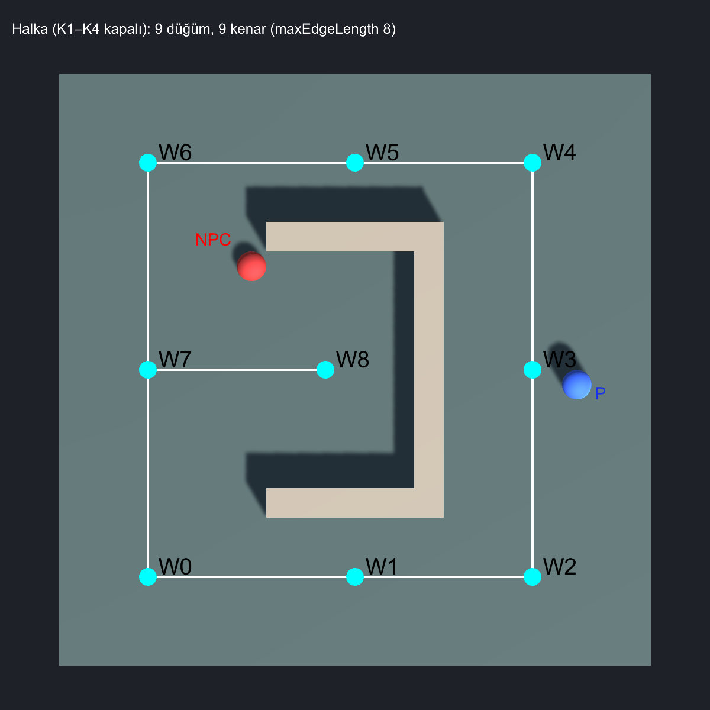
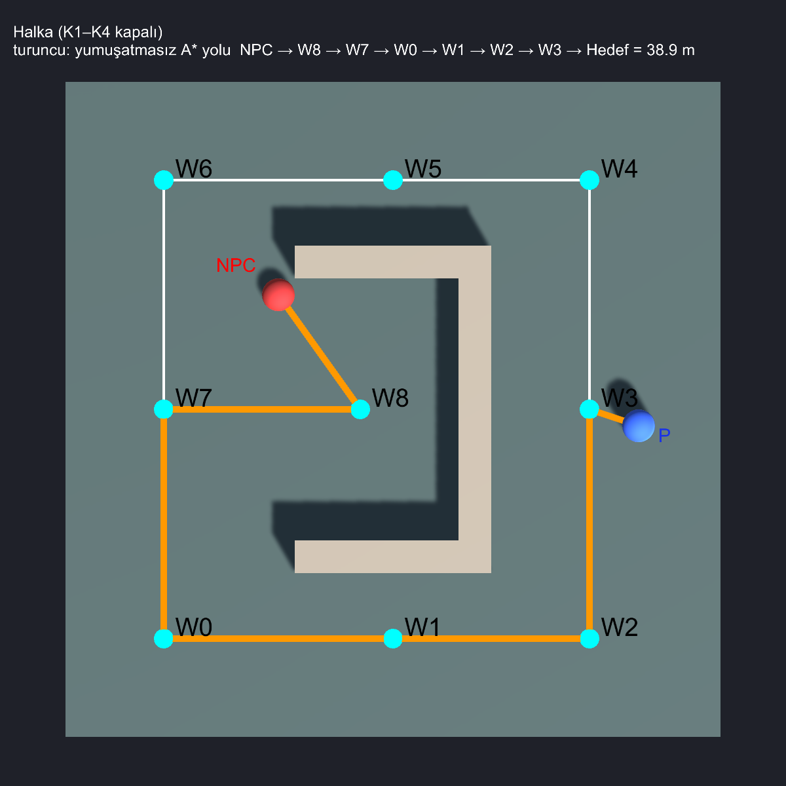
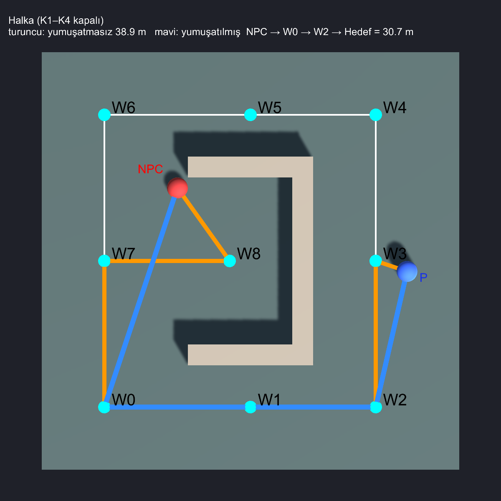
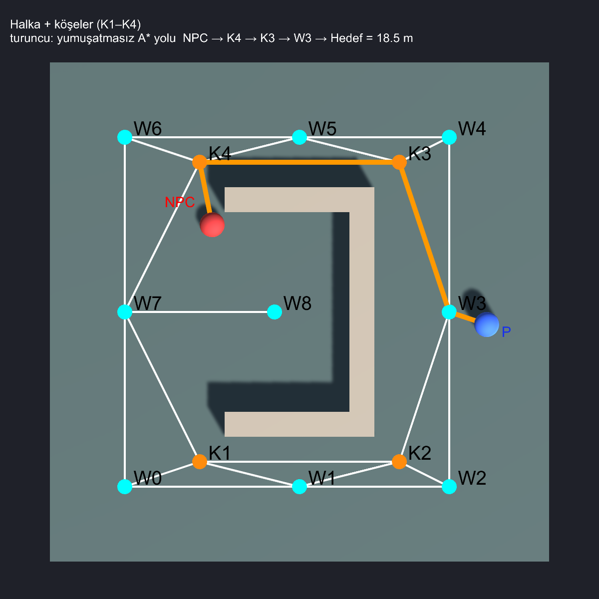
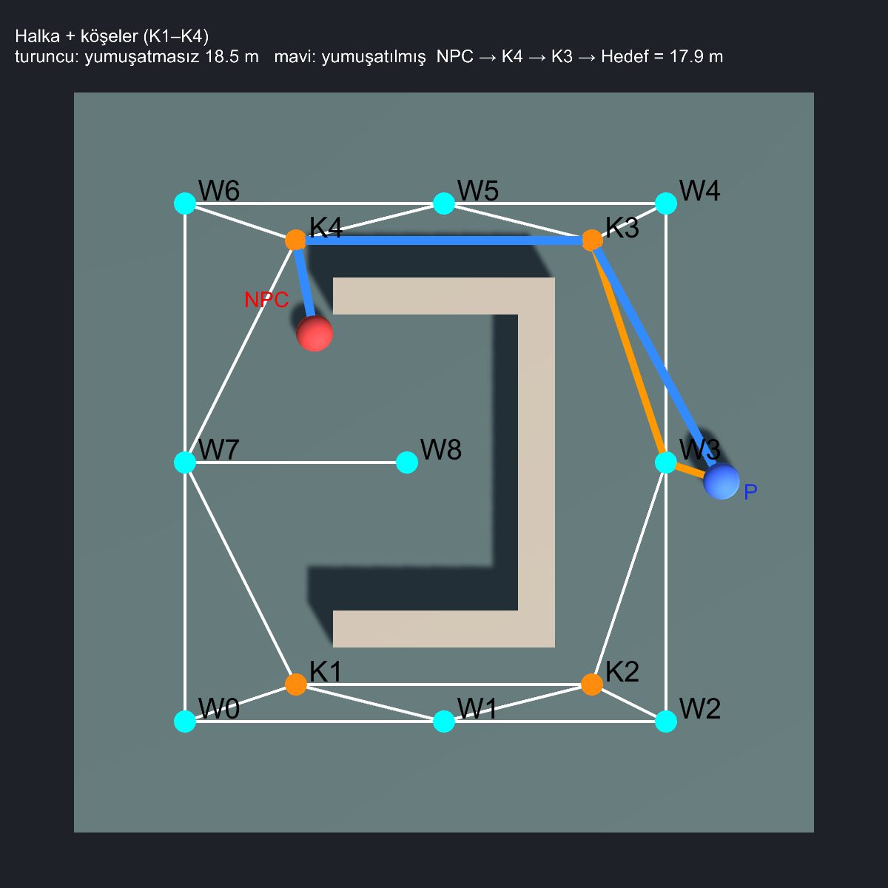

# Week 5: Waypoints and Graphs, homework "Köşe Noktaları" (Corner Points)

This is the homework for the "Dijital Oyunlarda Yapay Zekâ" course, week 5. The in-class Unity build of the waypoint graph is reproduced first, followed by the homework (lecture notes, section 10).

The in-class build includes:

- the `Waypoint` nodes;
- `WaypointGraph`, which builds edges automatically with `Physics.Linecast` and `maxEdgeLength`;
- `GraphAStar`;
- the `NpcWaypointGuard` (patrol, chase, return);
- the "A* Testi" measuring tool from section 9.1.

The homework, in short:

1. **Task 1:** Add four waypoints K1–K4 about 1 m outside the outer corners of the U obstacle. Keep `maxEdgeLength = 8`, rebuild the edges and report the edge count.
2. **Task 2:** Use "A* Testi" to fill the table "ring vs. ring + corners": nodes, edges, path, A* expanded, Dijkstra expanded, length.
3. **Task 3:** Add a `pingPong` patrol mode to `NpcWaypointGuard` (0 1 2 1 0 1 2 …) without breaking the loop mode.
4. **Task 4:** Write a three-sentence comment (in Turkish) on why the path got shorter, how the expanded count changed, and how the result compares with the 19 m grid path.
5. **Bonus (+10):** Add the section 7.2 path smoothing at the end of `PlanTo`, and compare before/after images.

The filled table, console outputs, comment and bonus results are in **[RAPOR.md](RAPOR.md)** (Turkish, for the teacher).

## Results

| Graph | Nodes | Edges | Path | A* expanded | Dijkstra expanded | Length |
|---|---|---|---|---|---|---|
| Ring (K1–K4 off) | 9 | 9 | W8 → W7 → W0 → W1 → W2 → W3 | 8 | 9 | 38.9 m |
| Ring + corners | 13 | 23 | K4 → K3 → W3 | 4 | 10 | 18.5 m |

The baseline row reproduces the lecture notes exactly. Smoothing (bonus) shortens the guard's path:

- ring: 38.9 m → 30.7 m (NPC → W0 → W2 → P, as in the notes);
- ring + corners: 18.5 m → 17.9 m.

## How to open and run

1. Open the folder `hafta05-kose-noktalari` with **Unity 6.6 (6000.6.8f1)**. It uses the Built-in Render Pipeline and the Input System package 1.20.1.
2. Open `Assets/Scenes/Hafta5.unity` and press **Play**.
   - The red NPC patrols W0…W7.
   - Walk the blue player in front of it and it chases (red path).
   - Hide behind the U and the console prints `A*:` lines while the path goes around the U.
   - After 3 s out of sight it returns (yellow) to the nearest patrol point.
3. Run the measuring tool on the `Waypoints` object: open the component's ⋮ menu, then choose **Kenarları Kur** or **A* Testi**. Toggle `Test Heuristic` for Dijkstra, and untick K1–K4 in the Hierarchy for the "ring" row.
4. Use the editor menu **Hafta 5**:
   - **Build Scene** rebuilds `Hafta5.unity` from code. It overwrites the scene.
   - **Run A\* Experiments (K1-K4 off and on)** produces the task 2 table in batch and writes `results/astar-experiments.txt`.
   - **Capture Screenshots** writes `screenshots/*.png`.

Command line (batch):

```
Unity.exe -batchmode -projectPath <this folder> -executeMethod Hafta5Builder.BatchAll -quit -logFile <log>
```

### Controls

| Key | Action |
|---|---|
| WASD / arrow keys / gamepad left stick | Move the player (blue capsule) |

## Requirement → implementation

| Requirement | Where |
|---|---|
| Waypoint node with adjacency list and Gizmos | `Assets/Scripts/Waypoint.cs` (teacher's code) |
| Automatic edges (line of sight + `maxEdgeLength`), `Nearest`, "Kenarları Kur" | `Assets/Scripts/WaypointGraph.cs` → `BuildEdges`, `CanSee`, `Nearest` |
| A* on the graph (Euclidean h, `useHeuristic = false` → Dijkstra) | `Assets/Scripts/GraphAStar.cs` (teacher's code) |
| Section 9.1 "A* Testi" (Test From / Test To / Test Heuristic) | `WaypointGraph.TestPath` |
| Guard: patrol / chase / return, `heading`, `PlanTo` | `Assets/Scripts/NpcWaypointGuard.cs` |
| Scene: 20 × 20 area, U obstacle on the `Obstacle` layer, W0–W8, NPC at (6.5, 0.5, 13.5), TestBaşlangıç / TestHedef | `Assets/Editor/Hafta5Builder.cs` → `BuildScene` → `Assets/Scenes/Hafta5.unity` |
| Task 1: K1–K4 under `Waypoints`, after W8 | `Hafta5Builder.CornerPoints` / `BuildScene` |
| Task 1: edge count printed at the end of `BuildEdges` | `WaypointGraph.BuildEdges` (last line) |
| Task 2: table from real runs, K1–K4 toggled in batch | `Hafta5Builder.RunExperiments` → `results/astar-experiments.txt`, `RAPOR.md` |
| Task 3: `pingPong` + `patrolDir`, loop mode unchanged | `NpcWaypointGuard.Update` (Patrol branch) |
| Task 4: three-sentence comment | `RAPOR.md`, Görev 4 |
| Bonus: path smoothing at the end of `PlanTo` | `NpcWaypointGuard.SmoothPath` (`smoothPath` toggle) |
| "Gizmos on" images (runtime stand-in) | `Assets/Scripts/GraphVisualizer.cs`, `Hafta5Builder.CaptureScreenshots` |
| Player movement (week 4, unchanged) | `Assets/Scripts/PlayerMove.cs` |

## Screenshots

| Ring (9 nodes, 9 edges) | Ring + corners (13 nodes, 23 edges) |
|---|---|
|  |  |
| Ring path, unsmoothed 38.9 m | Ring path, smoothed 30.7 m (blue) |
|  |  |
| Ring + corners, unsmoothed 18.5 m | Ring + corners, smoothed 17.9 m (blue) |
|  |  |

`screenshots/00-sahne-genel.png` is the Game view from the scene's Main Camera.

**About "Gizmos on":** Unity draws Gizmos only in the editor's Scene view, or in the Game view with the Gizmos button on. They never appear in camera captures or builds. The images were therefore rendered with `GraphVisualizer`, a small runtime component that draws the same information with real geometry:

- each node as a cyan sphere, with the corner points K1–K4 in orange;
- each `neighbors` edge as a white line;
- the guard's remaining path in green, red or yellow, by state.

In the comparison images, the A* path is orange and the smoothed path is blue. The same visualizer also runs in Play mode, so the graph is visible in the Game view without turning Gizmos on.

## Verification

All results come from real runs.

- **Editor batch** (`results/astar-experiments.txt`):
  - A* Testi with K1–K4 off and on, with Test Heuristic on and off;
  - the edge list and neighbour order;
  - `NpcWaypointGuard.PlanTo` with smoothing off and on.
- **Play mode** (`results/play-mode-runs.txt`): a temporary Windows player build of this scene with a test harness, deleted afterwards.
  - A* Testi in Play mode gives the same four results.
  - Patrol order with route W0, W1, W2 and `pingPong = true`: `0 1 2 1 0 1 2 1 0 1 2 1 0` (PASS).
  - Loop mode is unchanged: `0 1 2 0 1 2 …` and `0 1 … 7 0 1 …` (PASS).
  - Ping-pong over W0…W7 gives `0 1 … 7 6 … 0 1 …` (PASS).
  - The chase → A* → return → patrol cycle works.
- The scripts compile with 0 errors and 0 warnings.

## Notes and deviations

- **Standalone project.** The scene rebuilds the week 4 layout (week 4 slide 9) with `Alan` at the world origin on a flat 20 × 20 plane.
  - The week 4 NavMesh agent, `NpcNavChase` and `NpcGridChase` are not included. The week 5 notes say to disable them, and nothing else uses them.
  - The "19 m / 71 / 326" grid numbers in RAPOR.md are quoted from the lecture notes. They were not re-measured here.
- **Player input.** `PlayerMove` uses the project-wide `Move` action when one is assigned. This project has no project-wide actions asset, so it builds the same Move action (WASD, arrows, gamepad stick) in code.
- **Edges W8–K1 and W8–K4 are not built.** They are 6.71 m long, but the line passes exactly through the U's inner corners at (7, 6) and (7, 14). `Physics.Linecast` counts that as a hit, so W8 stays connected only to W7.
- **Fields added to `NpcWaypointGuard`.** Besides `pingPong`, `patrolDir` and `smoothPath`, it has three read-only properties (`CurrentPath`, `CurrentPathIndex`, `CurrentState`). They are used only by the visualizer. The teacher's logic is otherwise unchanged.
- **Thin ray.** Smoothing uses the teacher's thin `Linecast`. A body-sized `SphereCast` would be safer (section 7.2), but the corner points are about 1 m away from the walls and the NPC radius is 0.5 m.

## Manual steps for the student

- If a real Scene-view "Gizmos on" screenshot is required, take one: open `Hafta5.unity`, choose **Kenarları Kur** in the Waypoints ⋮ menu, and capture the Scene view with Gizmos on. Do this once with K1–K4 unticked and once with them ticked.
- To show the ping-pong test live: on `NPC` → `NpcWaypointGuard`, set Patrol Route size to 3 (W0, W1, W2) and tick **Ping Pong**. The scene is saved with the 8-point loop route.
- To record a video (optional, 1–2 min), show:
  1. the patrol;
  2. a chase in a straight line;
  3. hiding behind the U, so the `A*:` console lines appear and the path goes around the U through K4/K3;
  4. losing the NPC, which then returns;
  5. A* Testi with K1–K4 on and off;
  6. ping-pong with three points.
