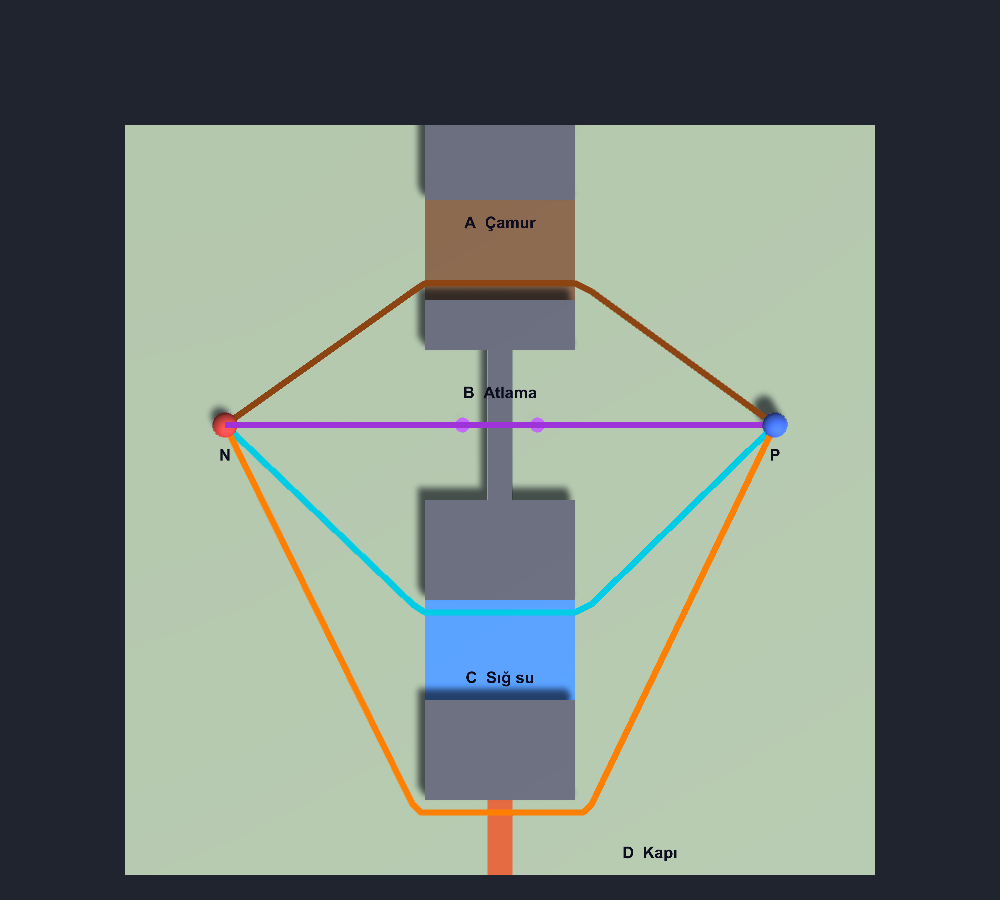
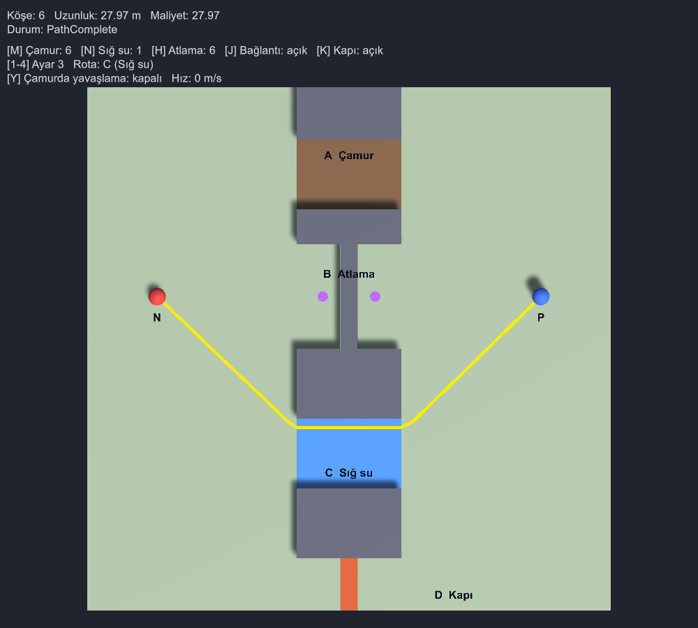
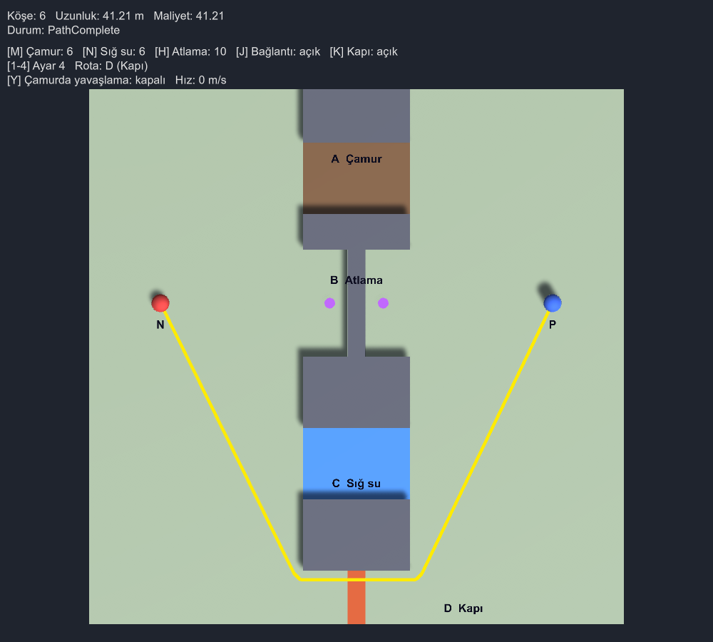
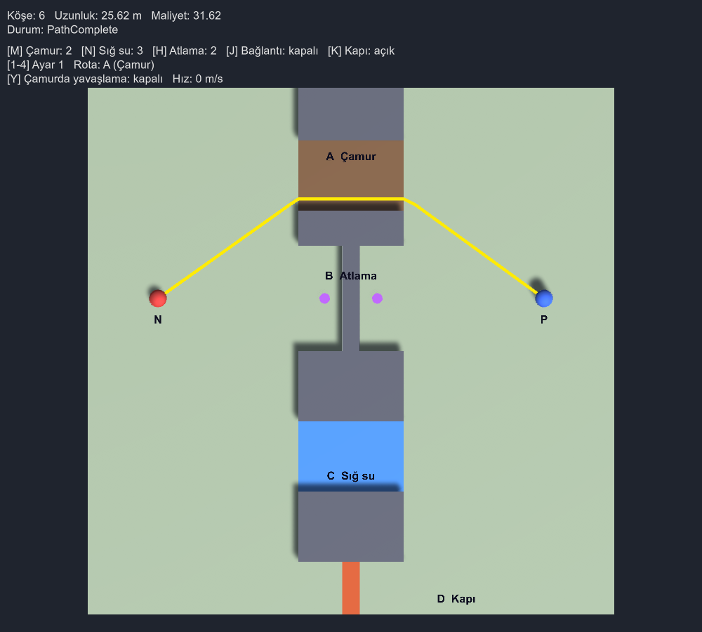

# Week 6 homework: "Kestirme mi, Güvenli Yol mu?" (Shortcut or safe road?)

Course: **Dijital Oyunlarda Yapay Zekâ**, week 6, *Navigasyon Ağları (NavMesh)*. Unity 6.6 (6000.6.8f1), Built-in Render Pipeline, AI Navigation 2.0.16, Input System 1.20.1.

**Report (Turkish, 2 pages): [`RAPOR.pdf`](RAPOR.pdf)**. Its source is [`RAPOR.html`](RAPOR.html).

## The assignment

Section 13 of the week 6 notes asks for the following:

- Redesign the in-class level with your own layout. The NPC needs **at least two different routes** to the character. The level must contain:
  - **two custom area types**, each marked with a `NavMeshModifierVolume`;
  - **one `NavMeshLink`** that the NPC crosses with `JumpLinkTraverser`;
  - **one moving obstacle**: a `NavMeshObstacle` with Carve on (`SlidingDoor`).
- Write a short report (PDF) with:
  - a top-down screenshot with the routes drawn on it and lettered;
  - a hand-estimated cost for each route, in the style of section 5.2;
  - **three cost settings** in a table. For each one: the estimate, the route Unity chose (screenshot of the yellow path) and the cost shown on screen;
  - in at least one setting the route must change, with the threshold cost computed by hand (like "c > 2,03");
  - one paragraph on which setting would look "smartest" to a player.
- Bonus: make the NPC really slow down in mud using `NavMesh.SamplePosition` and the area index, then compare the time it takes to reach the character with and without the slowdown.

Code is not graded, but the project has to work.

## Level layout



The ground is 30 × 30 m. A 1 m high barrier at x = 12..18 separates the NPC (N, red sphere, at (4, 18)) from the character (P, blue capsule, at (26, 18)). There are four ways through it:

| Route | Passage | What makes it special | Length (Unity) |
|---|---|---|---|
| **A** Çamur | top corridor, z 23..27 | 6 m of **Camur** area (NavMeshModifierVolume, User 3) | 25.62 m |
| **B** Atlama | 1 m thin wall at z 15..21 | **NavMeshLink** (13.5, 18) -> (16.5, 18), area Jump, bidirectional, crossed with `JumpLinkTraverser` | 22.00 m |
| **C** Sığ su | corridor z 7..11 | 6 m of **SigSu** area (NavMeshModifierVolume, User 4) | 27.97 m |
| **D** Kapı | bottom corridor z 0..3 | **SlidingDoor** + carving `NavMeshObstacle`. The "safe" road: no special area, but the longest | 41.21 m |

## How to open and run

1. Open the folder in Unity Hub with **Unity 6000.6.8f1**.
2. Open `Assets/Scenes/Hafta6.unity` and press **Play**. The NavMesh is already baked (`Assets/Scenes/Hafta6_NavMesh.asset`). The scene is in Build Settings.
3. The camera is a top-down orthographic view. The yellow line is the NPC's path. The panels in the top-left corner show the corner count, length, cost, path status, the current costs and the route letter.

To rebuild everything from code, use the **Hafta6 > Build Scene** menu item (`Hafta6SceneBuilder.Build`). It creates the scene, materials and input actions and bakes the NavMesh.

## Controls

| Key | Action |
|---|---|
| WASD / arrow keys | move the character |
| **1 / 2 / 3 / 4** | apply report setting 1–4 (Camur / SigSu / Jump costs) |
| M | cycle the Camur cost: 1, 2, 5, 10 |
| N | cycle the SigSu cost: 1, 2, 3, 5, 10 |
| H | cycle the Jump cost: 2, 4, 6, 10 |
| J | turn the jump link on/off |
| K | open/close the door |
| Y | turn the mud slowdown (bonus) on/off |

Tip from the lab (section 12): set the NPC's NavMeshAgent **Speed** to 0 to read the full path length and cost before the NPC starts walking.

## Requirements and where they are implemented

| Requirement / rubric item | Where |
|---|---|
| Own layout, ≥ 2 routes (4 here: A, B, C, D) | `Assets/Editor/Hafta6SceneBuilder.cs` (layout constants and comments), `Assets/Scenes/Hafta6.unity` |
| Two custom areas with NavMeshModifierVolume | `ProjectSettings/NavMeshAreas.asset` (User 3 `Camur`, User 4 `SigSu`); scene objects `Alan/Camur` and `Alan/SigSu` |
| NavMeshLink crossed with JumpLinkTraverser | `Alan/AtlamaBaglantisi`; `Assets/Scripts/JumpLinkTraverser.cs` |
| Moving obstacle, NavMeshObstacle with Carve | `Alan/Kapi` (Carve, Carve Only Stationary, Time To Stationary 0.5, NavMeshModifier "Remove object"); `Assets/Scripts/SlidingDoor.cs` |
| In-class scripts (section 11), rebuilt from the notes | `NpcNavChase.cs`, `PathDebugDraw.cs`, `SlidingDoor.cs`, `JumpLinkTraverser.cs`, `AreaCostToggle.cs` (extended with SigSu, Jump and presets), plus `PlayerMove.cs` |
| Hand cost per route (section 5.2 style) | `RAPOR.pdf` section 2 |
| Route lengths read from Unity | `Assets/Editor/RouteCostReport.cs` (menu **Hafta6 > Route Cost Report**) -> `rapor/kanit/editor-rota-hesabi.txt` |
| Three settings: estimate, Unity route, screenshot, on-screen cost | `RAPOR.pdf` section 3; `screenshots/ayar1..4.png`; values in `rapor/kanit/oyun-olcumleri.txt` |
| Threshold where the route changes | `RAPOR.pdf` section 4 (j > 4.21 by hand; Unity switches between 4.30 and 4.35), sweeps in `editor-rota-hesabi.txt` |
| "Smartest" paragraph | `RAPOR.pdf` section 5 |
| Bonus: half speed in mud, timed | `Assets/Scripts/MudSlowdown.cs`; `RAPOR.pdf` section 6 |

## Results (measured)

| Setting | Camur | SigSu | Jump | Hand estimate | Unity's route | On-screen length | On-screen cost |
|---|---|---|---|---|---|---|---|
| 1 | 2 | 3 | 2 | B (25.00) | **B** | 22.00 m | 25.00 |
| 2 | 2 | 3 | 6 | A (31.62) | **A** | 25.62 m | 31.62 |
| 3 | 6 | 1 | 6 | C (27.97) | **C** | 27.97 m | 27.97 |
| 4 | 6 | 6 | 10 | D (41.21) | **D** | 41.21 m | 41.21 |

Going from setting 1 to setting 2 changes only the Jump cost, and the route changes from B to A. By hand the switch should happen at 19.00 + 3j > 31.62, so j > 4.21. In the sweep Unity switches between 4.30 and 4.35.

Dynamic checks from the player run:

- Door closed in setting 4: route D -> B, 1.55 s after the key press.
- Link off in setting 1: route B -> A.
- The NPC jumps the wall and reaches the character in 5.64 s.

| Screens | |
|---|---|
|  |  |
|  |  |
|  |  |

## Bonus: slowing down in mud

`MudSlowdown.cs` samples the area under the agent every frame with `NavMesh.SamplePosition` and `PathDebugDraw.AreaIndex`. In `Camur` it halves `agent.speed` and restores it when the NPC leaves the mud. Measured in setting 2 (route A, 6 m of mud, 3.5 m/s), two runs per condition:

| Slowdown | Time in mud | Time to reach the character |
|---|---|---|
| off | 1.74 s | 7.30 s |
| on (× 0.5) | 3.33 s | 8.96 s (+1.66 s; expected +1.71 s) |

## How the numbers were produced

- `RouteCostReport.Run` (editor, batch mode) opens the baked scene and sets the costs with `NavMesh.SetAreaCost`. It calls `NavMesh.CalculatePath` and measures the path with the same sampling as `PathDebugDraw`. It also sweeps each cost from 1 to 15 in 0.05 steps to find where Unity's route switches.
  - Command: `Unity.exe -batchmode -projectPath <this folder> -executeMethod RouteCostReport.Run -quit`
- `Assets/Scripts/Dev/ReportCapture.cs` is a harness that only runs when the player is started with `-reportCapture`. It applies the settings, reads what PathDebugDraw shows on screen and takes the screenshots (`ScreenCapture`, so the OnGUI panels are included). It also tests the door and the link and times the runs.
  - Build it with `-executeMethod ReportBuild.Build -buildOutput <folder>`.
  - Run it with `Hafta6.exe -reportCapture -reportOut <folder> -screen-width 1000 -screen-height 900 -screen-fullscreen 0`.
- The PDF is printed from `RAPOR.html` with headless Edge (`msedge --headless --print-to-pdf`).

## Notes

- The overview image (`genel-rotalar.png`) draws each route's real NavMesh path in its own colour. The paths come from `NavMesh.CalculatePath` with a query filter that makes every other passage expensive.
- The NPC's NavMeshAgent is saved disabled. `NpcNavChase.Awake` enables it after the NavMeshSurface has loaded its data, which avoids the "Failed to create agent" message on the first frame.
- The door's NavMeshObstacle is saved disabled because the door starts open (`SlidingDoor.Awake` sets it anyway). This stops edit-mode carving from cutting the corridor in the Scene view.

## Manual steps for the student

- None are required: the scene opens ready to Play, and the report and screenshots are in place.
- Optionally, add your student number to the header of `RAPOR.html` and print it again:

  ```
  msedge --headless --disable-gpu --no-pdf-header-footer --print-to-pdf=RAPOR.pdf file:///.../RAPOR.html
  ```
