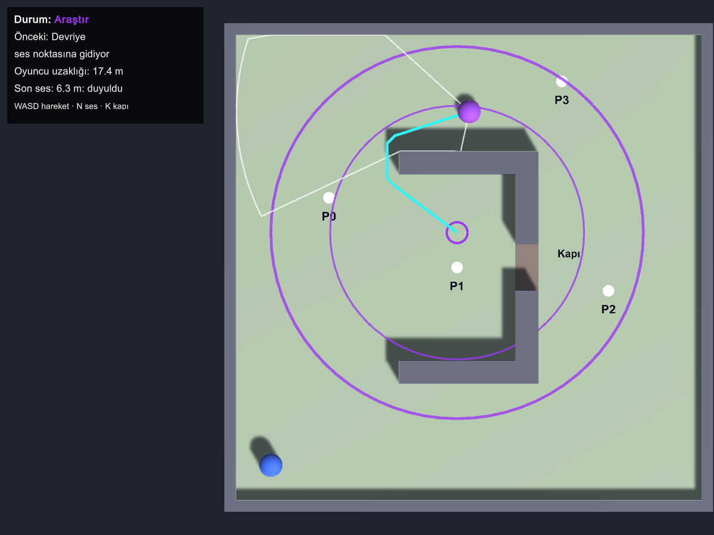
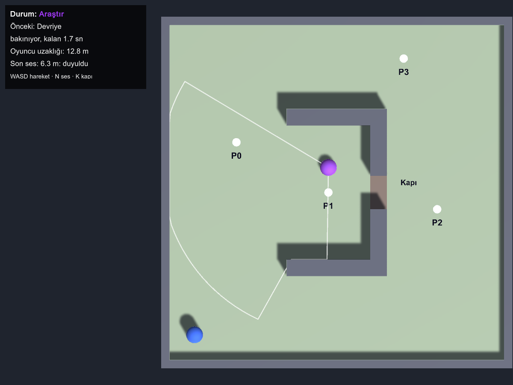
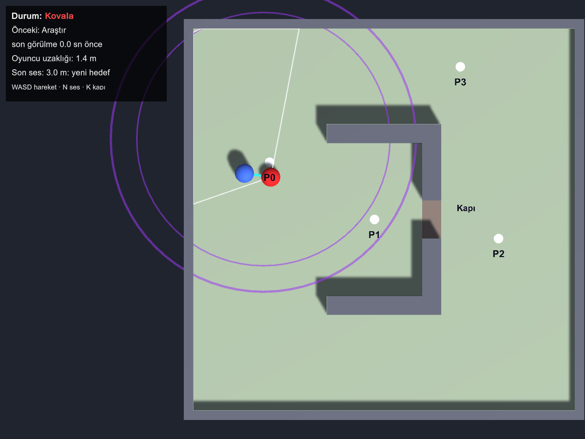
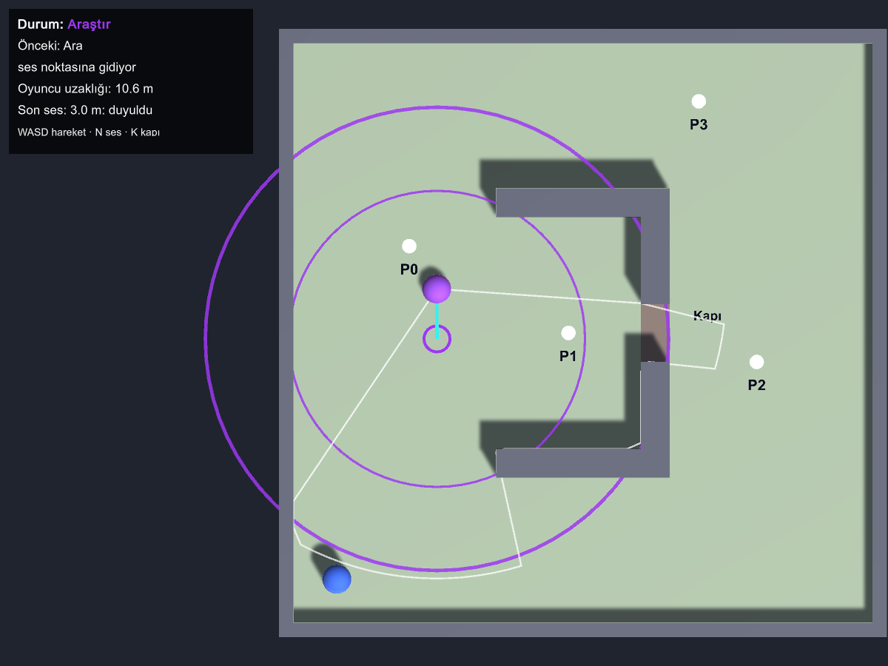
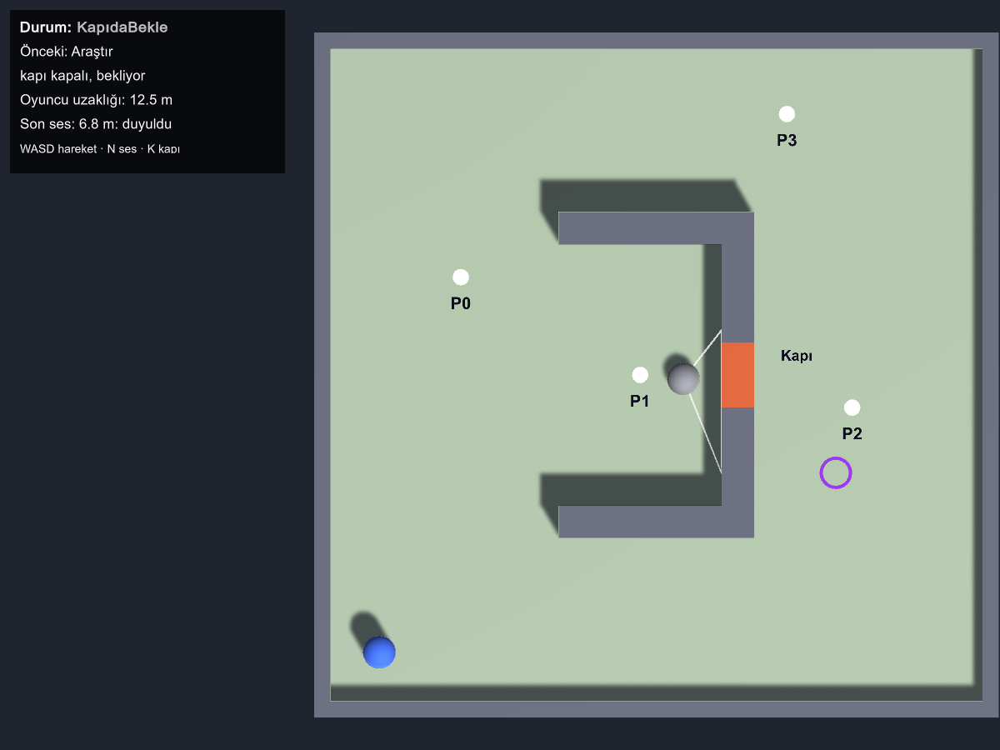

# Week 7 homework: "Sesi Duyan Bekçi" (The guard who hears)

Course: **Dijital Oyunlarda Yapay Zekâ**, week 7, *Sonlu Durum Makineleri (FSM)*. Unity 6.6 (6000.6.7f1, also opens in 6000.6.8f1), Built-in Render Pipeline, AI Navigation 2.0.16, Input System 1.20.1.

**Report (Turkish, 4 pages): [`RAPOR.pdf`](RAPOR.pdf)**. Its source is [`RAPOR.html`](RAPOR.html).

## The assignment

Section 10 of the week 7 notes asks for a fifth state, **Araştır** (Investigate), on top of the four-state guard built in class (Devriye, Kovala, Ara, Kapıda Bekle):

- When the player presses **N**, a noise is made where they stand. N must be a new Input Action called `MakeNoise`; the old Input Manager is not allowed.
- The guard hears the noise if it is closer than **8 m**. Walls do not block sound.
- In **Devriye** or **Ara** the guard goes to Araştır. In **Kovala** it ignores the noise.
- In Araştır the guard walks to the noise, looks around for **3 s** and goes back to Devriye.
- If it sees the player during Araştır, the existing global rule sends it to Kovala, with no extra code.
- Araştır needs its own colour, different from the other four.

Deliverables: `GuardStates.cs`, `Guard.cs` and the noise script; a five-state diagram; the transition table with the new rows; a console log and three screenshots of a run; a short answer on "could Ara have been reused instead of a new state?".

## Scene

The scene is the 20 × 20 area used in weeks 4–6: a U obstacle that opens to the west, plus the week 6 sliding door (K, carving `NavMeshObstacle`). Here the door sits in a 2 m gap in the U's back wall.

- **Bekci**, the guard, is the week 6 red sphere with the FSM on it. Its `NpcNavChase` is kept but disabled, as section 8.1 says.
- The patrol loop **P0 → P1 → P2 → P3** goes through the door. P1 is inside the U and P2 is outside it. The guard comes back to P0 over the top arm.
- When the door is closed far from the guard, the NavMesh finds a way around the U. When it closes right in front of the guard (under 2.5 m), the guard goes to Kapıda Bekle.
- On screen:
  - The guard's colour shows its state: green Devriye, red Kovala, yellow Ara, gray Kapıda Bekle, **purple Araştır**.
  - The white outline is the view cone, clipped by walls. The cyan line is the NavMesh path.
  - The purple ring is the 8 m hearing range around a noise. A small ring marks the target: purple for the noise point, yellow for the last seen point.
  - The panel shows the current and previous state, the timers and the result of the last noise.

## How to open and run

1. Open the folder in Unity Hub.
2. Open `Assets/Scenes/Hafta7.unity` and press **Play**. The NavMesh is already baked (`Assets/Scenes/Hafta7_NavMesh.asset`).
3. To rebuild the scene, materials, input actions and NavMesh from code, use **Hafta7 > Build Scene** (`Hafta7SceneBuilder.Build`).

| Key | Action |
|---|---|
| WASD / arrow keys | move the character |
| **N** | make a noise (`MakeNoise` action) |
| K | open/close the door |

## Requirements and where they are implemented

| Requirement / rubric item | Where |
|---|---|
| Araştır with Enter, Execute and Exit (30) | `GuardInvestigate` in [`Assets/Scripts/Guard/GuardStates.cs`](Assets/Scripts/Guard/GuardStates.cs). Enter: purple, 3 m/s, target = noise, 3 s timer. Execute: door check, then look around once arrived, then Devriye. Exit: restore the 2 m/s patrol speed. |
| N via Input Action; the 8 m and Kovala rules (20) | `MakeNoise` (Button, `<Keyboard>/n`) in `Assets/InputSystem_Actions.inputactions`; Active Input Handling is "Input System Package (New)". [`PlayerNoise.cs`](Assets/Scripts/PlayerNoise.cs) calls `Guard.HearNoise`, which checks the flat distance and the current state ([`Guard.cs`](Assets/Scripts/Guard/Guard.cs)). |
| State diagram matching the code (20) | [`rapor/durum-diyagrami.svg`](rapor/durum-diyagrami.svg) (`.png` too); report section 2 |
| Complete transition table (15) | report section 3 |
| Console log, screenshots, short answer (15) | [`rapor/konsol-gunlugu.txt`](rapor/konsol-gunlugu.txt), `screenshots/01–07`, report sections 4 and 5 |
| In-class scripts (section 8) | `FSM/State.cs` and `FSM/StateMachine.cs` as in the notes; the in-class parts of `Guard.cs` and `GuardStates.cs`; the `IsOpen` line in `SlidingDoor.cs` (8.6) |

Lines added for the homework are marked `[ÖDEV]` in `Guard.cs` and `GuardStates.cs`.

### Design decisions

These go beyond the letter of the assignment. Each is explained in the report.

- **Araştır also checks the door.** Like Devriye and Ara, Araştır stops at a closed door and goes to Kapıda Bekle. When the door opens, `RevertToPreviousState` returns the guard to Araştır, where Enter restarts the 3 s timer.
- **A second noise during Araştır is not a transition.** The guard keeps the state; only the target and the timer are renewed (`GuardInvestigate.Retarget`), like reaching a patrol point. `ChangeState` would refuse Araştır → Araştır anyway.
- **Kapıda Bekle ignores noises.** The assignment only lists Devriye and Ara as states that react.
- **Exit has a real job.** Araştır runs at 3 m/s, and Exit restores 2 m/s. In the run, Araştır → Kovala gave 4.0 m/s and the return to patrol gave 2.0 m/s.

## Test run (measured)

Six scripted steps, **15/15 checks passed**:

| Step | What happens | Result |
|---|---|---|
| 1 | noise 12.5 m away | not heard, stays in Devriye |
| 2 | noise 6.3 m away, behind the U's top arm | Devriye → Araştır, looks around 3.0 s, → Devriye |
| 3 | noise while chasing | ignored, stays in Kovala; → Ara after 1 s |
| 4 | noise 3.0 m behind the guard in Ara, then a second noise | Ara → Araştır; the second noise only renews the target |
| 5 | player steps in front of the guard in Araştır | Araştır → Kovala (global rule) |
| 6 | noise behind the back wall; K when the guard is 2.3 m from the door; K again | Devriye → Araştır → KapıdaBekle → Araştır → Devriye |

| | |
|---|---|
|  |  |
|  |  |

## How the numbers were produced

- [`Assets/Scripts/Dev/Hafta7Capture.cs`](Assets/Scripts/Dev/Hafta7Capture.cs) is a harness that only runs when the player is started with `-reportCapture`.
  - It presses N and K on a virtual keyboard through the Input System, so the real `MakeNoise` and `ToggleDoor` actions fire.
  - It moves the player by teleporting so that the run is repeatable.
  - It records every `Debug.Log` line and saves the screenshots with `ScreenCapture` (the panel is included).
- Build the macOS player with `-executeMethod ReportBuild.Build -buildOutput <folder>`.
- Run it with: `Hafta7.app/Contents/MacOS/Hafta7\ Sesi\ Duyan\ Bekci -reportCapture -reportOut <folder> -screen-width 1200 -screen-height 900 -screen-fullscreen 0`
- The PDF and the diagram PNG were printed from `RAPOR.html` and the SVG with WebKit (`WKWebView`) on macOS.

## Manual steps for the student

- Write your name and number in the header of `RAPOR.html` (`Öğrenci: ____ · No: ____`), then print it again to PDF from any browser (A4, background graphics on).
- The notes allow a hand-drawn diagram ("elle çizip fotoğrafını çekebilirsiniz"). The SVG diagram already covers this item.
- The week 7 lab experiments (section 9: prediction table, Search Time trials, forgetting Exit) are in-class work. They are not part of this homework and are not included.
